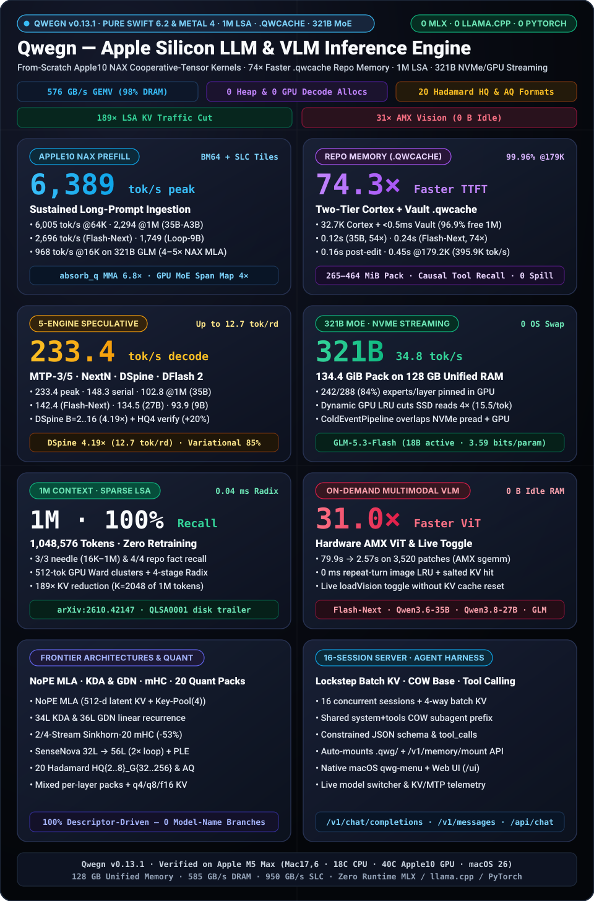
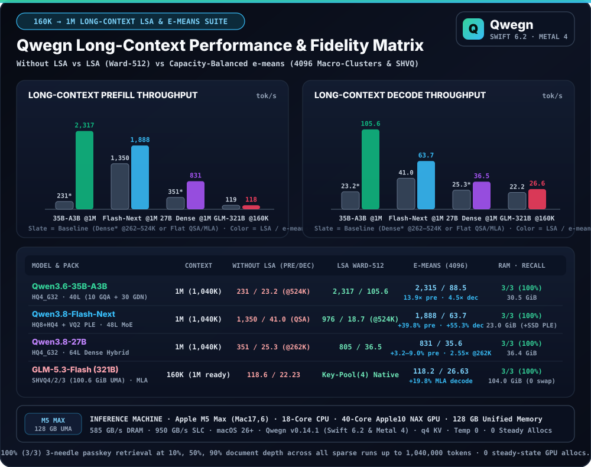
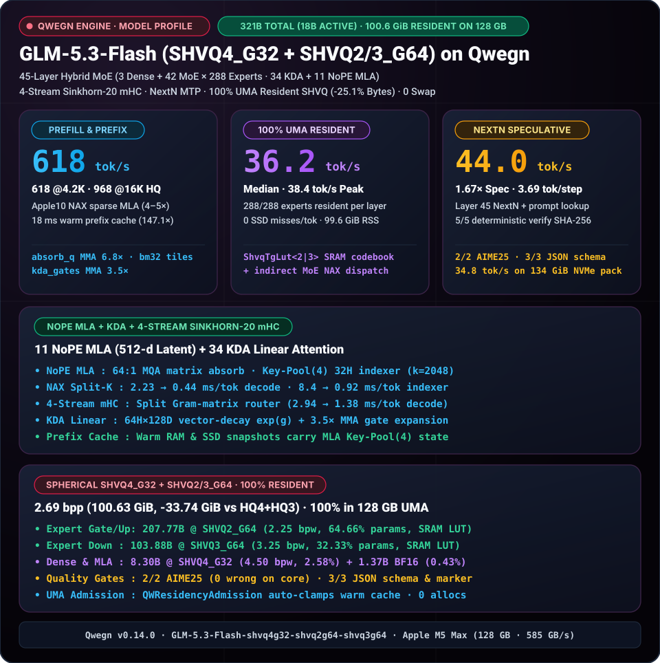
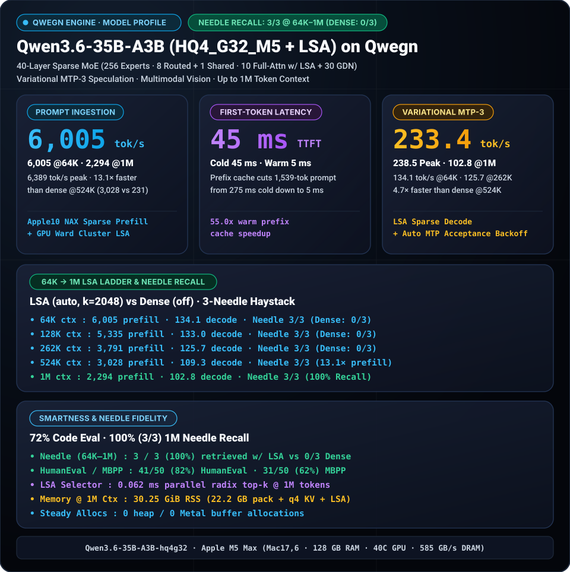
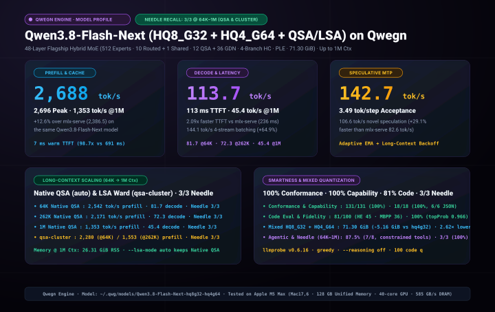
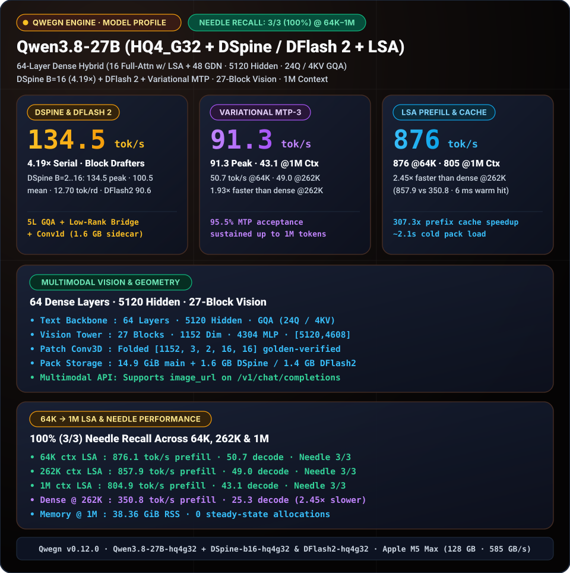
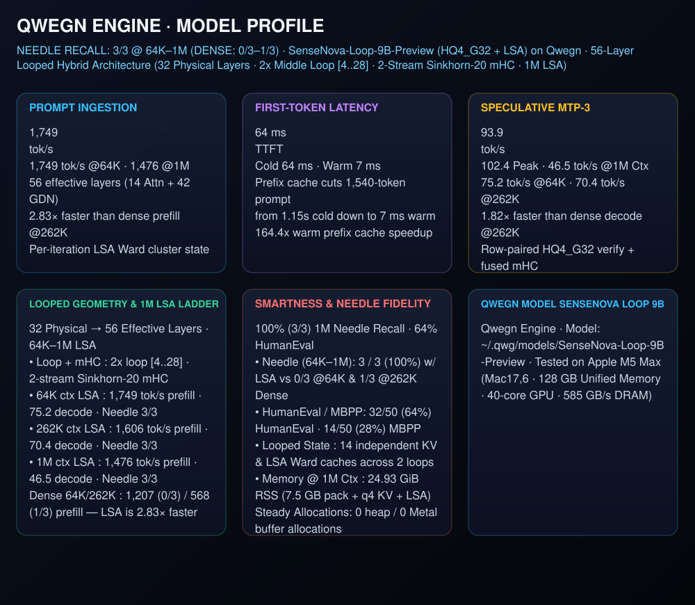
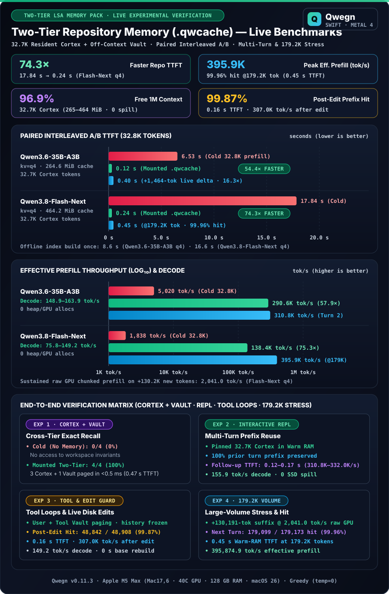

<p align="center">
  
</p>

<h1 align="center">Qwegn</h1>

<p align="center">
  <a href="LICENSE"></a>
  
  
  <a href="https://github.com/qwegnai/qwegn/actions/workflows/ci.yml"></a>
  <a href="CHANGELOG.md"></a>
</p>

**Qwegn** (`qwg`) is a from-scratch LLM/VLM inference engine for Apple Silicon,
written in Swift 6.2 and Metal 4 — no MLX, no llama.cpp, no PyTorch at runtime.
Custom cooperative-tensor kernels, direct Metal command encoding, and zero heap
or Metal-buffer allocations in steady-state decode, from dense 9B models up to a
321B MoE running 100% UMA-resident (`100.6 GiB` SHVQ) or NVMe-streamed on a 128 GB Mac.

Requires macOS 26+ on Apple Silicon (M-series; M5 recommended for NAX cooperative
tensors), Xcode 26+ and Python 3.13 for the build. One-line dev loop: `make init && make ci`.

## Quick Start

Install from the release `.pkg` (`Qwegn-<version>-macos-arm64.pkg` places `qwg` in `/usr/local/bin/`, `Qwegn.app` in `/Applications/`, and `uninstall.sh` in `/usr/local/share/qwegn/`), or build from source:

```bash
make init     # verify toolchain, create .venv-oracle, generate unit-test goldens
make build    # .build/release/qwg and .build/release/Qwegn.app
make pkg      # dist/Qwegn-<version>-macos-arm64.pkg
make ci       # metallibs + linters + tests
```

Pull, quantize and run a model:

```bash
.build/release/qwg pull Qwen/Qwen3.8-27B --folder ~/.qwg/hf
.build/release/qwg quantize ~/.qwg/hf/Qwen3.8-27B --out ~/.qwg/models/Qwen3.8-27B-q4g --quant q4g
.build/release/qwg run ~/.qwg/models/Qwen3.8-27B-q4g \
  --prompt "Explain Query-Aware Sparse Attention and Gated DeltaNet in three bullet points." \
  --max-tokens 256
```

`qwg plan <pack> --context-tokens 262144 --kv-mode q4` reports GPU capabilities and
whether a context budget fits in unified memory — a zero-generation way to verify
the toolchain.

> Model packs are large quantized checkpoints. Until official Hugging Face packs
> are published, build one from a local Hugging Face download with `qwg pull` +
> `qwg quantize` (above). <!-- TODO(link-hf-org) -->

## Highlights

- **Codebase & Knowledge Memory Packs (`QWMemoryPack` + `QWMemoryVault`)** — precompute a repository offline (`qwg index`) into a **Two-Tier Hierarchical LSA Memory Pack** (`<repo>/.qwg/*.qwcache` + `.qwg/manifest.json`): **`32.7K`-token Resident Cortex (`265 MiB` `35B` / `465 MiB` `Flash-Next`, `23.7×` smaller `.qwcache`)** + **`< 0.5 ms` Off-Context Vault Recall** across all `294` files, leaving **`96.9%` (`1,015,834` tokens) of the 1M context window free** for coding agents while delivering **`54.4×–74.3×` faster TTFT (`0.12–0.24 s`)**, **`150.5–163.9 tok/s` multi-turn decode (`+53%`)**, and zero-rebuild `<|memory_delta|>` live git edits (`0.40 s` TTFT). [Manual](docs/lsa.md#4-unified-codebase--knowledge-memory-packs-qwg-index--repoqwgqwcache) · [Whitepaper](docs/lsa-codebase-memory-whitepaper.md)
- **Model-agnostic runtime** — hybrid, looped and MoE architectures driven by the model descriptor (`QWModelDescriptor`), never by model name. [Supported models](#supported-models)
- **321B MoE on 128 GB Mac (100% UMA Resident SHVQ or NVMe-Streamed)** — `GLM-5.3-Flash` (`321B` total / `18B` active) runs **100% resident in unified memory** at `100.6 GiB` (`SHVQ4_G32 + SHVQ2_G64 + SHVQ3_G64`, **`1,006 tok/s` prefill (`825–869` serve), `46.0–46.4 tok/s` decode / `50.7–53.6 tok/s` NextN speculative**, **`743 / 45.0 tok/s` @242.5K `e-means`**, **`81/100` HumanEval+MBPP (`92%` HE), `184/184` API conformance, `37/37` capability, `99.74%` fidelity**, `0` SSD misses, `0` swap) or cold-expert streamed from NVMe on packs exceeding RAM (`134.4 GiB`, `31.6–34.8 tok/s`). [Cold-expert streaming & SHVQ](docs/tuning.md#cold-expert-streaming)
- **1M-token context (LSA `Ward-512` & Capacity-Balanced `e-means-4096`)** — **2,317 tok/s prefill / 105.6 tok/s decode at 1M** (`Qwen3.6-35B-A3B`, `13.88×` vs dense @524K), **1,888 tok/s prefill / 63.7 tok/s decode at 1M** (`Qwen3.8-Flash-Next` `+55.3%` `e-means`), **743 tok/s prefill / 45.0 tok/s decode at 242.5K** (`GLM-5.3-Flash` `321B` `e-means`), **3/3 needle recall** across every model, training-free. [LSA manual](docs/lsa.md)
- **Speculative decoding & mixed quantization** — MTP / Variational / DSpine (`B=2..16`, up to `4.19×` / `12.7 tok/round`) / DFlash 2 / MoE-Spec across 20 Hadamard `HQ*` & affine `AQ*` formats, 20 Spherical `SHVQ{1,15,2,3,4}` e-means VQ formats, and `QNGRAM v3 VQ2_G32` / `VQ4_G32` PLE tables (`50.9 → 27.1 → 15.1 GiB`, up to `-70.4%`). [Quantization guide](docs/quantization.md)

## Benchmarks (headline)

| Model | Prefill (peak) | Decode (spec) | Long-ctx / 1M prefill / decode (LSA · `e-means`) | Repo `.qwcache` / Warm Cache TTFT |
| :--- | :---: | :---: | :---: | :---: |
| Qwen3.6-35B-A3B (`HQ4_G32`) | 6,389 tok/s | 233.4 tok/s | **2,317 / 105.6 tok/s** @1M (`136.8` @64K `e-means`) | **0.12 s** `.qwcache` (`54.4×` vs 6.53 s) |
| Qwen3.8-Flash-Next (`HQ8+HQ4` + `VQ2` PLE) | 2,696 tok/s | **145.4 tok/s** (`95.1` novel) | **1,888 / 63.7 tok/s** @1M (`e-means` · `1,350 / 41.1` QSA) | **0.24 s** `.qwcache` (`74.3×` vs 17.84 s) |
| Qwen3.8-27B (+ `DSpine-b16`) | 914 tok/s | **134.5 tok/s** (`4.19×`) | **831 / 36.5 tok/s** @1M (`e-means` / `Ward`) | 6 ms warm cache (`307×`) |
| GLM-5.3-Flash (`321B`, `SHVQ4/2/3` 100.6 GiB) | **1,006 tok/s** (`825–869` serve) | **50.7–53.6 tok/s** (`46.0` novel · `81/100` code) | **743 / 45.0 tok/s** @242.5K (`e-means`) · 1M UMA | **10–18 ms** warm cache (`96–193×`) |
| ERNIE-5.5-Flash-Base (`280B`, `HQ8+SHVQ15/3` 81.6 GiB) | **856–899 tok/s** (`604` @149.5K) | **40.2–42.6 tok/s** (ECHO `d=1`, `+28.1%`) | **303 / 16.3 tok/s** @300K (`e-means`) · 1M `87.6 GiB` UMA | **0.29 s** `.qwcache` (`78.6×` vs 22.79 s) |

<p align="center">
  
</p>

All measured on Apple M5 Max 128 GB (`llmprobe v0.6.16–v0.6.17`, `--temperature 0`).
Full tables, paired A/B repository memory benchmarks, and thermal protocol: [docs/benchmarks.md](docs/benchmarks.md).

## Supported models

<p align="center">
  
</p>

**GLM-5.3-Flash** · 45L MoE (`321B` total / `18B` active, 288 experts, 8 + 1 active), 11 NoPE MLA (512D latent KV + Key-Pool(4)) + 34 KDA, 4-stream Sinkhorn mHC, NextN MTP, vision (`SHVQ4_G32 + SHVQ2_G64 + SHVQ3_G64`, `100.6 GiB` 100% resident on 128 GB Mac — `1,006 tok/s` prefill, `46.0–53.6 tok/s` decode, `81/100` HumanEval+MBPP)

**ERNIE-5.5-Flash-Base** · 43L MoE (`280B` total / `14B` active, 512 experts, dual-split sigmoid `top-10` + 1 shared, `moe_latent_size=2048`, `SituAndMul`), 37 Heavily Compressed Attention (`HCA` `128:1` + `128`-tok SWA + VHA) + 6 decoupled-RoPE `MLA-DSA` (`64H` Walsh-Hadamard `H_128`), 4-stream Sinkhorn-20 mHC (`hc_head`), `MultiMax` `lm_head`, shared-Layer-43 `ECHO` (`HQ8_G32 + SHVQ15_G64 + SHVQ3_G64`, `81.61 GiB` 100% UMA-resident through `1M` — `856–899 tok/s` prefill, `40.2–42.6 tok/s` ECHO decode, `78.6×` `.qwcache`, `3/3` needles @ `18.8K`/`149.5K`/`300K`)

<p align="center">
  
</p>

**Qwen3.6-35B-A3B** · 40L MoE (256 experts, 8 + 1 active), 10 QSA + 30 GDN, MoE MTP-3, vision

<p align="center">
  
</p>

**Qwen3.8-Flash-Next** · 48L MoE (512 experts, 10 + 1 active), 12 QSA + 36 GDN, 4-branch HC, `VQ2_G32` PLE (`27.1 GiB`), MTP, vision (`HQ8_G32 + HQ4_G64`, `71.3 GiB`)

<p align="center">
  
</p>

**Qwen3.8-27B** (+ DSpine-b16 & DFlash 2) · 64L dense hybrid, 5120 hidden, 24Q / 4KV GQA, MTP-3/5, 5-layer DSpine (`134.5 tok/s` / `4.19×`) & DFlash 2 drafters, vision

<p align="center">
  
</p>

**SenseNova-Loop-9B-Preview** · 32 physical → 56 effective layers (2× loop), 2-stream Sinkhorn mHC, MTP-3

<p align="center">
  
</p>

**QWMemoryPack (`.qwcache`)** · Two-tier COW repository memory (`54.4×–74.3×` TTFT speedup, `0.04 ms` per-token LSA selection, live `<|memory_delta|>`)

Standard `llama`, `qwen2`, `qwen3`, `qwen3_moe`, `qwen3_5_text` and `mistral` checkpoints also run on the unified runtime. Their model configs are adopted automatically, and per-model profiles are stored in `~/.qwg/profiles/`.

## Codebase Memory Packs (`qwg index`)

Index any git repository into `<repo>/.qwg/` (`manifest.json` + `.qwcache`) to give `qwg repl`, `qwg run`, and `qwg serve` instant whole-codebase visibility without cold prefill or exploratory grep loops:

```bash
# 1. Build repository memory pack offline (auto-selects kvMode from ~/.qwg/profiles/<model>.json)
.build/release/qwg index /path/to/repo --model ~/.qwg/models/Qwen3.8-Flash-Next-hq8g32-hq4g64

# 2. Interactive REPL (auto-mounts .qwg/manifest.json in cwd; slash commands: /memory, /memory mount|unmount)
cd /path/to/repo && .build/release/qwg repl --model Qwen3.8-Flash-Next-hq8g32-hq4g64

# 3. Single-shot CLI query against mounted repository memory (pass --no-memory-pack to bypass)
.build/release/qwg run ~/.qwg/models/Qwen3.6-35B-A3B-hq4g32 --repo /path/to/repo --prompt "Audit AGENTS.md Law 20."
```

Full architecture, 3-tier stability ordering, live `<|memory_delta|>` overlays, and benchmarks: [docs/lsa.md](docs/lsa.md#4-unified-codebase--knowledge-memory-packs-qwg-index--repoqwgqwcache) and [docs/lsa-codebase-memory-whitepaper.md](docs/lsa-codebase-memory-whitepaper.md).

## Server

OpenAI-, Anthropic-, and Ollama-compatible HTTP server (auto-discovers `<repo>/.qwg/manifest.json` from coding-agent workspace prompts):

```bash
.build/release/qwg serve ~/.qwg/models/Qwen3.8-Flash-Next-hq8g32-hq4g64 \
  --host 127.0.0.1 --port 8080 --kv-mode q4 --context-tokens 262144 --no-lazy
```

| Protocol | Endpoints | Features |
| :--- | :--- | :--- |
| **OpenAI API** | `POST /v1/chat/completions` · `GET /v1/models`<br>`POST /v1/models/load` · `POST /v1/models/unload` | Streaming SSE (`stream: true`), multimodal `image_url`, constrained JSON & tool calling, `reasoning_content`, runtime model switching |
| **Anthropic API** | `POST /v1/messages` | Streaming SSE events, system prompts, thinking blocks, tool use |
| **Ollama API** | `POST /api/chat` · `POST /api/generate` · `GET /api/tags`<br>`GET /api/ps` · `POST /api/show` · `POST /api/load` · `POST /api/unload` | NDJSON streaming, model status and residency management |
| **Memory & Telemetry** | `POST /v1/memory/mount` · `POST /v1/memory/unmount`<br>`GET /v1/engine/info` · `GET /ui` · `GET /v1/dashboard` · `GET /metrics` | Live `.qwcache` repo memory mount/unmount & `kvMode` lock, built-in web UI (`http://127.0.0.1:8080/ui`), live token/s and cache telemetry |

Example OpenAI request:

```bash
curl http://127.0.0.1:8080/v1/chat/completions \
  -H 'Content-Type: application/json' \
  -d '{
    "model": "Qwen3.8-Flash-Next-hq8g32-hq4g64",
    "messages": [{"role": "user", "content": "Write a fast radix top-k selection summary."}],
    "temperature": 0.0,
    "max_tokens": 256,
    "stream": true
  }'
```

## CLI reference

| Command | Description |
| :--- | :--- |
| `qwg init` | Creates or rebuilds (`--python`) the quantizer Python environment in `~/Library/Application Support/Qwegn/venv/`. |
| `qwg plan` | Reports Apple Silicon GPU capabilities and verifies whether a context budget fits in unified memory. |
| `qwg pull` | Downloads a Hugging Face checkpoint (`org/model`) into a local directory using parallel HTTP range requests. |
| `qwg quantize` | Converts a BF16 safetensors checkpoint into a page-aligned quantized `.qwp` pack. |
| `qwg inspect` | Validates a pack's header, provenance, quantization descriptors, and tensor geometry (`--dequant` exports `.npy`). |
| `qwg index` | Builds an offline 3-tier LSA codebase memory pack (`<repo>/.qwg/manifest.json` + `.qwcache`). |
| `qwg run` | Executes single-turn generation from a prompt string or file (`--repo <path>` mounts `.qwcache`). |
| `qwg repl` | Launches an interactive multi-turn terminal chat session with automatic `.qwg/` memory & prefix caching. |
| `qwg serve` | Runs the multi-protocol HTTP inference server (OpenAI, Anthropic, Ollama, Memory API, and Web UI). |
| `qwg bench` | Runs performance regression gates against `Scripts/bench/baselines.json`. |

Core flags for `run` / `repl` / `serve` (defaults come from `QWKnobRegistry`; per-model profiles and `.qwg/manifest.json` can override them):

| Flag | Default | Description |
| :--- | :--- | :--- |
| `--context-tokens` | `4096` | Context capacity, up to `1048576` (1M tokens) with YaRN auto-scaling and LSA. |
| `--kv-mode` | `q4` | KV cache format: `q4` (default, `4×` smaller), `q8` or `f16` (automatically enforced when a `.qwg/` memory pack is mounted). |
| `--lsa-mode` | `auto` | Adaptive Latent Sparse Attention: exact dense `<= 2.5K`, `.qlsa`/SVD on GQA, QSA + `>262K` `e-means` on Flash-Next, `<41K` bypass + `e-means` on MLA. [LSA manual](docs/lsa.md) |
| `--memory-policy` / `--os-reserve` | `maxResident` / `8` | Unified-memory residency policy (`maxResident` vs swap-free `safe`) and OS RAM reserve in GiB. |
| `--load-vision` / `--no-load-vision` | `false` | Eagerly wire or omit multimodal ViT planes at startup (`-1.60 GiB` RSS when omitted; loads on demand). |
| `--stream-ngrams` / `--no-stream-ngrams` | `false` | Stream external PLE N-gram tables (`ngram.bin`) from NVMe (`-27.30 GiB` GPU RAM) vs keeping `VQ2_G32` GPU-resident. |
| `--dflash-draft-pack` / `--dflash-window` | — | External `DSpine` (`B=2..16`) or `DFlash 2` (`B=2..8`) block drafter (`config.json` auto-detected). |
| `--repo` / `--no-memory-pack` | `cwd` | Mount `<repo>/.qwg/manifest.json` in `run`/`repl`/`serve`, or bypass automatic repository memory mounting. |
| `--temperature` / `--top-p` / `--top-k` | `0.7` / `0.9` / `40` | Sampling (`0` selects greedy). `--enable-thinking` (`true`) toggles `<think>` blocks. |

## Testing & Quality Gates

```bash
make lint     # file size, comment style, geometry defaults, basis, Metal kernel reachability gates
make test     # XCTest unit and Metal parity suites (serial: GPU bundles are not parallel-safe)
make perf     # performance regression gates against Scripts/bench/baselines.json
```

## Documentation

- [docs/settings-reference.md](docs/settings-reference.md) — Complete settings inventory (`49` knobs), CLI & Menu Bar guide, and copy-paste operational recipes
- [docs/lsa.md](docs/lsa.md) — Latent Sparse Attention, NoPE MLA, 1M-context scaling, and `qwg index` usage manual
- [docs/lsa-codebase-memory-whitepaper.md](docs/lsa-codebase-memory-whitepaper.md) — Whitepaper & live experiments: `QWMemoryPack` vs. RAG and Memorilla (`arXiv:2610.42147`)
- [docs/benchmarks.md](docs/benchmarks.md) — full benchmark tables and thermal-controlled (`Scripts/paired_perf.py`) reproduction protocol
- [docs/quantization.md](docs/quantization.md) — quant formats, mixed packs, quality tooling
- [docs/tuning.md](docs/tuning.md) — memory policy, cold-expert streaming, speculation knobs
- [docs/menu-bar-app.md](docs/menu-bar-app.md) — `Qwegn.app` (`qwg-menu`) status, 7-tab settings (`DSpine`, `streamNgrams`, `loadVision`) & `.qwcache` controls

## Repository Layout

- `Sources/Foundation` — Core tensor types, quantization formats (`QWQuant`), arena allocator (`QWAlloc`), and Metal HAL (`QWHAL`)
- `Sources/Operators` — Quantized matrix multiply (`QWGEMM`), normalization (`QWNorm`), RoPE (`QWRope`), sparse/dense attention (`QWAttn`), and Gated DeltaNet (`QWGDN`)
- `Sources/Subsystems` — Model family pipelines (`QWFlashNext`, `QWMLP`, `QWHead`, `QWMTP`, `QWVision`, `QWState`)
- `Sources/Runtime` — Engine driver (`QWEngine`), `QWMemoryPack`, continuous batching, prefix caching, and speculative decoding (`DFlash` / `MTP`)
- `Sources/QWMetal` — Metal 4 compute kernels (`.metal`) and shared headers (`.metalh`)
- `Sources/Apps` — CLI (`qwg`), HTTP server (`QWServer`), macOS menu bar app (`QWMenuBar`), and kernel microbenchmarks (`qwg-bench-kernels`)
- `Scripts` / `Tests` — Metal build scripts, style/kernel/basis linters, golden generators, and XCTest unit/GPU parity suites

## Contributing & License

See [CONTRIBUTING.md](CONTRIBUTING.md) and [SECURITY.md](SECURITY.md). Licensed under Apache License 2.0 ([LICENSE](LICENSE)).

## Citation

```bibtex
@software{qwegn,
  title  = {Qwegn: a from-scratch LLM/VLM inference engine for Apple Silicon},
  author = {{QwegnAI}},
  year   = {2026},
  url    = {https://github.com/qwegnai/qwegn}
}
```
