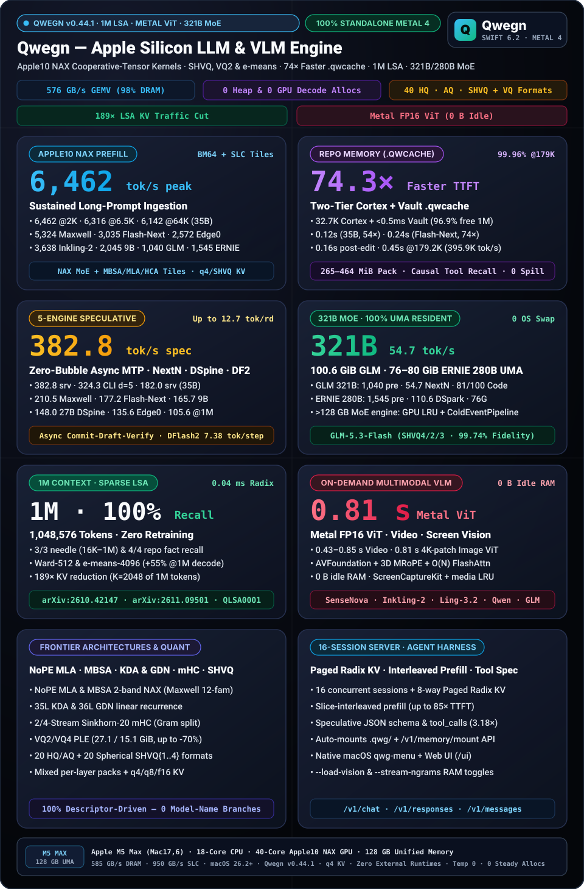
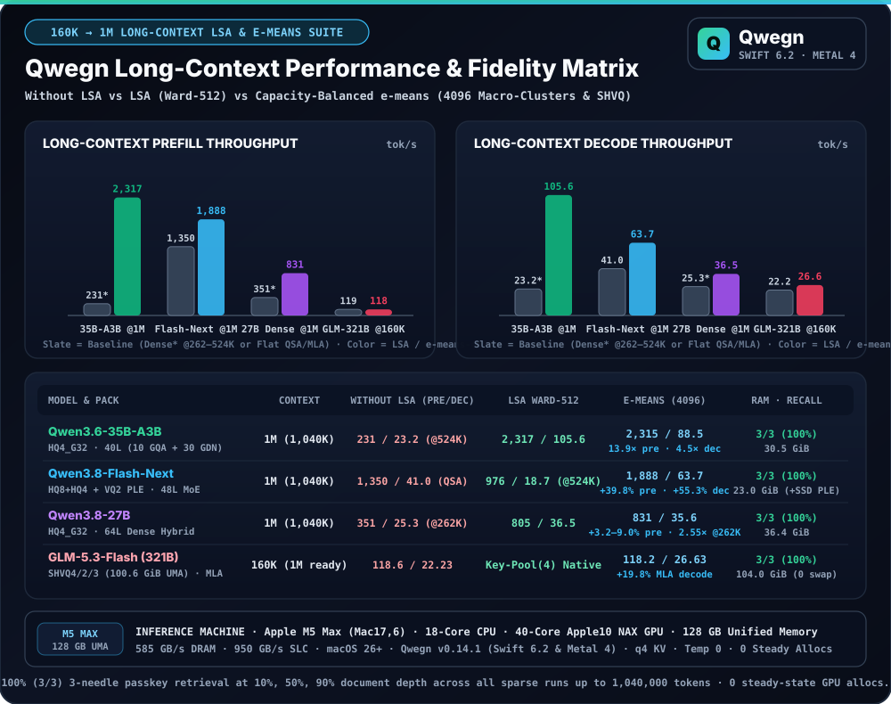

<h1 align="center">Qwegn</h1>

<p align="center">
  <strong>From-scratch Apple Silicon LLM &amp; VLM inference engine in Swift 6.2 &amp; Metal 4</strong><br/>
  Zero external C/Python runtimes · Apple10 NAX kernels · 0 steady-state allocations · 1M context
</p>

<p align="center">
  <a href="LICENSE"></a>
  
  
  <a href="https://github.com/qwegnai/qwegn/actions/workflows/ci.yml"></a>
  <a href="CHANGELOG.md"></a>
  <a href="https://huggingface.co/qwegnai"></a>
</p>

**Qwegn** (`qwg`) is an Apple Silicon-native inference engine and quantization toolkit built directly on Swift 6.2 and Metal 4 — no MLX, no llama.cpp, and no PyTorch at inference time. It executes dense, hybrid linear-attention (`GDN`/`KDA`), looped-layer (`mHC`), DeepSeek-style MLA/HCA, block-sparse (`MBSA`), MoE (up to `321B` parameters on a 128 GB Mac), and multimodal VLM models through capability-driven Metal 4 pipelines (`QWModelDescriptor` + `QWModelCapabilities`).

Requires macOS 26.2+ on Apple Silicon (M5 recommended for Apple10 NAX cooperative tensors), Xcode 26.2+, and Python 3.13 for quantization and tooling.

<p align="center">
  
</p>

## Key Highlights

- **Zero-Allocation Metal 4 Core**: Direct Metal command encoding, Apple10 NAX cooperative-tensor prefill (up to **`6,462 tok/s`**), up to **98% DRAM GEMV bandwidth**, and **0 heap / Metal-buffer allocations** in steady-state decode.
- **1M-Token Context Without Retraining**: Training-free Latent Sparse Attention (`Ward-512` & `e-means-4096`) delivers up to **`5,491 / 100.9 tok/s` at 1M tokens** with `3/3` multi-hop needle recall (`16K–1M`). [LSA guide](docs/lsa.md)
- **321B & 280B MoE on One Mac**: Mixed `HQ` / `AQ` / spherical `SHVQ{1..4}` (`2.52–3.84 bpw`) plus `VQ2`/`VQ4` PLE tables fit `321B` (`100.6 GiB`), `280B` (`81.6 GiB`), and `124B` (`52.2 GiB`) packs 100% UMA-resident, with lock-free NVMe expert streaming for oversized packs. [Quantization guide](docs/quantization.md)
- **Multi-Engine Speculative Decoding**: Zero-bubble async NextN, MTP, Variational, `DFlash 2`, `DSpine` (`B=2..16`), `DSpark`, `ECHO`, prompt lookup (`up to 382.8 tok/s` serve decode), and lossless grammar-accelerated structured JSON & tool-call speculation (`1.27×–3.18×` speedup). [Tuning & knobs](docs/tuning.md)
- **Native Metal ViT, Video, Paged Radix KV & Repo Memory (`.qwcache`)**: On-demand FP16 Metal Vision Transformer (`0.43–0.85 s` hardware `AVFoundation` video & `0.81 s` image ViT, unified 3D `MRoPE` / `VideoRoPE`, privacy-gated `ScreenCaptureKit` snapshots, `0 B` idle RAM via `--load-vision`), hybrid-aware `256`-token paged Radix KV cache with `B=1..8` slice-interleaved prefill (`1.72×–2.43×` faster 8-subagent waves, up to `85.4×` lower foreground TTFT), and two-tier COW repository memory packs (`qwg index`, up to `74.3×` faster TTFT). [Whitepaper](docs/lsa-codebase-memory-whitepaper.md)
- **Drop-In Server & macOS App**: OpenAI (`/v1/chat/completions`, `/v1/responses`, `/v1/completions`), Anthropic (`/v1/messages`), and Ollama-compatible server with `/ui` workbench and native `Qwegn.app` menu bar control (`qwg-menu`).

## Quick Start

Install the signed `.pkg` from [GitHub Releases](https://github.com/qwegnai/qwegn/releases) (installs `/usr/local/bin/qwg` and `/Applications/Qwegn.app`), or build from source:

```bash
make init     # verify toolchain, set up quantizer venv, generate test goldens
make build    # build release .build/release/qwg and Qwegn.app
make ci       # build metallibs and run linters + unit suites
```

Pull and run a pre-quantized pack from [`huggingface.co/qwegnai`](https://huggingface.co/qwegnai):

```bash
qwg pull qwegnai/Qwen3.8-Flash-Next-hq8g32-hq4g64
qwg run Qwen3.8-Flash-Next-hq8g32-hq4g64 --prompt "Hello!" --max-tokens 128

# New in v0.43.0: /v1/embeddings, /v1/rerank, Cognitive MCP, Session Trees & 10x Inkling-2 Prefix Cache
qwg pull qwegnai/Ling-3.2-air-hq8g32-shvq3g64
qwg serve Ling-3.2-air-hq8g32-shvq3g64 --context-tokens 65536 --kv-mode q4
```

Quantize any local Hugging Face checkpoint and validate memory fit before generation:

```bash
qwg pull Qwen/Qwen3.8-27B --folder ~/.qwg/hf
qwg quantize ~/.qwg/hf/Qwen3.8-27B --out ~/.qwg/models/Qwen3.8-27B-q4g --quant q4g
qwg plan ~/.qwg/models/Qwen3.8-27B-q4g --context-tokens 262144 --kv-mode q4
```

## Supported Models & Architectures

Official packs are listed with detailed architecture cards and `llmprobe` fidelity suites in [**`docs/models.md`**](docs/models.md):

| Model Pack (`qwegnai/*`) | Architecture | Quant & Size | Prefill Peak | Speculative Decode | Max Context / 1M | Details |
| :--- | :--- | :--- | :---: | :---: | :---: | :---: |
| [`Qwen3.6-35B-A3B-hq4g32`](https://huggingface.co/qwegnai/Qwen3.6-35B-A3B-hq4g32) | 40L MoE (`10` QSA + `30` GDN, `256` exp) | `HQ4_G32` | **6,462 tok/s** | **382.8 tok/s** (`324.3` CLI `d=5`) | `1M` (`2,317 / 105.6 tok/s`) | [Card](docs/models.md#qwen36-35b-a3b) |
| [`Apex-35B-V1.0-hq4g32`](https://huggingface.co/qwegnai/Apex-35B-V1.0-hq4g32) | 40L MoE (`35.95B`/`3B`, ViT) | `HQ4_G32_M5` (`22.2 GiB`) | **6,416 tok/s** | **261.1 tok/s** (`178.0` srv) | `1M` (**`5,491 / 100.9 tok/s`**) | [Card](docs/models.md#apex-35b-v10) |
| `Maxwell-V1-Flash-HQ8-SHVQ3D4` | 45L all-MBSA + `4×` mHC (`36.8B`/`3.2B`) | `HQ8 + SHVQ3/4` (`17.2 GiB`) | **5,324 tok/s** | **210.5 tok/s** (`104.0` srv) | `524K` (`1,620 / 20.8` `@64K`) | [Card](docs/models.md#maxwell-v1-flash) |
| [`Inkling-2-Mini-shvq4g32-shvq2g64-shvq3g64`](https://huggingface.co/qwegnai/Inkling-2-Mini-shvq4g32-shvq2g64-shvq3g64) | 48-visit looped MoE + `DSpark` + ViT | `SHVQ4/2/3` (`10.2 GiB`) | **3,638 tok/s** | **99.9 tok/s** `d=3` (`100.6` `B=4`) | `1M` (`2,017 / 33.9` · `512K` `55.0`) | [Card](docs/models.md#inkling-2-mini) |
| [`Qwen3.8-Flash-Next-hq8g32-hq4g64`](https://huggingface.co/qwegnai/Qwen3.8-Flash-Next-hq8g32-hq4g64) | 48L MoE (`12` QSA + `36` GDN, PLE, ViT) | `HQ8 + HQ4 + VQ2` (`98.4 GiB`) | **3,035 tok/s** | **177.2 tok/s** (`DFlash2`) | `1M` `e-means` (`1,888 / 63.7 tok/s`) | [Card](docs/models.md#qwen38-flash-next) |
| [`Ling-3.2-air-hq8g32-shvq3g64`](https://huggingface.co/qwegnai/Ling-3.2-air-hq8g32-shvq3g64) | 42L `bailing_moe_v3_vl` (`35` KDA + `7` MLA, ViT) | `HQ8 + SHVQ3` (`52.2 GiB`) | **2,847 tok/s** | **110.5 tok/s** (`103.7` NextN) | `262K` (`3/3` needle `@16.9K`) | [Card](docs/models.md#ling-32-air) |
| [`Edge0-145B-hq8g32-hq4g64`](https://huggingface.co/qwegnai/Edge0-145B-hq8g32-hq4g64) | 48L `145B` MoE + `VQ2` PLE | `HQ8 + HQ4 + VQ2` (`83.1 GiB`) | **2,572 tok/s** | **135.6 tok/s** (`69.2` CLI `d=1`) | `1M` UMA (`1,886` `@300K` `3/3`) | [Card](docs/models.md#edge0-145b) |
| [`SenseNova-Loop-9B-hq4g32`](https://huggingface.co/qwegnai/SenseNova-Loop-9B-hq4g32) | 56L `2×` looped `F32` mHC + ViT | `HQ4_G32` (`7.4 GiB`) | **2,045 tok/s** | **165.7 tok/s** (`153.0` `B=4`) | `524K` YaRN (`49.4 tok/s` `@1M`) | [Card](docs/models.md#sensenova-loop-9b) |
| [`Qwen3.8-27B-hq4g32`](https://huggingface.co/qwegnai/Qwen3.8-27B-hq4g32) | 64L dense (`16` GQA + `48` GDN, ViT) | `HQ4_G32` (+ `DSpine`/`DF2`) | **1,043 tok/s** | **154.2 tok/s** DF2 / **148.0** DSpine | `1M` `e-means` (`831 / 36.5 tok/s`) | [Card](docs/models.md#qwen38-27b) |
| [`ERNIE-5.5-Flash-Base-hq8g32-shvq15g64-shvq3g64`](https://huggingface.co/qwegnai/ERNIE-5.5-Flash-Base-hq8g32-shvq15g64-shvq3g64) | 43L `280B`/`14B` (`37` HCA + `6` MLA-DSA) | `HQ8 + SHVQ15/3` (`81.6 GiB`) | **1,137 tok/s** | **52.7 tok/s** (`ECHO`) | `1M` UMA (`303 / 16.3` `@300K`) | [Card](docs/models.md#ernie-55-flash-base) |
| [`ERNIE-5.5-Flash-Preview`](https://huggingface.co/qwegnai/ERNIE-5.5-Flash-Preview-hq4g32m5-hq8head-shvq15g64-shvq3g64) ([`HQ8`](https://huggingface.co/qwegnai/ERNIE-5.5-Flash-Preview-hq8g32-shvq15g64-shvq3g64)) | 43L `280B`/`14B` (`chatv2p3`, `DSpark`, `FlashIndexer`) | `HQ4_G32_M5` / `HQ8` + `SHVQ15/3` (`77.9–81.6 GiB` disk) | **1,545 tok/s** *(Track C)* / `1,051` *(Track A)* | **110.6 tok/s** `DSpark` (`89.5` JSON · `81/100` Track A Code) | `16K` `3/3` needle (`60.9` `@65.6K`) | [Card](docs/models.md#ernie-55-flash-preview) |
| [`GLM-5.3-Flash-shvq4g32-shvq2g64-shvq3g64`](https://huggingface.co/qwegnai/GLM-5.3-Flash-shvq4g32-shvq2g64-shvq3g64) | 45L `321B`/`18B` (`34` KDA + `11` MLA) | `SHVQ4/2/3` (`100.6 GiB`) | **1,014 tok/s** | **54.7 tok/s** (`NextN`) | `1M` UMA (`743 / 45.0` `@242.5K`) | [Card](docs/models.md#glm-53-flash) |

Standard `llama`, `qwen2`, `qwen3`, `qwen3_moe`, `qwen3_5*`, `mistral`, and MLX-formatted checkpoints are also adopted automatically with per-model profiles stored under `~/.qwg/profiles/`.

## Benchmarks

All numbers are measured on an idle Apple M5 Max (`Mac17,6`, 40-core Apple10 NAX GPU, 128 GB unified memory, macOS 26+) with `--kv-mode q4 --temperature 0` (`llmprobe v0.6.16–v0.6.17`) and `0` steady-state allocations.

<p align="center">
  
</p>

See [**`docs/benchmarks.md`**](docs/benchmarks.md) for full `512 → 1M` scaling tables, paired A/B methodology (`Scripts/paired_perf.py`), and `llmprobe` fidelity/coding suites.

## Codebase Memory Packs (`qwg index`)

Index any git repository into `<repo>/.qwg/` (`manifest.json` + `.qwcache`) for instant cold-free prefix mounting across `qwg repl`, `qwg run`, and `qwg serve` (**54×–74× faster TTFT**, `96.9%` free 1M window, live `<|memory_delta|>` git diffs):

```bash
qwg index /path/to/repo --model ~/.qwg/models/Qwen3.8-Flash-Next-hq8g32-hq4g64
cd /path/to/repo && qwg repl --model Qwen3.8-Flash-Next-hq8g32-hq4g64
qwg run ~/.qwg/models/Qwen3.6-35B-A3B-hq4g32 --repo /path/to/repo --prompt "Summarize architecture invariants."
```

## Server & Native Apps

```bash
qwg serve ~/.qwg/models/Ling-3.2-air-hq8g32-shvq3g64 \
  --host 127.0.0.1 --port 8080 --kv-mode q4 --context-tokens 65536 --no-lazy
```

| Protocol | Key Endpoints | Highlights |
| :--- | :--- | :--- |
| **OpenAI** | `/v1/chat/completions` · `/v1/responses` · `/v1/completions` · `/v1/models` | Streaming SSE (`TCP_NODELAY`), multimodal `image_url`, JSON schema & tool calls, `reasoning_content`, live model load/unload |
| **Anthropic** | `/v1/messages` · `/v1/messages/count_tokens` | SSE streams, system prompts, extended thinking blocks, tool use, exact token counts |
| **Ollama & Tokenizers** | `/api/{chat,generate,show,tags,ps,load,unload}` · `/tokenize` · `/detokenize` · `/tokenizer_info` | NDJSON streaming and `lm_eval` / `inspect_ai` tokenizer inspection |
| **Decisions & MCP** | `/v1/decisions[/batch]` · `/v1/systemone[/batch]` · `/v1/laya` · `/mcp` | Calibrated System-1 sidecar (`d1-2B`, SystemOne, OpenAI Decisions, RFC 7578 multipart vision, `X-Qwegn-Decision-Route` auto-routing) |
| **Memory & Telemetry** | `/v1/memory/{inspect,index,mount,unmount}` · `/v1/engine/info` · `/ui` · `/metrics` | Streaming `.qwcache` indexing (`#modal-memory-pack`), built-in web workbench (`/ui`), and Prometheus telemetry |

<table>
  <tr>
    <td width="64%"></td>
    <td width="36%" align="center"></td>
  </tr>
  <tr>
    <td width="55%"></td>
    <td width="45%"></td>
  </tr>
</table>

## CLI Reference

| Command | Summary |
| :--- | :--- |
| `qwg init` / `plan` | Set up quantizer Python venv (`--python`) or inspect GPU memory budgets |
| `qwg pull` / `quantize` / `inspect` | Download HF checkpoints, pack page-aligned `.qwp`, validate geometry/hashes |
| `qwg index` | Build 3-tier LSA codebase memory pack (`<repo>/.qwg/`) |
| `qwg decide` / `calibrate` | Evaluate System-1 decision prompts (text/vision/packed sets) or fit calibration tables |
| `qwg run` / `repl` / `serve` | Run single-shot prompts, interactive terminal chat, or multi-protocol HTTP server |
| `qwg bench` | Run kernel and regression suites against `Scripts/bench/baselines.json` |

Key runtime flags: `--context-tokens` (`4096` up to `1048576`), `--kv-mode` (`q4` default, `q8`, `f16`), `--lsa-mode` (`auto`), `--lsa-cross-loop-reuse`, `--mtp-drafts` (`0...15`), `--moe-spec-budget` (`0...64`), `--memory-policy` (`maxResident` / `safe`), `--load-vision`, `--stream-ngrams`, `--dflash-draft-pack`, `--decision-model` (`--decision-load-vision`, `--decision-score-readout`), and `--repo`. See all settings in [**`docs/settings-reference.md`**](docs/settings-reference.md).

## Documentation & Quality Gates

- `make lint` — file size (`<= 800` lines), header/comment style, capability-seam linter (`lint_capability_seams.py`), Metal basis & reachability gates
- `make test` — serial XCTest and Swift Testing Metal/unit suites (`GPU` suites require idle Apple Silicon)
- [`docs/models.md`](docs/models.md) — official model catalog, SVG infographics, and supported HF `model_type` matrix
- [`docs/benchmarks.md`](docs/benchmarks.md) — complete `512 → 1M` benchmarks and paired A/B protocol
- [`docs/lsa.md`](docs/lsa.md) & [`docs/lsa-codebase-memory-whitepaper.md`](docs/lsa-codebase-memory-whitepaper.md) — Latent Sparse Attention (`Ward-512`, `e-means`) and `QWMemoryPack`
- [`docs/quantization.md`](docs/quantization.md) — `HQ`, `AQ`, spherical `SHVQ{1,15,2,3,4}`, and `VQ2`/`VQ4` PLE formats
- [`docs/tuning.md`](docs/tuning.md) & [`docs/settings-reference.md`](docs/settings-reference.md) — memory residency, cold-expert streaming, and all knobs
- [`docs/menu-bar-app.md`](docs/menu-bar-app.md) — `Qwegn.app` (`qwg-menu`) status bar, settings, and `.qwcache` controls

## Repository Layout

- `Sources/Foundation` (`QWCore`, `QWQuant`, `QWAlloc`, `QWHAL`) · `Sources/Operators` (`QWGEMM`, `QWAttn`, `QWGDN`, `QWMLP`, `QWHead`, `QWKV`, `QWNorm`, `QWRope`, `QWHyperPLE`)
- `Sources/Subsystems` (`QWMTP`, `QWToken`, `QWVision`, `QWMM`) · `Sources/Runtime` (`QWLoad`, `QWEngine`, `QWMemoryPack`)
- `Sources/QWMetal` (Metal 4 compute shaders & headers) · `Sources/Apps` (`qwg`, `QWServer`, `QWMenuBar`, `qwg-bench-kernels`) · `Scripts` & `Tests`

## Contributors

Thanks to everyone who has helped improve Qwegn — see [CONTRIBUTORS.md](CONTRIBUTORS.md) (including [@ViktorBystrov72](https://github.com/ViktorBystrov72) for [#1](https://github.com/qwegnai/qwegn/pull/1)).

## Contributing, License & Citation

See [CONTRIBUTING.md](CONTRIBUTING.md), [CONTRIBUTORS.md](CONTRIBUTORS.md), and [SECURITY.md](SECURITY.md). Licensed under Apache License 2.0 ([LICENSE](LICENSE)).

```bibtex
@software{qwegn,
  title   = {Qwegn: a from-scratch LLM/VLM inference engine for Apple Silicon},
  author  = {{QwegnAI}},
  version = {0.43.0},
  year    = {2026},
  url     = {https://github.com/qwegnai/qwegn}
}
```
