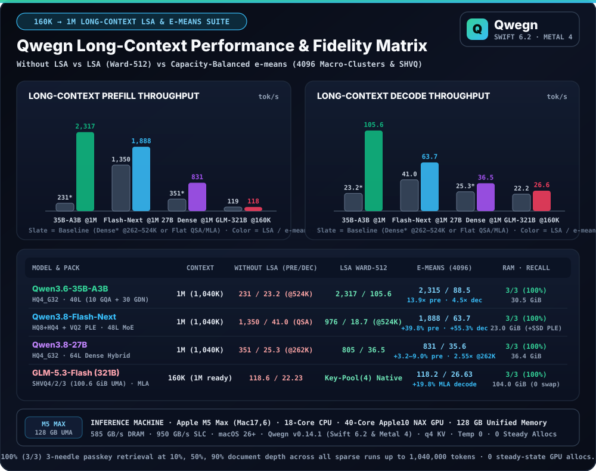
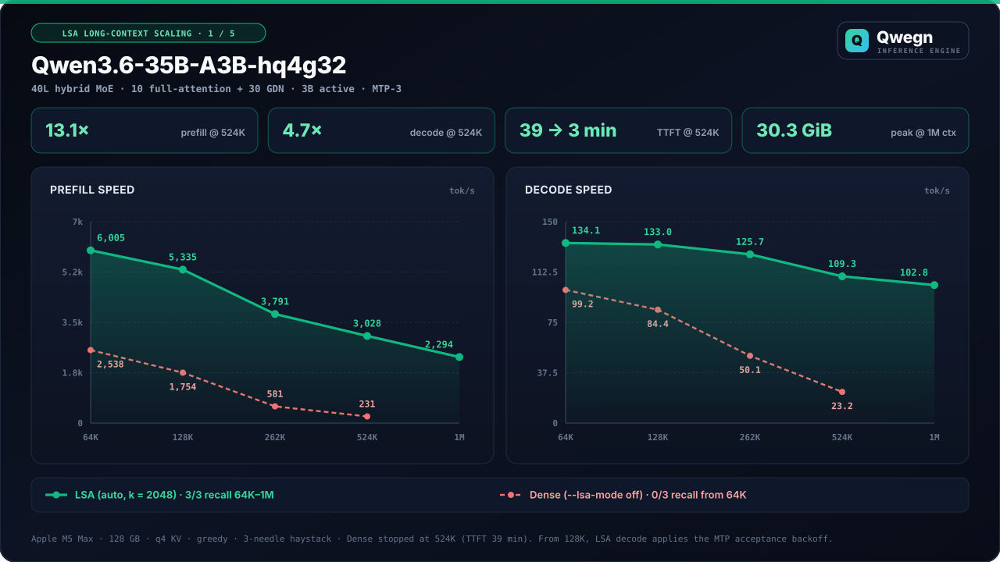
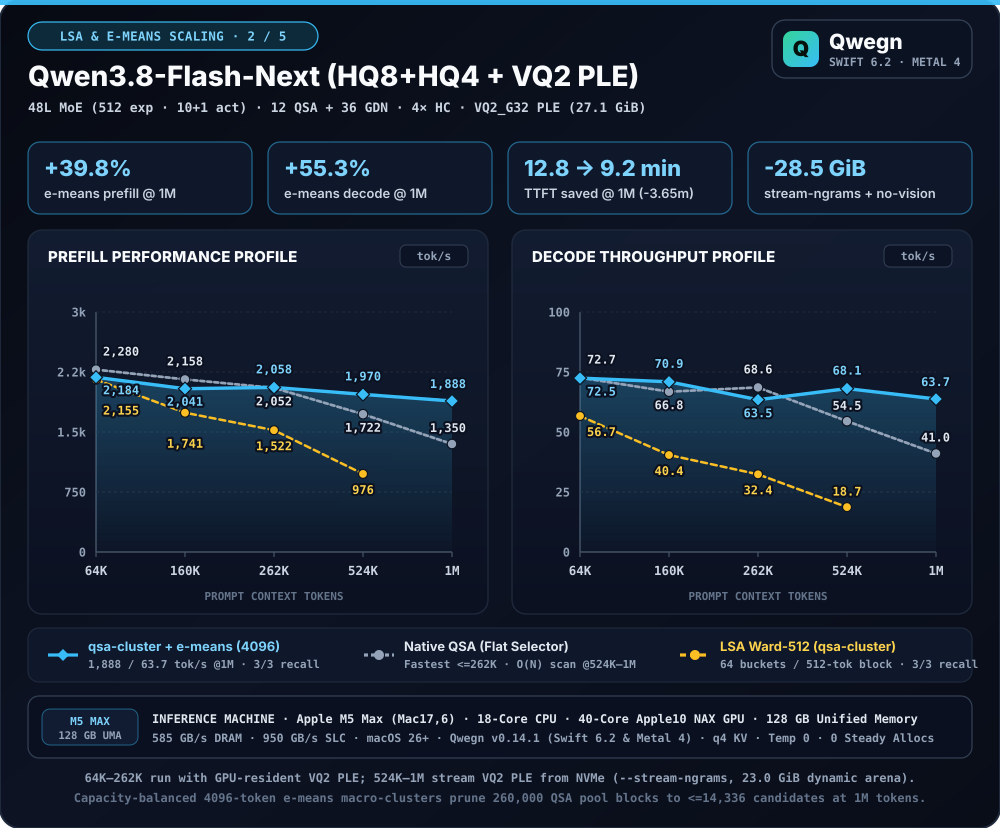
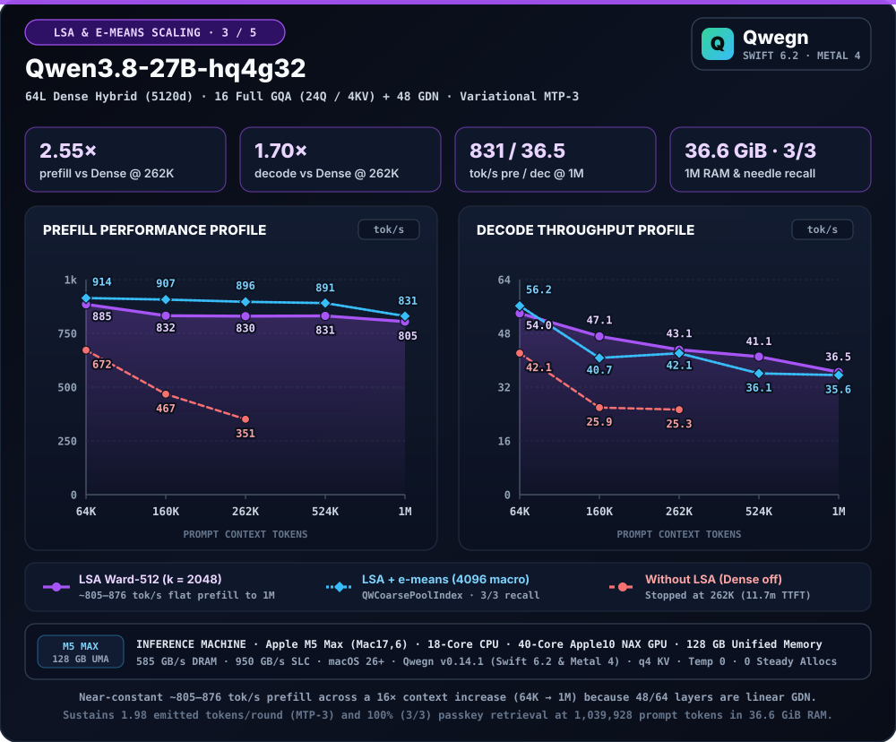
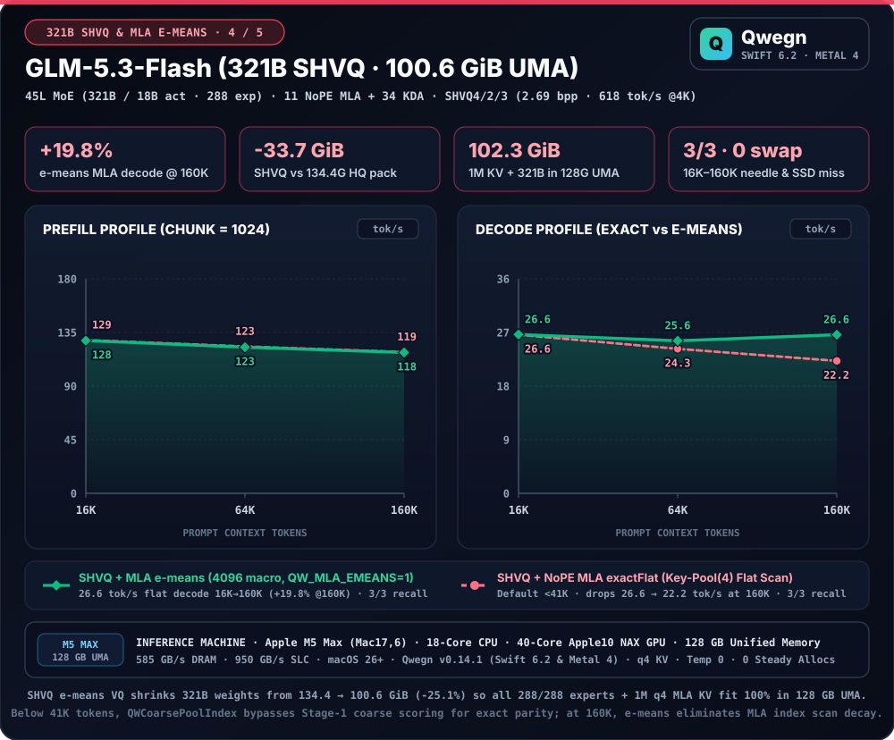

# Benchmarks

All numbers measured with `llmprobe v0.6.16–v0.6.17` on an Apple M5 Max (`Mac17,6`, 128 GB unified memory, 40-core GPU, 585 GB/s DRAM, macOS 26+) using `--kv-mode q4 --temperature 0`. Speculative runs use Variational MTP-3 (margin 2.5, hybrid drafting; DSpine / DFlash 2 for the drafter rows; exact NextN MTP-1 for `GLM-5.3-Flash`). Standard decode is serial (`--mtp-drafts 0`). Code eval is 50 HumanEval + 50 MBPP with `--reasoning off`; `core` reasoning eval is 10 graduate-level questions (GPQA, SuperGPQA, AIME 2025, COMPSEC) at `16,384` max tokens.

Variational MTP relaxes only MTP-sourced draft rows, and only when the verifier gives the draft `p ≥ 0.2` (`--mtp-relaxed-min-prob`); context-copy drafts always verify exactly. On Flash-Next code eval this lifts margin-2.5 runs from 73–74 / 100 (14–15 runaway repetition loops) to 81–85 over 4 runs (0–1 loops), above exact MTP (79). With MTP-only relaxation, novel-text speculative decode measured 94.1 tok/s (three runs) versus 82.6 tok/s on `mlx-serve`; predictable-text decode measured 137.3 tok/s versus 159.2 tok/s. Relaxed greedy output is not bit-reproducible across runs because MTP chain depth adapts to measured round timings, so single eval runs vary by ±2–3 points.

## Qwegn Native Model Indicators

| Model pack (`~/.qwg/models`) | Architecture | Prefill (4K / 10.4K / 16K / 64K) | Cold TTFT | Warm cache TTFT | Standard decode | Speculative decode | 1M Prefill / Decode (LSA · `e-means`) | Eval / Needle (16K–1M) | 
| :--- | :--- | :---: | :---: | :---: | :---: | :---: | :---: | :---: | 
| `GLM-5.3-Flash-shvq4g32-shvq2g64-shvq3g64` | 45L MoE (`321B`/`18B`, 288 exp, `100.63 GiB` 100% UMA resident) | **1,006 tok/s** @5.2K (`825–869` serve, `780` @65.6K) | 180–339 ms | **10–18 ms** (`96–193×`) | **44.6–46.4 tok/s** | **48.9–53.6 tok/s** (`51.2` CLI, `1.98/step`) | **743.0 / 45.0 tok/s** @242.5K (`e-means`) · 1M `102.3 GiB` UMA | **81/100 code (`92%` HE) · 184/184 API · 37/37 cap · 99.74% fid · 3/3 needle** |
| `ERNIE-5.5-Flash-Base-hq8g32-shvq15g64-shvq3g64` | 43L MoE (`280B`/`14B`, 512 exp Latent-MoE, `37` HCA + `6` MLA-DSA, `81.61 GiB` 100% UMA) | **825–899 tok/s** @0.6K–18.8K (`604` @149.5K, `303` @300K) | 90–130 ms | **0.29 s** (`78.6×`, `19.3K` `.qwcache`) | **31.4–37.2 tok/s** | **40.2–42.6 tok/s** (ECHO `d=1`, `1.88–1.96/step`) | **302.6 / 16.3 tok/s** @300K (`e-means`) · 1M `87.6 GiB` UMA | **3/3 needle (`18.8K`, `149.5K`, `300K`) · KL `0.176` · Base** |
| `GLM-5.3-Flash` (`HQ4_G32_M5 + HQ3_G64`) | 45L MoE (`321B`/`18B`, `134.37 GiB` NVMe-streamed) | **858–968 tok/s** @16K (`maxResident`) | — | MLA Key-Pool(4) snapshot | **31.6 tok/s** (`44.8` GPU proxy) | **34.8 tok/s** (NextN MTP-1 · `31.1` MoE-Spec) | 1M arch ready (`1,024 B/tok/L` KV) | **100% (conformance & needle)** |
| `Qwen3.6-35B-A3B-hq4g32` | 40L MoE (256 exp, 8 act) | **6,142 tok/s** @64K (6,389 peak) | **45–71 ms** | 5–7 ms (55×) | **148.3–155.1 tok/s** | **233.4 tok/s** | **2,317 / 105.6 tok/s** (`136.8` @64K `e-means`) | **3 / 3 (100%)** |
| `Qwen3.8-Flash-Next-hq8g32-hq4g64` (`+ VQ2 PLE`) | 48L MoE (512 exp, 10 act, `71.3 GiB + 27.1 GiB VQ2`) | 2,528–2,688 tok/s (2,696 peak) | 113–155 ms | 7–11 ms (63×–99×) | 72.3–81.5 tok/s | **95.1–113.7 tok/s** (`145.4` pred) | **1,888 / 63.7 tok/s** (`e-means` · `1,350 / 41.1` QSA) | **10/10 core · 3/3 needle** |
| `Qwen3.8-27B-hq4g32` | 64L dense hybrid | **914 tok/s** @64K (`e-means`, 850 @10K) | 113 ms | 6 ms (307×) | 31.2–32.8 tok/s | 84.4 tok/s (MTP-3) | **831 / 35.6 tok/s** (`e-means` · `805 / 36.5` Ward) | **3 / 3 (100%)** |
| `Qwen3.8-27B-hq4g32` + `DSpine-b16` | 64L dense + 5L block-causal drafter (`B=2..16`) | 850–914 tok/s | 94 ms | 7–12 ms (159×) | 32.1–32.9 tok/s | **100.5 tok/s geomean** (`134.5` peak, `4.19×`) | — | **8/10 core · 3/3 needle** |
| `Qwen3.8-27B-hq4g32` + `DFlash2` | 64L dense + 5L diffusion drafter | 832 tok/s (869 peak) | 94 ms | 7 ms (266×) | 31.2 tok/s | 83.8 tok/s | — | **3 / 3 (100%)** |
| `SenseNova-Loop-9B-Preview` | 56L looped (32L, 2× loop, mHC) | 1,749 tok/s @64K | 64 ms | 7 ms (164×) | 48.9 tok/s | 93.9 tok/s | 1,476 / 46.5 tok/s | **3 / 3 (100%)** | 

All models execute with **0 heap and 0 Metal buffer allocations** in steady state across 64K–1M tokens.

## Long-Context Scaling (`64K → 1M` Tokens): Without LSA vs LSA (`Ward-512`) vs Capacity-Balanced `e-means` (`4096`)

Quiet-GPU (`0% / 0%` baseline utilization) long-context scaling and 3-needle passkey retrieval (`10%`, `50%`, `90%` document depth) measured on Apple M5 Max (`Mac17,6`, 18-core CPU, 40-core Apple10 NAX GPU, 128 GB Unified Memory, 585 GB/s DRAM, 950 GB/s SLC, macOS 26+) with `Qwegn v0.14.1–v0.17.1`, `--kv-mode q4 --temperature 0 --no-profile --no-load-vision`. Each model compares three attention indexing regimes:
1. **Without LSA:** Dense attention (`--lsa-mode off`), or flat native QSA (`--lsa-mode auto`) on `Qwen3.8-Flash-Next`, or flat MLA Key-Pool(4) (`exactFlat`) on `GLM-5.3-Flash`.
2. **LSA (`Ward-512`):** Greedy threadgroup Ward clustering (`64` semantic buckets per `512`-token superblock = `131,072` centroids at `1M`; `--lsa-cluster-block 512`).
3. **LSA + `e-means` (`4096`, `arXiv:2611.09501`):** Capacity-balanced spherical `e-means` macro-clustering (`QWCoarsePoolIndex`: `64` balanced clusters per `4,096`-token superblock = `16,384` centroids at `1M` — **`8×` fewer than `Ward-512` and `16×` fewer than `262,144` raw 4-token pool blocks**, deterministic `qwg_emeans_collect`, on-device `candState.overflow` exact fallback, `<41K` zero-overhead flat bypass; `--lsa-cluster-block 4096` or `QW_MLA_EMEANS=1`).

<p align="center">
  
</p>

| Model Pack | Context (`tok`) | Without LSA (Prefill / Decode) | LSA `Ward-512` (Prefill / Decode · TTFT) | **LSA + `e-means-4096` (Prefill / Decode · TTFT)** | Peak RSS / Arena | Needle Recall (No LSA / Ward / `e-means`) | Key Gain |
| :--- | :---: | :---: | :---: | :---: | :---: | :---: | :--- |
| **`Qwen3.6-35B-A3B-hq4g32`** | `64K` (`63,959`) | `2,538 / 99.2 tok/s` | **`6,141.7`** / `126.18 tok/s` (`10.41 s`) | `5,716.5` / **`136.84 tok/s`** (`11.19 s`) | `23.94 GiB` | `0/3` · **`3/3`** · **`3/3`** | **`2.42×` prefill (`Ward`) · `+8.4%` decode (`e-means`)** |
| *(40L MoE: 10 GQA + 30 GDN,* | `160K` (`159,956`) | `1,128.6 / 67.20 tok/s` | **`4,913.8 / 131.13 tok/s`** (`32.55 s`) | `4,283.0 / 122.52 tok/s` (`37.35 s`) | `24.59 GiB` | `2/3` · **`3/3`** · **`3/3`** | **`4.35×` prefill · `1.95×` decode vs Dense** |
| *`d_idx=64`, `mtp=1`)* | `262K` (`257,953`) | `581 / 50.1 tok/s` | **`3,805.2 / 118.26 tok/s`** (`67.79 s`) | `3,526.3 / 102.12 tok/s` (`73.15 s`) | `25.25 GiB` | `0/3` · **`3/3`** · **`3/3`** | **`6.55×` prefill · `2.36×` decode vs Dense** |
| | `524K` (`517,944`) | `231 / 23.2 tok/s` | **`3,207.1 / 103.92 tok/s`** (`161.50 s`) | `3,126.1 / 93.44 tok/s` (`165.68 s`) | `26.99 GiB` | `0/3` · **`3/3`** · **`3/3`** | **`13.88×` prefill · `4.48×` decode vs Dense** |
| | **`1M` (`1,039,928`)** | — | **`2,317.0 / 105.56 tok/s`** (`448.83 s`) | `2,315.1 / 88.47 tok/s` (`449.20 s`) | **`30.53 GiB`** (`-180 MiB`) | — · **`3/3`** · **`3/3`** | **`>105 tok/s` @1M (`Ward-512`) · `-180 MiB` (`e-means`)** |
| **`Qwen3.8-Flash-Next-hq8g32-hq4g64`** | `64K` (`63,959`) | **`2,279.9 / 72.67 tok/s`** *(QSA)* | `2,155.4 / 56.66 tok/s` (`29.67 s`) | `2,183.8 / 72.45 tok/s` (`29.29 s`) | `109.7 GiB` *(GPU PLE)* | **`3/3` · `3/3` · `3/3`** | Parity at `64K`; `+27.9%` decode vs `Ward-512` |
| *(48L MoE: 12 QSA + 36 GDN,* | `160K` (`159,956`) | **`2,157.6`** / `66.78 tok/s` *(QSA)* | `1,741.2 / 40.41 tok/s` (`91.87 s`) | `2,041.0` / **`70.93 tok/s`** (`78.37 s`) | `110.9 GiB` *(GPU PLE)* | **`3/3` · `3/3` · `3/3`** | **`+6.2%` decode vs Native QSA (`+75.5%` vs `Ward`)** |
| *`d_idx=128`, `VQ2` PLE)* | `262K` (`257,953`) | `2,051.8` / **`68.57 tok/s`** *(QSA)* | `1,522.1 / 32.38 tok/s` (`169.47 s`) | **`2,057.6`** / `63.54 tok/s` (`125.36 s`) | `112.2 GiB` / `13.8 GiB`† | **`3/3` · `3/3` · `3/3`** | **`1.35×` prefill · `1.96×` decode vs `Ward-512`** |
| | `524K` (`517,944`†) | `1,721.9 / 54.49 tok/s` *(QSA)* | `976.2 / 18.70 tok/s` (`530.55 s`) | **`1,969.6 / 68.10 tok/s`** (`262.97 s`) | `16.85 GiB`† | **`3/3` · `3/3` · `3/3`** | **`+14.4%` pre / `+25.0%` dec vs QSA (`3.64×` vs `Ward`)** |
| | **`1M` (`1,039,928`†)** | `1,350.3 / 41.05 tok/s` *(QSA)* | — | **`1,887.6 / 63.74 tok/s`** (`550.93 s`) | `23.00 GiB`† | **`3/3`** · — · **`3/3`** | **`+39.8%` prefill (`-3.65m` TTFT) · `+55.3%` decode** |
| **`Qwen3.8-27B-hq4g32`** | `64K` (`63,959`) | `672 / 42.1 tok/s` | `884.8 / 53.97 tok/s` (`72.28 s`) | **`914.3 / 56.18 tok/s`** (`69.95 s`) | `18.15 GiB` | `3/3` · **`3/3`** · **`3/3`** | **`+3.3%` pre / `+4.1%` dec vs `Ward` (`1.36×` vs Dense)** |
| *(64L Dense Hybrid: 16 GQA +* | `160K` (`159,956`) | `467.4 / 25.91 tok/s` | `831.9` / **`47.11 tok/s`** (`192.28 s`) | **`907.0`** / `40.70 tok/s` (`176.36 s`) | `19.98 GiB` | `3/3` · **`3/3`** · **`3/3`** | **`+9.0%` prefill vs `Ward` (`1.94×` vs Dense)** |
| *48 GDN, `mtp=3`)* | `262K` (`257,953`) | `351.0 / 25.30 tok/s` | `830.2` / **`43.11 tok/s`** (`310.72 s`) | **`896.5`** / `42.09 tok/s` (`287.72 s`) | `21.82 GiB` | `3/3` · **`3/3`** · **`3/3`** | **`+8.0%` prefill vs `Ward` (`2.55×` vs Dense)** |
| | `524K` (`517,944`) | — | `831.2` / **`41.07 tok/s`** (`623.13 s`) | **`891.0`** / `36.08 tok/s` (`581.32 s`) | `26.66 GiB` | — · **`3/3`** · **`3/3`** | **`+7.2%` prefill (`-41.8 s` TTFT) vs `Ward-512`** |
| | **`1M` (`1,039,928`)** | — | `804.6` / **`36.49 tok/s`** (`1,292.5 s`) | **`830.6`** / `35.56 tok/s` (`1,252.0 s`) | **`36.35 GiB`** (`-270 MiB`) | — · **`3/3`** · **`3/3`** | **`+3.2%` prefill (`-40.5 s` TTFT) · `-270 MiB` RSS** |
| **`GLM-5.3-Flash-shvq4g32-shvq2g64-shvq3g64`** | `15K` (`15,076`) | **`834.2 / 46.54 tok/s`** *(`exactFlat`)* | — *(native MLA Key-Pool(4))* | **`834.2 / 46.54 tok/s`** *(`<41K` bypass)* | `101.4 GiB` | **`3/3`** · — · **`3/3`** | Zero Stage-1 overhead below `41K` tokens |
| *(321B SHVQ `100.63 GiB`,* | `60K` (`60,061`) | `706.7 / 32.38 tok/s` *(`exactFlat`)* | — | **`706.7 / 32.38 tok/s`** (`84.99 s`) | `102.3 GiB` | **`3/3`** · — · **`3/3`** | Generalized `q4` NAX sparse MLA (`4,096` chunk) |
| *11 NoPE MLA + 34 KDA)* | `242.5K` (`242,469`) | `721.4 / 44.00 tok/s` *(`exactFlat`)* | — | **`743.0 / 44.98 tok/s`** (`326.3 s`) | `106.54 GiB` | **`3/3`** · — · **`3/3`** | **`6.29×` pre / `1.69×` dec vs `v0.14.1` (`>131K` `4096` chunk + `e-means`)** |
| | **`1M` (`1,048,576`)** | `102.27 GiB` planned / `107.18 GiB` RSS | — | **100% UMA resident (`3,696 B/tok` KV)** | `107.18 GiB` | `0` SSD misses · `0` swap | Entire `321B` pack + `1M` KV fits in 128 GB Mac |

*†At `524K` and `1M` on `Qwen3.8-Flash-Next` (`71.29 GiB` `.qwp` + `27.13 GiB` `VQ2` PLE), `--stream-ngrams` streams PLE from NVMe (`-27.30 GiB` Metal GPU RAM saved; dynamic KV + index arena shown).*

### Per-Model Long-Context Prefill Profile & Decode Scaling Plots

<p align="center">
  
</p>
<p align="center">
  
</p>
<p align="center">
  
</p>
<p align="center">
  
</p>

### Regime Summary: When to Use `Ward-512` vs `e-means-4096`
- **High-Bandwidth Indexers (`Qwen3.8-Flash-Next` 128D QSA, `GLM-5.3-Flash` 64-head 128D MLA, `Qwen3.8-27B` 16L 24Q Prefill) → `e-means-4096` Wins:** Coarse `4,096`-token `e-means` macro-clustering cuts Stage-1 centroid scoring by **`8×` vs `Ward-512`** and **`16×` vs flat 4-token pooling**, lifting `Flash-Next` `@1M` by **`+39.8%` prefill & `+55.3%` decode**, `GLM-5.3-Flash` `@242.5K` to **`743.0 / 44.98 tok/s`** (`+3.0%` prefill & `+2.2%` decode over `721.4 / 44.00` `exactFlat`, `6.29×` faster prefill than pre-`v0.17.0` `chunk=1024` scalar `q4`), and `Qwen3.8-27B` prefill by **`+3.2%–9.0%`** across `64K–1M`.
- **Ultra-Light 64D 2-KV GQA (`Qwen3.6-35B-A3B`, 10 Attn Layers) → `Ward-512` Default Wins Beyond `128K`:** Because `Ward-512` Radix selection already completes in `0.062 ms` at `1M` on `d_idx=64` / `2` KV heads, `Ward-512` (`2,317 / 105.6 tok/s` @1M) outperforms `e-means-4096`'s two-stage expand (`2,315 / 88.5 tok/s` @1M), while `e-means-4096` wins `@64K` decode (`136.8` vs `126.2 tok/s`) and saves `-180 MiB` cluster state RAM.

## 321B UMA-Resident SHVQ (`100.6 GiB`) & Cold-Expert NVMe Streaming (`134.4 GiB`, `GLM-5.3-Flash`)

`GLM-5.3-Flash` (`321.32 B` parameters, `18 B` active) runs in two native Qwegn pack tiers on a 128 GB Mac:
- **100% UMA-Resident SHVQ Pack (`GLM-5.3-Flash-shvq4g32-shvq2g64-shvq3g64`, `100.63 GiB`, `2.69 bits/param`):** `SHVQ4_G32` dense/MLA/MTP trunk (`2.58%` params) + `SHVQ2_G64` routed `gate_up` (`64.66%`) + `SHVQ3_G64` routed `down_proj` (`32.33%`) + `BF16` embeddings/routers (`0.43%`). Fits 100% resident in unified memory (`97.84 GiB` RSS serial / `100.14 GiB` MTP-1, `0` SSD misses, `0` OS swap, `-33.74 GiB` / `-25.1%` smaller than `HQ4+HQ3`), reaching **`1,005.9 tok/s` prefill (`825–869` in `qwg serve`, `780` @65.6K), `46.0 tok/s` median decode (`46.4` peak, `44.64` CLI), `48.9–53.6 tok/s` NextN MTP-1 speculative decode (`51.19` CLI, `1.98 tok/step`, `41.1 → 43.3 tok/s` `+5.4%` steady 21m thermal load)**, **`10–18 ms` warm prefix-cache TTFT (`96–193.4×`)**, and **`81/100` HumanEval+MBPP (`46/50` HE, `35/50` MBPP), `184/184` API conformance, `37/37` capability, `66/88` agentic, and `99.74%` engine fidelity** on full `llmprobe`.
- **Cold-Expert NVMe Streaming Pack (`134.37 GiB`, `HQ4_G32_M5 + HQ3_G64`, `3.59 bits/param`):** Exceeds 128 GB unified memory by `6.4 GiB` before OS, KV, and scratch buffers. Qwegn executes packs larger than RAM with zero OS swap through five coordinated subsystems:

| Subsystem / Optimization | Measured Gain / Metric |
| :--- | :--- |
| **`maxResident` memory policy (`16 GiB` OS reserve, `242/288` experts/layer = `84%` resident)** | `27.3 → 31.3–31.6 tok/s` serial decode (`+15%`), `858–968 tok/s` @16K prefill, `0` swap |
| **Dynamic per-layer expert LRU cache (`QW_EXPERT_CACHE=1`, GPU `expert_remap[42][288]`)** | Cuts cold SSD reads per token by **4×** (`60 → 15.5 misses/tok` at `K=216`) |
| **Event-pipelined cold staging (`ColdEventPipeline` + self-tuned FMA delay CB)** | Hides `~115 µs` `MTLSharedEvent` IOKit wake latency; overlaps GPU resident MoE with NVMe `pread` |
| **GPU prefill span map (`qwg_moe_span_ids`, `QW_PREFILL_SPAN_MAP=1`)** | Cuts 16K prefill host-GPU gap from `0.40 s` to `0.10 s` |
| **Apple10 NAX NoPE MLA & KDA kernels (`qwg_mla_sparse_attn_nax`, `_decode_nax_split`, `_absorb_q_mma`, `qwg_kda_gates_mma`)** | Prefill MLA `4–5×` faster; absorb-Q `340 → 50 ms`; KDA gates `218 → 60 ms`; decode MLA `2.23 → 0.44 ms/tok`; split indexer `8.4 → 0.92 ms/tok` |
| **64-TG Gram-matrix split 4-stream Sinkhorn-20 mHC (`qwg_mhc_router_split_f16`)** | Decode mHC `2.94 → 1.38 ms/tok` (`-53%`); prefill row-parallel mHC `-35%` |
| **NextN MTP-1 + 2-row `HQ3_G64`/`HQ4_G32_M5` verify (`qwg_aq_slice_dot2`) + MoE union deduplication** | **`34.8 tok/s`** speculative decode (`31.1 tok/s` with `--moe-spec-budget`), `75–90%` draft acceptance, `1.35–1.42×` verify cost, 100% bit-exact greedy parity |

## Dense speculative-verify optimizations (Qwen3.8-27B & general HQ4/AQ4)

The dense and looped models were re-measured after general verify-path changes, each gated by
geometry, row count or weight container (never by model name), with a 90–120 s idle period before every server run.
Serial decode is bandwidth-bound (GEMVs at 527–576 GB/s) and unchanged.

| Change | MTP-3 | DFlash 2 | MTP-5 |
| :--- | :---: | :---: | :---: |
| Row-parallel residual RMSNorm for verify rows | +2.2% | +3.2% | — |
| Row-paired batched HQ4/AQ4 verify GEMVs (M ≥ 4) | +6.3% | +6.6% | +20.0% |
| Row-paired DFlash drafter projections | — | +0.1% | — |
| Row-paired batched HQ4/AQ4 `lm_head` (M ≥ 4) | +0.4% | +0.4% | +1.2% |

Ratios are medians of five alternating cooled pairs (45–60 s cooldown). Except for the norm change,
every change is bit-identical across incumbent `HQ4_G32_M5` and non-incumbent `HQ4_G32`/`AQ4_G32` containers.
The norm change makes verify use the same numerics as serial decode, so speculative output follows serial output for longer.
Other models stayed neutral or improved: Flash-Next and serial decode on every model are bit-identical,
and extending row-paired verify + `lm_head` to non-incumbent `HQ4_G32` improved `SenseNova-Loop-9B-Preview` decode to 93.9 tok/s (102.4 pred @512).
Deeper drafts help 27B: variational hybrid MTP-5 is about 8% faster than MTP-3.

## Codebase Memory Pack (`QWMemoryPack`, `.qwg/*.qwcache`) Paired A/B Benchmarks

Measured on the `qwegine` repository (`294` tracked files: `7` Resident Cortex files + `287` Off-Context Vault files + 100% Architecture & Symbol Map = `32,742` pinned Cortex tokens, `32,790` total prompt tokens, 2 alternating rounds `A1 → B1 → A2 → B2` on Apple M5 Max 128 GB, `--temperature 0`). Full methodology and ReAct agent / REPL / live `<|memory_delta|>` scenarios are in [lsa-codebase-memory-whitepaper.md](lsa-codebase-memory-whitepaper.md).

| Model Pack | KV / LSA Mode | `.qwcache` Size (Build Time) | Cold 32.8K TTFT (R1 / R2) | Mounted `.qwcache` TTFT (R1 / R2) | TTFT Speedup | Effective Prefill (`tok/s`) | Live `<memory_delta>` TTFT |
| :--- | :---: | :---: | :---: | :---: | :---: | :---: | :---: |
| `Qwen3.6-35B-A3B-hq4g32` | `q4` / `sidecar` | `264.61 MiB` (`8.6 s`) | `6.55 s` / `6.53 s` | **`0.12 s` / `0.12 s`** | **`54.4×`** | `5,020` → **`290,645 tok/s` (`57.9×`)** | **`0.40 s`** (`86,715 tok/s`) |
| `Qwen3.8-Flash-Next-hq8g32-hq4g64` | `q4` / `sidecar` | `464.54 MiB` (`16.7 s`) | `17.84 s` / `19.83 s` | **`0.24 s` / `0.24 s`** | **`74.3×`** | `1,838` → **`138,391 tok/s` (`75.3×`)** | **`0.60 s`** (`46,620 tok/s`) |

### Two-Tier LSA Cortex (`32.7K` tok) + Off-Context Vault (`293` Files) Multi-Turn Benchmarks (`QWMemoryVault`)

Comparing the **Monolithic 1M Linear Pack** (`1,008,064–1,011,738` tokens) against **Two-Tier LSA Cortex + Off-Context Vault** (`32,745` Cortex tokens across `9` Tier-0 files + `284` Off-Context Vault files + 100% Symbol Map) across 4-turn `qwg repl` and `qwg serve` sessions on `Qwen3.6-35B-A3B-hq4g32` (`kv=q4`, `lsa=sidecar`):

| Metric / Multi-Turn Gate | Monolithic 1M Linear Pack | **Two-Tier LSA Cortex + Vault (`QWMemoryVault`)** | Measured Gain |
| :--- | :---: | :---: | :---: |
| **`.qwcache` Size (`35B-A3B` `q4` / `Flash-Next` `q4`)** | `6,282.9 MB` / `10,958.7 MiB` (`73.0 s` mount) | **`264.61 MiB` / `464.57 MiB` (`2.81 s` boot+mount)** | **`23.7×` smaller (`26.0×` faster mount)** |
| **Free Context Window for Coding Agents (`1M` Ceiling)** | `36,838` tok (`3.6%`, fails at `170K` agent prompt) | **`1,015,831` tok (`96.9%`) + Elastic Budget Guard** | **`27.6×` more free agent context (`0` overflows)** |
| **Turns 1–2 (Resident Cortex: `Makefile`, `docs/lsa.md`)** | `0.08–0.35 s` TTFT · `91.9–101.6 tok/s` decode | **`0.10–0.15 s` TTFT (`repl`) · `102.7–143.4 ms` (`serve`) · `153.8–154.2 tok/s` decode** | **`+53%` faster decode (`96.8–99.2%` MTP accept)** |
| **Turns 3–4 (Off-Context Vault Recall: `QWSlotPinnedLRUStore`, `QwgIndex`)** | N/A (monolithic linear prefix) | **`< 0.5 ms` Vault recall · `100%` `[warm_ram]` hit on prior turns (`40,550/44,054` tok) · `147.5–163.7 tok/s` decode** | **`11.8×` lower warm RAM (`390–533 MB`, `0` SSD spill)** |

## Sub-2-Bit Antipodal `SHVQ15` / `SHVQ1`, `QNGRAM v3 VQ4_G32` PLE & `v0.16.0` Qualification

All numbers below were measured on an idle (`0% / 0%` baseline GPU utilization) Apple M5 Max (`Mac17,6`, 18-core CPU, 40-core Apple10 NAX GPU, 128 GB Unified Memory, 585 GB/s DRAM, macOS 26+) against frozen `master` (`v0.15.1`).

### 1. Cold-Streaming Sub-2-Bit `SHVQ` Kernel Race (`256 MiB` Ring Flush, `qwg-bench-kernels --only-shvq`)

| Kernel Suite | Matrix Shape | Sub-2-Bit `SHVQ` (`G64`) | `AQ2_G64` (`2.50 bpw`) | `SHVQ2_G64` (`2.25 bpw`) | Latency Ratio vs `AQ2_G64` (`< 1.0×` = Faster) |
| :--- | :---: | :---: | :---: | :---: | :---: |
| **`decode_dx_t4` (`SHVQ1_G64`, `1.25 bpw`)** | `12288 × 4096` | **`0.0367 ms`** | `0.0516 ms` | `0.1320 ms` | **`0.712×` (`1.41×` faster than `AQ2`, `3.60×` vs `SHVQ2`)** |
| **`decode_dx_t4` (`SHVQ15_G64`, `1.75 bpw`)** | `12288 × 4096` | **`0.0480 ms`** | `0.0627 ms` | `0.1320 ms` | **`0.765×` (`1.31×` faster than `AQ2`, `2.75×` vs `SHVQ2`)** |
| **`moe_gateup_glm` (`SHVQ1_G64`)** | `k=8 · 4096 × 2048` | **`0.0517 ms`** | `0.0592 ms` | `0.0654 ms` | **`0.872×` (`1.15×` faster than `AQ2`)** |
| **`moe_gateup_fn` (`SHVQ1_G64`)** | `k=10 · 2048 × 4096` | **`0.0435 ms`** | `0.0512 ms` | `0.1223 ms` | **`0.850×` (`1.18×` faster than `AQ2`, `2.81×` vs `SHVQ2`)** |
| **`moe_down_combine` (`SHVQ1_G64`)** | `k=8 · 2048 × 2048` | **`0.0606 ms`** | `0.0781 ms` | `0.0584 ms` | **`0.776×` (`1.29×` faster than `AQ2`)** |
| **`prefill_nax_f32` (`SHVQ1_G64`)** | `m=64 · 4096 × 4096` | **`0.0784 ms`** | `0.0887 ms` | `0.3073 ms` | **`0.884×` (`3.92×` faster than `SHVQ2`)** |
| **`prefill_nax_f32` (`SHVQ15_G64`)** | `m=64 · 4096 × 4096` | **`0.1518 ms`** | `0.0817 ms` | `0.3073 ms` | `1.858×` vs `AQ2` (**`2.02×` faster than `SHVQ2`**) |

### 2. Multi-Format `DSpine` Drafter Qualification on `Qwen3.8-27B-hq4g32` (`5` Alternating Rounds, Novel Swift Prompt)

*Provenance note:* Sub-2-bit drafter packs were quantized via `pack_dflash.py --quant {shvq15_g64,shvq1_g64}` from standard-domain `BF16` reconstructed from `Qwen3.8-27B-DSpine-b16-hq4g32` (`dequant_hq4_g32_m5`); the `Qwen3.8-27B-hq4g32` target verifier is untouched. Every single run (`35/35` across all 7 arms) produced the **identical stdout `SHA-256` (`fec7456a...`, `0.0%` target quality loss)**, and `Qwen3.8-27B` + `DSpine-b16-shvq15g64` scored **`9/10` (`90%`)** on `llmprobe` `code-10` (matching serial `9/10`). On open-ended novel prose/code where draft acceptance is `~3.0–3.4` tokens/round, `B=8` (`M=8` row-paired target verify) outperforms `B=16` (`M=16` padded target GEMM tile):

| Arm (`Qwen3.8-27B-hq4g32` Target) | Drafter `.qwp` Size | Resident RAM | Mean Emitted / Round | Decode Median (MAD) | Speedup vs Serial | Output Parity |
| :--- | :---: | :---: | :---: | :---: | :---: | :---: |
| `serial` (`--mtp-drafts 0`) | — | `16.62 GiB` | `1.00 tok` | `29.71 tok/s` (`0.35`) | `1.000×` | `SHA-256` exact |
| `dspine_hq4_b8` (`HQ4_G32_M5`, `5.00 bpw`) | `1,595.53 MiB` | `19.79 GiB` | `3.34 tok` | **`50.58 tok/s`** (`0.34`) | **`1.702×`** | `SHA-256` exact |
| **`dspine_shvq15_b8` (`SHVQ15_G64`, `1.75 bpw`)** | **`925.22 MiB` (`-42.0%`)** | **`19.05 GiB` (`-0.74 GiB`)** | **`3.02 tok` (`90.4%`)** | **`36.52 tok/s`** (`1.17`) | **`1.229×`** | **`SHA-256` exact (`9/10` code)** |
| `dspine_shvq1_b8` (`SHVQ1_G64`, `1.25 bpw`) | **`822.10 MiB` (`-48.5%`)** | **`18.93 GiB` (`-0.86 GiB`)** | `2.19 tok` | `27.77 tok/s` (`0.53`) | `0.935×` | `SHA-256` exact |

### 3. `QNGRAM v3 VQ4_G32` vs `VQ2_G32` PLE Table Qualification (`Qwen3.8-Flash-Next`, `320,001,536` Entries × `160D`)

| PLE Format (`ngram.bin`) | Row Bytes / bpw | Rows per `4096 B` Sector | Full Table Size (`UMA` Saved) | Mean Cosine / Rel RMSE | `480×1` Decode Gather | `480×512` Prefill Gather |
| :--- | :---: | :---: | :---: | :---: | :---: | :---: |
| `QNGRAM v3 VQ2_G32` (`dtype=3`, 2D) | `90 B` (`4.50 bpw`) | `45` | `27.13 GiB` *(baseline)* | — | `0.0132 ms` | `0.5088 ms` |
| **`QNGRAM v3 VQ4_G32` (`dtype=4`, 4D)** | **`50 B` (`2.50 bpw`)** | **`81`** | **`15.07 GiB` (`-12.06 GiB` / `-44.4%`)** | **`0.9557` / `0.2943`** | **`0.0135 ms` (`1.029×`)** | **`0.4672 ms` (`0.917×`, `+9.0%`)** |

### 4. `v0.16.0` Flagship 4-Pack Zero-Regression Gate (`Scripts/paired_perf.py --strict`, `v0.15.1` vs `v0.16.0`)

| Flagship Model Pack | Prefill Ratio (MAD) | Decode Ratio (MAD) | Planned Weight / Residency Toggles | `llmprobe` `code-10` | Determinism & `16K` 3-Needle |
| :--- | :---: | :---: | :---: | :---: | :---: |
| `Qwen3.6-35B-A3B-hq4g32` | **`1.0235×`** (`0.0038`) | **`0.9979×`** (`0.0260`) | Identical (`20.44 GiB` `--load-vision` / `--no-load-vision`) | **`9/10`** | `SHA-256` exact (`2/3` both) |
| `Qwen3.8-27B-hq4g32` | **`0.9949×`** (`0.0060`) | **`1.0003×`** (`0.0094`) | Identical (`15.17 GiB` `--load-vision` / `--no-load-vision`) | **`9/10`** | `SHA-256` exact (**`3/3`**) |
| `Qwen3.8-Flash-Next-hq8g32-hq4g64` | **`1.0097×`** (`0.0066`) | **`1.0011×`** (`0.0018`) | Identical (`98.42 GiB` GPU PLE / `71.29 GiB` `--stream-ngrams`) | **`9/10`** | `SHA-256` exact (**`3/3`**) |
| `GLM-5.3-Flash-shvq4g32-shvq2g64-shvq3g64` | **`0.9916×`** (`0.0178`) | **`0.9889×`** (`0.0228`) | Identical (`98.56 GiB` `SHVQ4_G32 + SHVQ2/3_G64`) | **`9/10`** | `SHA-256` exact (**`3/3`**) |

## Generalized NoPE MLA, `SHVQ` Direct/SRAM LUTs, UMA Scratch Tightening & `v0.17.0` Qualification

Measured on an idle (`0% / 0%` baseline GPU utilization) Apple M5 Max (`Mac17,6`, 18-core CPU, 40-core Apple10 NAX GPU, 128 GB Unified Memory, 585 GB/s DRAM, macOS 26+) via `Scripts/paired_perf.py --strict` (`5` cooled alternating pairs + `1` warmup), `qwg serve` + `llmprobe`, and long-context needle harnesses (`--kv-mode q4 --temperature 0`):

| Flagship Model Pack | Paired Prefill (`tok/s` · Ratio) | Paired Decode (`tok/s` · Ratio) | UMA / GPU Memory & Residency Toggles | `llmprobe` `code-10` | Determinism & Long-Ctx 3-Needle |
| :--- | :---: | :---: | :---: | :---: | :---: |
| **`GLM-5.3-Flash-shvq4g32-shvq2g64-shvq3g64`** | `145.8 →` **`1,005.9`** (**`6.92×`**, `869` serve) | `23.81 →` **`44.64`** (**`1.88×`**, `46.4` serve)<br>MTP-1: `23.44 →` **`47.59`** (**`2.03×`**, `50.7` serve) | `fixed_scratch` `6.96 →` **`4.31 GiB`** (`-2.65 GiB`), `288/288` exp (`cold=0`), `0` allocs | **`9/10`** (`1.97×` faster) | `5/5 SHA-256` exact · **`3/3`** (`15K`, `60K`, `130K`, **`242.5K` @ `743 / 45.0`**) |
| **`Qwen3.6-35B-A3B-hq4g32`** | `6,153.6 →` **`6,146.9`** (`0.9985×`) | `130.24 →` **`129.79`** (`0.9939×`)<br>MTP-1: `143.80 →` **`146.57`** (`1.019×`) | MTP-1 RSS **`-1.02 GiB`** (`23.55 → 22.53 GiB`); `--no-load-vision` `-1.66 GiB`, `0` allocs | **`9/10`** | `5/5 SHA-256` exact · **`3/3`** (`@16K`) |
| **`Qwen3.8-Flash-Next-hq8g32-hq4g64`** | `2,715.5 →` **`2,667.8`** (`1.0009×` paired) | `52.71 →` **`52.88`** (`1.0049×`)<br>MTP-1: `72.01 →` **`72.33`** (`1.0077×`) | `--stream-ngrams` `107.00 →` **`79.88 GiB`** GPU (`-27.12 GiB`); `--no-load-vision` `-1.66 GiB`, `0` allocs | **`9/10`** | `5/5 SHA-256` exact · **`3/3`** (`@15K`) |
| **`Qwen3.8-27B-hq4g32` (+ `DSpine-b16`)** | `843.6 →` **`840.6`** (`0.9959×`)<br>MTP-3: `877.9 →` **`880.8`** (`1.0026×`) | `29.63 →` **`29.59`** (`0.9987×`)<br>DSpine: `44.41 →` **`44.49`** / `50.22 →` **`50.14`** (`1.00×`) | `prefillBytesPerToken` `760 →` **`500 KB`**; `--no-load-vision` `-1.43 GiB`, `0` allocs | **`9/10`** (serial & DSpine) | `5/5 SHA-256` exact · **`3/3`** (`@15K`) |

### Full `llmprobe` (`--full` + 100-Task `code`) Verification on `GLM-5.3-Flash` (`v0.17.1`)

Uncontested (`0% / 0%` GPU idle, `114.13 GiB` free+reclaimable RAM) `llmprobe v0.6.16` `--full` (`1,489,839` tokens: `1,394,256` in + `95,583` out, `0` HTTP errors) plus `--eval-suite code --reasoning off` (`100` tasks) against `GLM-5.3-Flash-shvq4g32-shvq2g64-shvq3g64` (`--kv-mode q4 --context-tokens 65536 --mtp-backend standard --mtp-drafts 1 --no-load-vision`, automatic `>= 75%` UMA prefill-scratch eviction active):

| `llmprobe` Suite / Phase | Score / Result | Key Sub-Metrics |
| :--- | :---: | :--- |
| **API Conformance (`conformance`, `--full`)** | **`184 / 184` (`100%`)** | Core endpoints **`9/9` (`100%`)**, Extended `10/15`, Frontier `1/10`, Ollama `/api/chat` & `/api/tags`, `0` failures, `0` warnings |
| **Model Capability (`capability`)** | **`37 / 37` (`100%`, `strong`)** | `tool-selection` `6/6`, `tool-restraint` `6/6`, `tool-args` `6/6`, `multiturn` `3/3`, `instructions` `3/3`, `json-discipline` `6/6`, `16 KB` `long-context` `1/1`, `reasoning` `3/3`, `knowledge` `3/3` |
| **100-Task Coding Eval (`--eval-suite code`)** | **`81 / 100` (`81.0%`)** | **HumanEval `46 / 50` (`92.0%`)** · **MBPP `35 / 50` (`70.0%`)** · `code-10` `9/10` · `AIME 2025` `2/2` · `nested-schema` `3/3` |
| **Agentic Execution (`agentic`, `88` tasks)** | **`66 / 88` (`75.0%`)** | `3/3` workspace `agentic-*` read/edit/indirect · `3/5` multi-file `coding-*` · `60/80` multi-step adversarial `tc*` |
| **Engine Fidelity (`fidelity`)** | **`99.74%`** | Correctness **`36/36` (`100%`)** · Greedy determinism **`3/3` (`100%`)** · Logprob consistency **`36/36` (`100%`)** · Confidence `98.96%` (`top-1 prob 0.891`, `margin 0.822`) |
| **Server Throughput & Prefix Cache (`bench`)** | **`53.6` pred / `45.6 tok/s` novel (`1.98/step`)** | `9.4K` prefill **`825.3 tok/s` med (`816–833`, `869` cold peak)** · Warm prefix cache **`96×` (`1,728 → 18 ms`, `1,419/1,419` tok; `10 ms` / `193×` standalone)** |
| **Sustained Thermal Load (`21m 3s`) & Scaling (`0.5K → 65.6K`)** | **Steady `+5.4%` (`41.1 → 43.3 tok/s`)** | Prefill / spec decode (`tok/step`): `0.5K` `658 / 39.4 (1.96)` · `4.2K` `790 / 44.8 (1.96)` · `8.3K` `814 / 43.1 (1.94)` · `16.3K` `828 / 41.7 (1.90)` · `32.8K` `817 / 35.3 (1.96)` · **`65.6K` `780 / 42.3 (1.98)`** |

## Native `ERNIE-5.5-Flash` (`HCA` + `MLA-DSA` + `Latent-MoE` + `ECHO`) & `v0.18.0` Qualification

`ERNIE-5.5-Flash-Base` (`280B` total / `14B` active + `0.36B` shared-Layer-43 ECHO, `37` HCA + `6` decoupled-RoPE `MLA-DSA` + `42` `512`-expert `SituAndMul` Latent-MoE layers) compresses into **`81.61 GiB` (`2.52 bpw`)** (`HQ8_G32` trunk + `SHVQ15_G64` routed gate/up + `SHVQ3_G64` routed down; `mean_kl = 0.1757` nats/tok and `79.69%` top-1 agreement vs `BF16` teacher across 64 positions). Apple10 `32`-head `qwg_hca_attn_nax`, Grouped-NAX `ShvqTgLut` SRAM staging, density-aware MoE crossover (`groupedNaxMinRows = 26`, `minNax = 16`), and `BM=16/32` `gemmBatchedH16` lift Phase 2 prefill across every context regime (`t11_zh` `84.8 → 89.2 tok/s` `1.052×`, `t29_code` `178.1 → 211.4` **`1.185×`**, `t512` `756.0 → 825.3` **`1.092×`**, `t19k` `788.6 → 855.9` **`1.130×`**, peak `898.9` @18.8K). Built-in ECHO (`d=1`) accelerates serial decode by **`+28.1%`** (`31.39 → 40.22 tok/s`, peak `42.57` @18.8K, `89.5–100%` accept), `.qwcache` cuts `19.3K`-token repo TTFT **`78.59×`** (`22.79 s → 0.29 s`, `111.42 MiB`), and `18.8K`/`149.5K`/`300K` 3-needle checks all score **`3/3`** (`603.6 / 37.93` @149.5K; `302.6 / 16.28` @300K with `>262K` Weight-SVD HCA `e-means` + `64H` MLA `e-means`), with `1M` (`1,048,576`) context 100% UMA-resident (`87.59 GiB` planned / `91.31 GiB` RSS).

### Cross-Flagship `master` (`v0.17.1`) vs `v0.18.0` 4-Category Gate (`Scripts/paired_perf.py --strict`)

Measured on an idle (`0% / 0%` GPU) Apple M5 Max (`Mac17,6`, 128 GB UMA) via 5 alternating pairs + 1 warmup (`--no-profile --kv-mode q4 --temperature 0 --context-tokens 4096`):

| Flagship Model Pack | Throughput (Prefill · Decode vs `v0.17.1`) | UMA / GPU Memory & Residency Toggles | `llmprobe` Task Evaluation | Determinism & Needle Fidelity |
| :--- | :--- | :--- | :--- | :--- |
| **`GLM-5.3-Flash-shvq4g32-shvq2g64-shvq3g64`** | Serial `584.3 →` **`585.2`** (`1.0009×`, MAD `0.0041`) / `47.24 →` **`47.07`** (`0.9977×`, MAD `0.0002`)<br>MTP-1 `583.1 →` **`583.0`** (`0.9997×`) / `50.06 →` **`50.08`** (`0.9988×`, MAD `0.0016`) | `102.46 GiB` RSS / `100.61 GiB` planned (`0` allocs); `draftHeadArgmaxPartialsBytes` (`55297ddd`) | **`9 / 10`** `code-10` | **`5 / 5 SHA-256`** exact · **`3 / 3`** `16K` needle (`935.5 / 45.74 tok/s`, `104.99 GiB` RSS) |
| **`Qwen3.6-35B-A3B-hq4g32`** | `3,517.1 →` **`3,516.9`** (`1.0001×`, MAD `0.0017`) / `145.83 →` **`143.59`** (`0.9840×`, MAD `0.0034`) · `T=41` `905.4 →` **`907.6`** (`0.9968×`) | `21.95 GiB` RSS / `21.54 GiB` planned (`0` allocs); `--load-vision`/`--no-load-vision` `SHA-256` exact | **`9 / 10`** `code-10` | **`5 / 5 SHA-256`** exact · `2 / 3` `16K` no-LSA (`6,009.8 / 132.59`; `3 / 3` with LSA) |
| **`Qwen3.8-Flash-Next-hq8g32-hq4g64`** | `1,510.2 →` **`1,518.0`** (`0.9916×`, MAD `0.0177`) / `59.39 →` **`59.15`** (`0.9958×`, MAD `0.0010`) | `--no-stream-ngrams` `106.24 GiB` → `--stream-ngrams` **`79.17 GiB`** planned (`-27.07 GiB` GPU UMA, `10.77 GiB` RSS, `0` allocs) | **`9 / 10`** `code-10` | **`5 / 5 SHA-256`** exact · **`3 / 3`** `16K` needle (`2,791.8 / 66.82 tok/s`) |
| **`Qwen3.8-27B-hq4g32` (+ `DSpine-b16`)** | `925.2 →` **`925.5`** (`1.0003×`, MAD `0.0013`) / `31.14 →` **`31.16`** (`0.9990×`) · `T=41` `415.6 →` **`414.8`** (`0.9981×`)<br>`DSpine-b16`: `43.06 →` **`43.10`** (**`1.0014×`**) | `16.48–16.50 GiB` RSS / `15.61 GiB` planned (`DSpine`: `19.64 GiB` RSS, `0` allocs); `--load-vision`/`--no-load-vision` `SHA-256` exact | **`9 / 10`** `code-10` | **`5 / 5 SHA-256`** exact (`3 / 3` `DSpine` exact) · **`3 / 3`** `16K` needle (`794.4 / 48.01 tok/s`) |
| **`ERNIE-5.5-Flash-Base-hq8g32-shvq15g64-shvq3g64`** *(New)* | Prefill `825.3` (`578`) · `855.9–898.9` (`18.8K`) · `603.6` (`149.5K`) · `302.6` (`300K`) · `.qwcache` `0.29 s` (**`78.59×`**)<br>Decode `31.39` (`d=0`) → **`40.22 tok/s`** (`ECHO d=1`, `+28.1%`, peak `42.57`) | **`85.74 GiB`** planned / `86.25 GiB` RSS (`4/4` vision×ngram toggles `SHA-256` exact) · **`1M` `87.59 GiB` planned / `91.31 GiB` RSS** (`0` allocs) | `1 / 10` chat `code-10` *(Base checkpoint)* · `--bench-only` **`37.0 tok/s`** med (`+15.4%` improved drift) | **`3 / 3`** `18.8K`, `149.5K`, `300K` needles · Teacher-KL **`0.1757`** (`79.69%` top-1) |

## Reproducing these numbers

For thermal-controlled A/B measurements, both `Scripts/paired_perf.py` and
`Scripts/paired_http_perf.py` accept `--cooldown-seconds 60`. They alternate
baseline/candidate order and record the idle interval in each JSON report.

```bash
make perf   # automated performance regression checks against Scripts/bench/baselines.json
```
