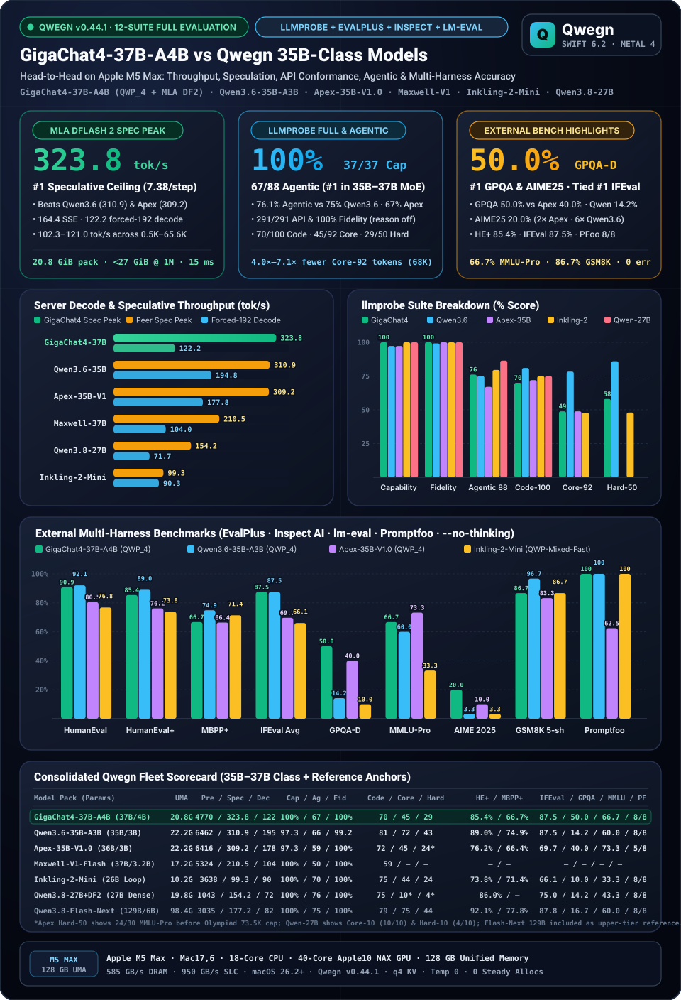
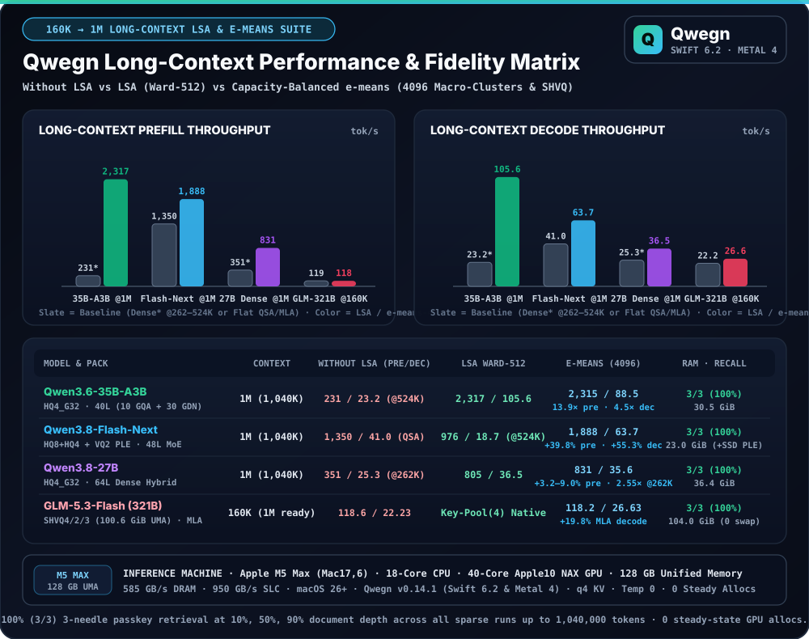
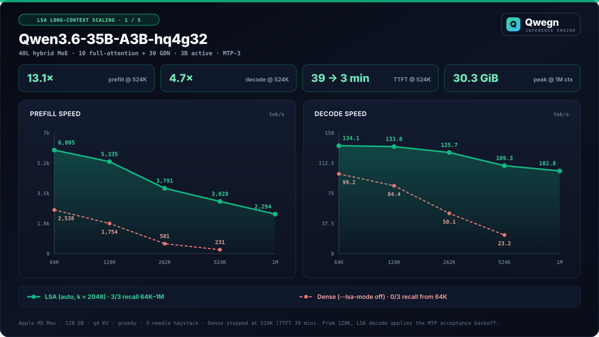
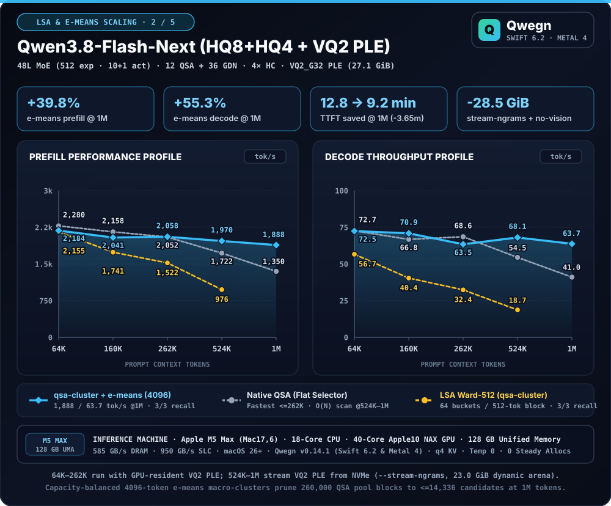
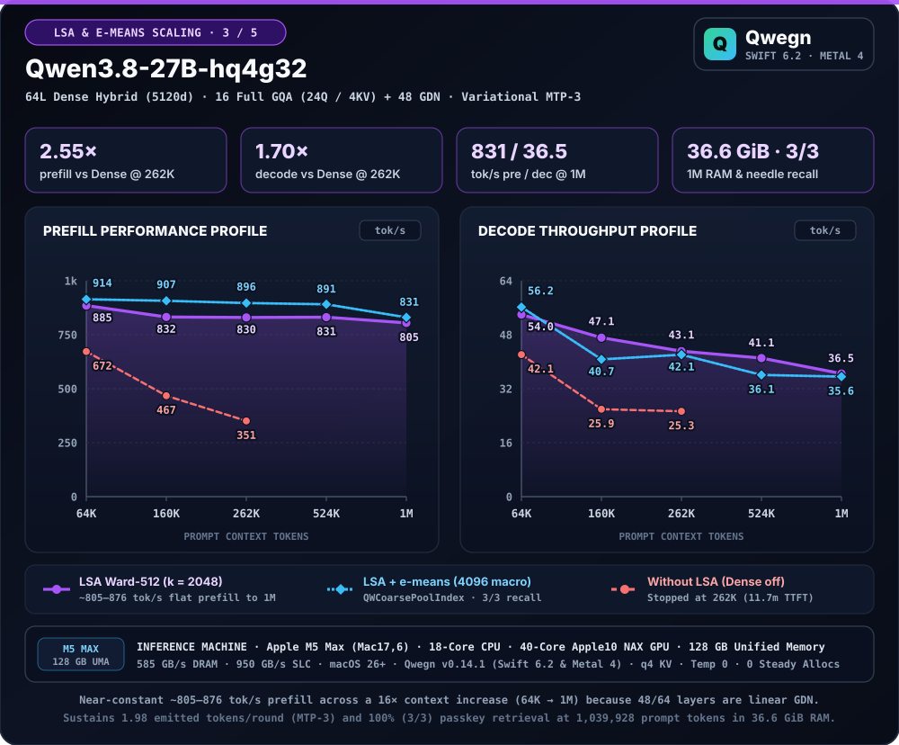
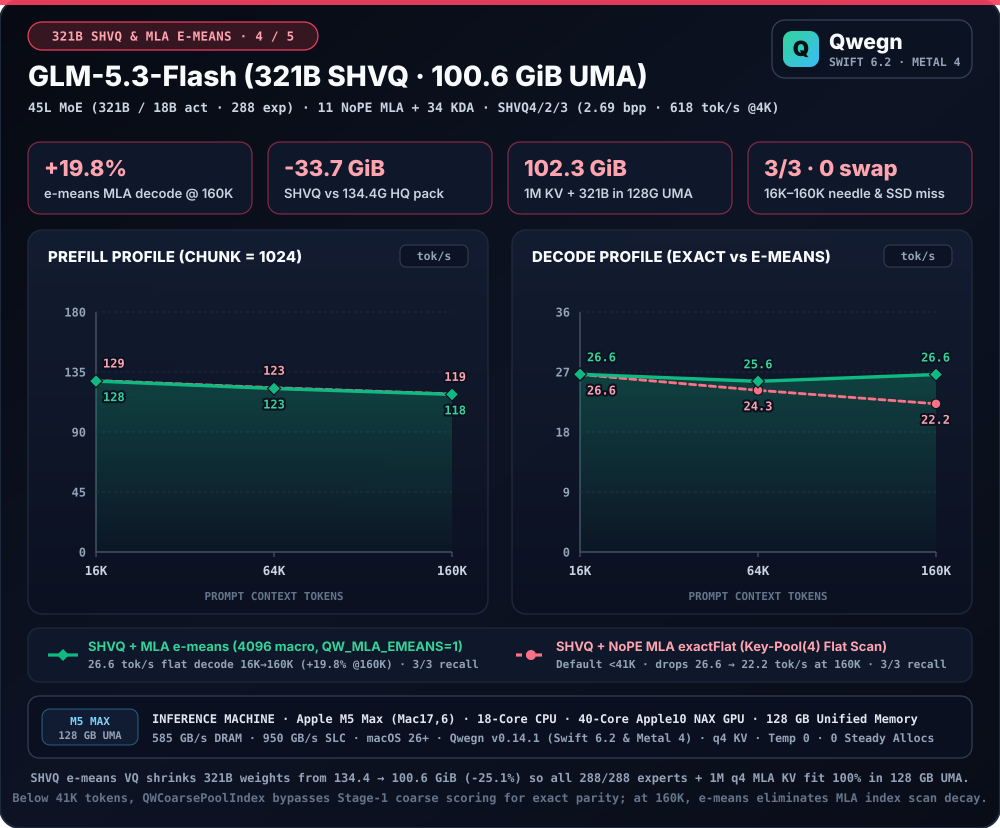
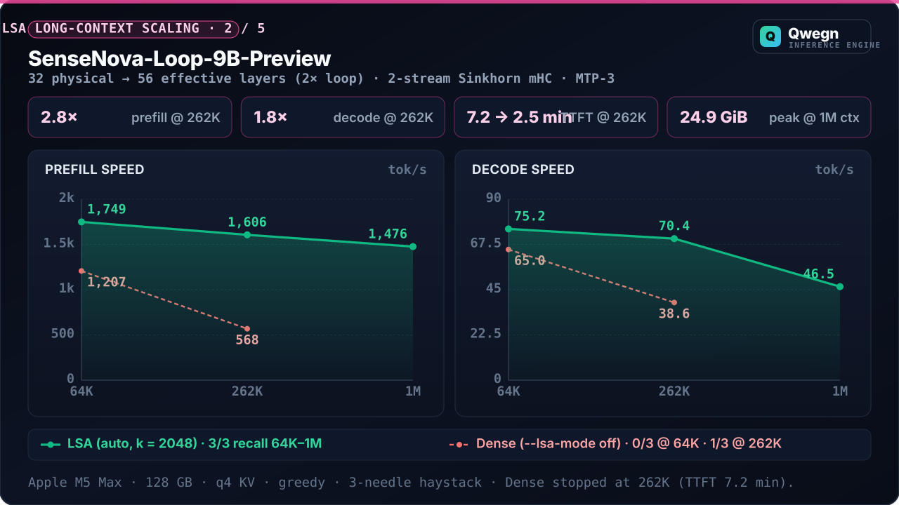

# Benchmarks

All numbers measured with `llmprobe v0.6.16–v0.6.17` on an Apple M5 Max (`Mac17,6`, 128 GB unified memory, 40-core GPU, 585 GB/s DRAM, macOS 26+) using `--kv-mode q4 --temperature 0`. Speculative runs use Variational MTP-3 (margin 2.5, hybrid drafting; DSpine / DFlash 2 for the drafter rows; exact NextN MTP-1 for `GLM-5.3-Flash`). Standard decode is serial (`--mtp-drafts 0`). Code eval is 50 HumanEval + 50 MBPP with `--reasoning off`; `core` reasoning eval is 10 graduate-level questions (GPQA, SuperGPQA, AIME 2025, COMPSEC) at `16,384` max tokens.

Variational MTP relaxes only MTP-sourced draft rows, and only when the verifier gives the draft `p ≥ 0.2` (`--mtp-relaxed-min-prob`); context-copy drafts always verify exactly. On Flash-Next code eval this lifts margin-2.5 runs from 73–74 / 100 (14–15 runaway repetition loops) to 81–85 over 4 runs (0–1 loops), above exact MTP (79). With MTP-only relaxation, novel-text speculative decode measured 94.1 tok/s (three runs) versus 82.6 tok/s on `mlx-serve`; predictable-text decode measured 137.3 tok/s versus 159.2 tok/s. Relaxed greedy output is not bit-reproducible across runs because MTP chain depth adapts to measured round timings, so single eval runs vary by ±2–3 points.

## Qwegn Native Model Indicators

| Model pack (`~/.qwg/models`) | Architecture | Prefill (4K / 10.4K / 16K / 64K) | Cold TTFT | Warm cache TTFT | Standard decode | Speculative decode | 1M Prefill / Decode (LSA · `e-means`) | Eval / Needle (16K–1M) | 
| :--- | :--- | :---: | :---: | :---: | :---: | :---: | :---: | :---: | 
| `GLM-5.3-Flash-QWP-Mixed` | 45L MoE (`321B`/`18B`, 288 exp, `100.63 GiB` 100% UMA resident) | **1,014 tok/s** @4K (`1,006` @5.2K, `825–869` serve, `780` @65.6K) | 180–339 ms | **10–18 ms** (`96–193×`) | **44.6–46.4 tok/s** | **54.7 tok/s** (`51.4` CLI, `50.8` serve, `1.98/step`) | **743.0 / 45.0 tok/s** @242.5K (`e-means`) · 1M `102.3 GiB` UMA | **81/100 code (`92%` HE) · 184/184 API · 37/37 cap · 99.74% fid · 3/3 needle** |
| `ERNIE-5.5-Flash-Base-QWP-Mixed` | 43L MoE (`280B`/`14B`, 512 exp Latent-MoE, `37` HCA + `6` MLA-DSA, `81.61 GiB` 100% UMA) | **1,137 tok/s** @4K (`1,015` serve, `909` @16K, `899` @18.8K, `604` @149.5K) | 90–130 ms | **15 ms (`114×`)** / **0.29 s** `.qwcache` | **32.6–37.2 tok/s** | **52.7 tok/s** serve (`45.6` CLI ECHO `d=1` · `64.2` `d=5` code) | **302.6 / 16.3 tok/s** @300K (`e-means`) · 1M `87.6 GiB` UMA | **3/3 needle (`18.8K`, `149.5K`, `300K`) · 5/10 Core-10 · 88/90% PIQA · KL `0.176`** |
| `Ling-3.2-air-QWP-Mixed` | 42L MoE (`124B`/`5.5B`, 512 exp `n_group=8/4`, `35` KDA + `7` Direct-Q MLA, 27L ViT, `52.23 GiB` `3.41 bpw`) | **2,847 tok/s** @4.1K (`2,292` @8.3K, `2,141.4` @10.4K srv, `1,651` @16.3K) | 124 ms | **37 ms (`14.5×`)** | **76.2–78.3 tok/s** | **100.0 tok/s** serve (`110.5` pred, `86.0` novel, `1.98/step` · **`103.7`** CLI NextN) | `262K` native (`50.1–51.4 GiB` CLI · `54.96 GiB` serve · `2,800 B/tok` `q4`) | **100% cap · 98.04% fid (`36/36`) · 285/293 API · 67/88 agentic · 3/3 needle (`16.9K`)** |
| `GLM-5.3-Flash` (`HQ4_G32_M5 + HQ3_G64`) | 45L MoE (`321B`/`18B`, `134.37 GiB` NVMe-streamed) | **858–968 tok/s** @16K (`maxResident`) | — | MLA Key-Pool(4) snapshot | **31.6 tok/s** (`44.8` GPU proxy) | **34.8 tok/s** (NextN MTP-1 · `31.1` MoE-Spec) | 1M arch ready (`1,024 B/tok/L` KV) | **100% (conformance & needle)** |
| `Qwen3.6-35B-A3B-QWP_4` | 40L MoE (256 exp, 8 act) | **6,462 tok/s** @2K (`6,316` @6.5K, `6,142` @64K) | **45–71 ms** | 5–7 ms (55×) | **148.3–155.1 tok/s** | **382.8 tok/s** serve spec (`324.3` CLI `d=5` · `182.0` serve · `173.6` CLI `d=1`) | **2,317 / 105.6 tok/s** (`143.7` @64K) | **82% Code-50 (`100%` HE) · 83.3% Core-30 · 139/139 API · 3/3 needle (`16K`–`1M`)** |
| `Apex-35B-V1.0-QWP_4` | 40L MoE (`35.95B`/`3B`, 256 exp `8+1`, `22.18 GiB` + ViT) | **6,416 tok/s** @4K (`6,262` @16K, `5,810` @10.4K srv, `5,692` @64K) | **89 ms** | **28 ms (`11.5×`)** | **148.5 tok/s** (`134.6` ViT CLI) | **213.8 tok/s** pred / **178.0** serve (`174.9` CLI `d=3` · `154.3` novel) | **5,491 / 100.9 tok/s** (`Ward-512` · `5,325 / 89.0` `e-means`) | **295/295 API · 100% fid · 91.9% cap · 72/100 code (`82%` HE) · 3/3 needle (`64K`–`1M`)** |
| `Maxwell-V1-Flash-HQ8-SHVQ3D4` | 45L all-MBSA MoE (`256` exp `12+1`, `4×` mHC, `17.18 GiB` `3.84 bpw`) | **5,324 tok/s** @2K–4K (`4,664` @5.4K, `2,943` @16K, `1,620` @64K) | **96 ms** | **15 ms** (`25.8×`) | **100.4 tok/s** | **210.5 tok/s** pred / **102.3** serve (`118.1` CLI SQL, `5.49/step`) | **1,620 / 20.8 tok/s** @64K (`19.28 GiB` `q4`) | **92% HE (`23/25`) · 100% finished MMLU-Pro · 139/139 API · 3/3 needle (`16K`–`64K`) · KL `0.0055`** |
| `GigaChat4-37B-A4B-QWP_4` (`+ MLA DFlash2`) | 32L MoE (`37.59B`/`4B`, `24` GDN + `8` MLA-DSA, `192` exp `8+1`, `20.34 + 0.45 GiB`) | **4,770 tok/s** @4K (`3,696` @4.1K srv, `3,401` @10.4K, `2,894` @64K) | **76 ms** | **15 ms** (`31.3×`) | **98.8 tok/s** (`122.2` srv forced-192) | **323.8 tok/s** pred (`7.38/step`) / **164.4** SSE (`137.2` CLI `code128`) | `1,443 tok/s` @300K · **1M `26.99 GiB` UMA** | **291/291 API · 100% cap (`37/37`) · 67/88 ag · 70/100 Code · 45/92 Core (`68K` tok) · 90.9%/85.4%+ HE+ · 50% GPQA · 3/3 needle (`16K`–`300K`)** |
| `Qwen3.8-Flash-Next-QWP-Mixed` (`+ VQ2 PLE`) | 48L MoE (512 exp, 10 act, `71.3 GiB + 27.1 GiB VQ2`) | **2,941–3,035 tok/s** (`2,725` @32K, `2,385` @65K) | 113–155 ms | 7–11 ms (63×–99×) | 72.3–81.5 tok/s (`53.4` @4K) | **95.1–113.7 tok/s** (`145.4` pred · `86.2` CLI MTP) | **1,888 / 63.7 tok/s** (`e-means` · `1,840` @256K QSA) | **10/10 core · 9/10 Code-10 · 3/3 needle** |
| `Qwen3.8-Flash-Next-QWP-Mixed` + `DFlash2-shvq4g32` | 48L MoE + 5L block-diffusion drafter (`521.5 MiB` `SHVQ4_G32`) | **2,537 tok/s** serve (`2,924` CLI @8K) | 210 ms | **20 ms (`38.3×`)** · **0.12 s** `.qwcache` | 51.1 tok/s (`50.2–52.2`) | **177.2 tok/s** pred / **111.8** serve (`89.4` CLI DF2 · `7.38/step`) | `94.4 tok/s` dec @65K (`102.8` @32K serve) | **191/191 API · 83/100 Code-100 · 3/3 needle (`SHA-256` exact)** |
| `Edge0-145B-QWP-Mixed` (`+ VQ2 PLE`) | 48L MoE (`145B`, 512 exp `10+1`, `56.0 GiB + 27.1 GiB VQ2`) | **2,543–2,572 tok/s** (`2,292` @32K, `2,132` @65K) | `0.28 s` CLI | **8 ms (`119.8×`)** | 44.2–44.7 tok/s | **135.6 tok/s** pred / **80.9** novel (`69.2` CLI `d=1` · `6.86/step`) | **1,886 tok/s** @300K YaRN (`3/3` · 1M `69.7 GiB` `q4` / `103.0 GiB` `q8` UMA) | **9/10 Code-10 & Core-10 · 3/3 needle (`16K`/`128K`/`300K`)** |
| `Qwen3.8-27B-QWP_4` | 64L dense hybrid | **1,043 tok/s** @4K (`993` med, `914` @64K `e-means`, 850 @10K) | 113 ms | 6–29 ms (`2.33M tok/s` @65.5K) | 31.2–32.8 tok/s | 84.4 tok/s (MTP-3) | **831 / 35.6 tok/s** (`e-means` · `805 / 36.5` Ward) | **3 / 3 (100%)** |
| `Qwen3.8-27B-QWP_4` + `DSpine-b16` | 64L dense + 5L block-causal drafter (`B=2..16`) | 1,043 tok/s @4K (801 serve · 914 @64K) | 94 ms | **29.3 ms** @65.5K (`2.23M` med / `2.33M` pk) | 32.1–32.9 tok/s | **148.0 tok/s** (`144.1` pred serve · `69.2` CLI, `4.19×`) | — | **9/10 Code-10 · 9/10 Core-10 · 3/3 needle** |
| `Qwen3.8-27B-QWP_4` + `DFlash2` | 64L dense + 5L diffusion drafter | 832 tok/s (869 peak) | 94 ms | 7 ms (266×) | 31.2 tok/s | **154.2 tok/s** pred serve (`87.7` CLI `256`-tok) | — | **9/10 Code-10 · 9/10 Core-10 · 3/3 needle (100%)** |
| `SenseNova-Loop-9B-QWP_4` | 56L looped (32L, 2× loop, F32 mHC, 524K YaRN, `7.38 GiB`) | **2,045 tok/s** @4K (`1,944` @16K, `1,763` @64K, `1,650` @10.4K srv) | 108 ms | **18 ms (`46.1×`)** | **58.4 tok/s** srv (`153.0` 4-srv `3.02×`) | **165.7 tok/s** pred serve (`98.1` CLI code · `72.3` @512) | `49.3 / 49.4 tok/s` dec @524K / @1M (`14.3 / 22.4 GiB`) | **92% HE (`36/50` Code-50) · 10/12 Core-12 · 211/211 API · 3/3 needle (`16K`–`64K`)** |
| `SenseNova-Loop-9B-Preview` | 56L looped (32L, 2× loop, mHC) | 1,759 tok/s serve (`1,749` @64K) | 64 ms | 7 ms (164×) | 48.9 tok/s | **149.2 tok/s** pred serve (`91.4` CLI `d=1` · `76.9` serve) | 1,476 / 46.5 tok/s | **10/10 Core-10 · 8/10 Code-10 · 3/3 needle (100%)** |
| `Inkling-2-Mini-QWP-Mixed-Fast` | 48-visit looped MoE (24L, `[6..18]×3`, `128` exp `8/tok`, `10.20 GiB` + `DSpark` + ViT) | **3,638 tok/s** @8K (`3,507` @2K, `3,430` @16K, `3,218` @32K, **`3,200`** @128K) | — | `147/184` cached (`S1`) | **72.7–73.2 tok/s** (`100.6` `B=4` wavefront) | **99.9 tok/s** `d=3` (`84.3→55.0` `8K–512K` lossless · `86.2` `code256 B=12` · `59.3` `@512K B=12`) | **`2,016.5 / 33.92`** @1M `d=0` (`55.0` @512K / `60.2` @256K `d=3` lossless · `21.77 GiB` `@1M`) | **89/89 (100%) API · 21/25 Code-25 (`12/13` HE) · 3/3 (`12/12`) needle (`8K–1M` LSA/dense & `8K–512K` `d=3`) · 9/9 `S1..S9`** |
| `Inkling-2-Mini-QWP-Mixed` | 48-visit looped MoE (`SHVQ4_G32` trunk + lossless `NVFP4` MoE, `15.15 GiB` + `DSpark`) | **3,504 tok/s** @8K (`3,365` @2K, `3,156` @16K, `2,838` @32K) | — | — | **61.2–66.4 tok/s** | **80.1 tok/s** `d=3` (`79.9` `var5` · `59.4` `2K B=12`) | — | **89/89 (100%) API · 20/25 Code-25 (`13/13` HE) · `0.0132` KL / `97.9%` Top-1 · 3/3 needle (`16K`)** | 

All models execute with **0 heap and 0 Metal buffer allocations** in steady state across 64K–1M tokens.

## 35B–37B Class Full 12-Suite Evaluation (`llmprobe` + `EvalPlus` + `Inspect AI` + `lm-eval` + `Promptfoo`)

Sequential single-pack evaluation (`Qwegn v0.44.1`, `--kv-mode q4 --temperature 0`, quiet Apple M5 Max `128 GB` UMA) comparing `GigaChat4-37B-A4B-QWP_4` (`37.6B / 4B` active MoE + bundled 5L Matrix-Absorbed MLA `DFlash 2`) against Qwegn's 26B–37B peer packs and 128.8B reference anchor:

<p align="center">
  
</p>

| Model Pack | API / Cap / Agentic / Fidelity (`llmprobe --full`) | `Code-100` (`HE` / `MBPP`) | `Core-92` (`Out Tok`) | `Hard-50` | `EvalPlus` `HE+` / `MBPP+` | `Inspect` `IFEval` / `GPQA` / `MMLU-P` / `AIME25` | `GSM8K` 5s / `Promptfoo` |
| :--- | :---: | :---: | :---: | :---: | :---: | :---: | :---: |
| **`GigaChat4-37B-A4B-QWP_4`** | **`291/291` · `100%` · `67/88` (`76.1%`) · `100%`** | `70/100` (`41/50` · `29/50`) | `45/92` (**`68.3K`**) | `29/50` (`21/30` MMLU-P) | `85.4%` (`90.9%` b) / `66.7%` (`79.4%` b) | **`87.5%`** / **`50.0%`** / `66.7%` / **`20.0%`** | `86.7%` / **`8/8` (`6.6s`)** |
| `Qwen3.6-35B-A3B-QWP_4` | `291/291` · `97.3%` · `66/88` (`75.0%`) · `99.19%` | **`81/100`** (`48/50` · `33/50`) | **`72/92`** (`271.8K`) | **`43/50`** (`28/30` MMLU-P) | **`89.0%`** (`92.1%` b) / **`74.9%`** (`88.6%` b) | **`87.5%`** / `14.2%` / `60.0%` / `3.3%` | **`96.7%`** / **`8/8` (`8.5s`)** |
| `Apex-35B-V1.0-QWP_4` | `291/291` · `97.3%` · `59/88` (`67.0%`) · `100%` | `72/100` (`43/50` · `29/50`) | `45/92` (`484.6K`) | `24/30` MMLU-P (`80%`)* | `76.2%` (`80.5%` b) / `66.4%` (`78.8%` b) | `69.7%` / `40.0%` / **`73.3%`** / `10.0%` | `83.3%` / `5/8` (`7.0s`) |
| `Maxwell-V1-Flash` (`36.8B`) | `291/291` · `100%` · `50/88` (`56.8%`) · `100%` | `59/100` (`35/50` · `24/50`) | — | — | — | — | — |
| `Inkling-2-Mini-QWP-Mixed-Fast` | `292/292` · `100%` · `70/88` (`79.5%`) · `100%` | `75/100` (`44/50` · `31/50`) | `44/92` (`820.3K`) | `24/50` (`18/30` MMLU-P) | `73.8%` (`76.8%` b) / `71.4%` (`84.4%` b) | `66.1%` / `10.0%` / `33.3%` / `3.3%` | `86.7%` / **`8/8` (`46.9s`)** |
| `Qwen3.8-27B-QWP_4` (+ `DF2`) | `291/291` · `100%` · **`76/88` (`86.4%`)** · `100%` | `75/100` (`44/50` · `31/50`) | `10/10` *(c10)* | `4/10` *(h10)* | `86.0%` (`88.4%` b) / — | `75.0%` / `14.2%` / `43.3%` / — | `93.3%` / **`8/8` (`12.6s`)** |
| *`Qwen3.8-Flash-Next-QWP-Mixed`* | *`291/291` · `100%` · `75/88` (`85.2%`) · `100%`* | *`79/100` (`45/50` · `34/50`)* | *`75/92` (`260.0K`)* | *`44/50` (`28/30` MMLU-P)* | *`92.1%` (`93.9%` b) / `77.8%` (`91.5%` b)* | *`87.8%` / `16.7%` / `60.0%` / `6.7%`* | *`93.3%` / `8/8` (`14.7s`)* |

*\*External `EvalPlus`, `Inspect AI` (`limit=30`, `max_tokens=1024`), `lm-eval`, and `Promptfoo` suites ran with `--no-thinking` (`temperature=0`); `Apex-35B` completed `24/30` MMLU-Pro on `Hard-50` before hitting `73.5K`-token Olympiad caps.*

## Long-Context Scaling (`64K → 1M` Tokens): Without LSA vs LSA (`Ward-512`) vs Capacity-Balanced `e-means` (`4096`)

Quiet-GPU (`0% / 0%` baseline utilization) long-context scaling and 3-needle passkey retrieval (`10%`, `50%`, `90%` document depth) measured on Apple M5 Max (`Mac17,6`, 18-core CPU, 40-core Apple10 NAX GPU, 128 GB Unified Memory, 585 GB/s DRAM, 950 GB/s SLC, macOS 26+) with `Qwegn v0.14.1–v0.17.1`, `--kv-mode q4 --temperature 0 --no-profile --no-load-vision`. Each model compares three attention indexing regimes:
1. **Without LSA:** Dense attention (`--lsa-mode off`), or flat native QSA (`--lsa-mode auto`) on `Qwen3.8-Flash-Next`, or flat MLA Key-Pool(4) (`exactFlat`) on `GLM-5.3-Flash`.
2. **LSA (`Ward-512`):** Greedy threadgroup Ward clustering (`64` semantic buckets per `512`-token superblock = `131,072` centroids at `1M`; `--lsa-cluster-block 512`).
3. **LSA + `e-means` (`4096`, `arXiv:2611.09501`):** Capacity-balanced spherical `e-means` macro-clustering (`QWCoarsePoolIndex`: `64` balanced clusters per `4,096`-token superblock = `16,384` centroids at `1M` — **`8×` fewer than `Ward-512` and `16×` fewer than `262,144` raw 4-token pool blocks**, deterministic `qwg_emeans_collect`, on-device `candState.overflow` exact fallback, `<41K` zero-overhead flat bypass; `--lsa-cluster-block 4096` or `QW_MLA_EMEANS=1`).

<p align="center">
  
</p>

| Model Pack | Context (`tok`) | Without LSA (Prefill / Decode) | LSA `Ward-512` (Prefill / Decode · TTFT) | **LSA + `e-means-4096` (Prefill / Decode · TTFT)** | Peak RSS / Arena | Needle Recall (No LSA / Ward / `e-means`) | Key Gain |
| :--- | :---: | :---: | :---: | :---: | :---: | :---: | :--- |
| **`Qwen3.6-35B-A3B-QWP_4`** | `64K` (`63,959`) | `2,538 / 99.2 tok/s` | **`6,141.7`** / `126.18 tok/s` (`10.41 s`) | `5,716.5` / **`136.84 tok/s`** (`11.19 s`) | `23.94 GiB` | `0/3` · **`3/3`** · **`3/3`** | **`2.42×` prefill (`Ward`) · `+8.4%` decode (`e-means`)** |
| *(40L MoE: 10 GQA + 30 GDN,* | `160K` (`159,956`) | `1,128.6 / 67.20 tok/s` | **`4,913.8 / 131.13 tok/s`** (`32.55 s`) | `4,283.0 / 122.52 tok/s` (`37.35 s`) | `24.59 GiB` | `2/3` · **`3/3`** · **`3/3`** | **`4.35×` prefill · `1.95×` decode vs Dense** |
| *`d_idx=64`, `mtp=1`)* | `262K` (`257,953`) | `581 / 50.1 tok/s` | **`3,805.2 / 118.26 tok/s`** (`67.79 s`) | `3,526.3 / 102.12 tok/s` (`73.15 s`) | `25.25 GiB` | `0/3` · **`3/3`** · **`3/3`** | **`6.55×` prefill · `2.36×` decode vs Dense** |
| | `524K` (`517,944`) | `231 / 23.2 tok/s` | **`3,207.1 / 103.92 tok/s`** (`161.50 s`) | `3,126.1 / 93.44 tok/s` (`165.68 s`) | `26.99 GiB` | `0/3` · **`3/3`** · **`3/3`** | **`13.88×` prefill · `4.48×` decode vs Dense** |
| | **`1M` (`1,039,928`)** | — | **`2,317.0 / 105.56 tok/s`** (`448.83 s`) | `2,315.1 / 88.47 tok/s` (`449.20 s`) | **`30.53 GiB`** (`-180 MiB`) | — · **`3/3`** · **`3/3`** | **`>105 tok/s` @1M (`Ward-512`) · `-180 MiB` (`e-means`)** |
| **`Apex-35B-V1.0-QWP_4`** | `64K` (`63,903`) | `3,101.5 / 99.35 tok/s` | `5,675.4 / 153.44 tok/s` (`11.26 s`) | **`5,692.3 / 155.36 tok/s`** (`11.23 s`) | `22.25 GiB` | `3/3` · **`3/3`** · **`3/3`** | **`1.84×` prefill · `1.56×` decode (`e-means` vs Dense)** |
| *(40L MoE: 10 GQA + 30 GDN,* | `128K` (`127,860`) | `1,844.2 / 68.42 tok/s` | **`5,866.4 / 148.86 tok/s`** (`21.80 s`) | `5,600.1 / 145.00 tok/s` (`22.83 s`) | `22.70 GiB` | `3/3` · **`3/3`** · **`3/3`** | **`3.18×` prefill · `2.18×` decode (`Ward-512` vs Dense)** |
| *`d_idx=64`, `mtp=1`)* | `256K` (`257,940`) | `583.1 / 42.52 tok/s` | **`5,710.6 / 134.22 tok/s`** (`45.17 s`) | `5,488.1 / 114.21 tok/s` (`47.00 s`) | `23.59 GiB` | `3/3` · **`3/3`** · **`3/3`** | **`9.79×` prefill (`442.4→45.2 s`) · `3.16×` decode vs Dense** |
| | `512K` (`518,041`) | — | `5,205.0` / **`110.27 tok/s`** (`99.53 s`) | **`5,425.9`** / `96.05 tok/s` (`95.48 s`) | `25.40 GiB` | — · **`3/3`** · **`3/3`** | **`+14.2 tok/s` decode (`Ward-512`) · `-4.05 s` TTFT (`e-means`)** |
| | **`1M` (`1,040,042`)** | — | **`5,491.2 / 100.90 tok/s`** (`189.40 s`) | `5,325.4 / 88.99 tok/s` (`195.30 s`) | **`28.96 GiB`** (`-180 MiB`) | — · **`3/3`** · **`3/3`** | **`5,491 / 100.9 tok/s` @1M (`Ward-512`) · `28.78 GiB` (`e-means`)** |
| **`Qwen3.8-Flash-Next-QWP-Mixed`** | `64K` (`63,959`) | **`2,279.9 / 72.67 tok/s`** *(QSA)* | `2,155.4 / 56.66 tok/s` (`29.67 s`) | `2,183.8 / 72.45 tok/s` (`29.29 s`) | `109.7 GiB` *(GPU PLE)* | **`3/3` · `3/3` · `3/3`** | Parity at `64K`; `+27.9%` decode vs `Ward-512` |
| *(48L MoE: 12 QSA + 36 GDN,* | `160K` (`159,956`) | **`2,157.6`** / `66.78 tok/s` *(QSA)* | `1,741.2 / 40.41 tok/s` (`91.87 s`) | `2,041.0` / **`70.93 tok/s`** (`78.37 s`) | `110.9 GiB` *(GPU PLE)* | **`3/3` · `3/3` · `3/3`** | **`+6.2%` decode vs Native QSA (`+75.5%` vs `Ward`)** |
| *`d_idx=128`, `VQ2` PLE)* | `262K` (`257,953`) | `2,051.8` / **`68.57 tok/s`** *(QSA)* | `1,522.1 / 32.38 tok/s` (`169.47 s`) | **`2,057.6`** / `63.54 tok/s` (`125.36 s`) | `112.2 GiB` / `13.8 GiB`† | **`3/3` · `3/3` · `3/3`** | **`1.35×` prefill · `1.96×` decode vs `Ward-512`** |
| | `524K` (`517,944`†) | `1,721.9 / 54.49 tok/s` *(QSA)* | `976.2 / 18.70 tok/s` (`530.55 s`) | **`1,969.6 / 68.10 tok/s`** (`262.97 s`) | `16.85 GiB`† | **`3/3` · `3/3` · `3/3`** | **`+14.4%` pre / `+25.0%` dec vs QSA (`3.64×` vs `Ward`)** |
| | **`1M` (`1,039,928`†)** | `1,350.3 / 41.05 tok/s` *(QSA)* | — | **`1,887.6 / 63.74 tok/s`** (`550.93 s`) | `23.00 GiB`† | **`3/3`** · — · **`3/3`** | **`+39.8%` prefill (`-3.65m` TTFT) · `+55.3%` decode** |
| **`Qwen3.8-27B-QWP_4`** | `64K` (`63,959`) | `672 / 42.1 tok/s` | `884.8 / 53.97 tok/s` (`72.28 s`) | **`914.3 / 56.18 tok/s`** (`69.95 s`) | `18.15 GiB` | `3/3` · **`3/3`** · **`3/3`** | **`+3.3%` pre / `+4.1%` dec vs `Ward` (`1.36×` vs Dense)** |
| *(64L Dense Hybrid: 16 GQA +* | `160K` (`159,956`) | `467.4 / 25.91 tok/s` | `831.9` / **`47.11 tok/s`** (`192.28 s`) | **`907.0`** / `40.70 tok/s` (`176.36 s`) | `19.98 GiB` | `3/3` · **`3/3`** · **`3/3`** | **`+9.0%` prefill vs `Ward` (`1.94×` vs Dense)** |
| *48 GDN, `mtp=3`)* | `262K` (`257,953`) | `351.0 / 25.30 tok/s` | `830.2` / **`43.11 tok/s`** (`310.72 s`) | **`896.5`** / `42.09 tok/s` (`287.72 s`) | `21.82 GiB` | `3/3` · **`3/3`** · **`3/3`** | **`+8.0%` prefill vs `Ward` (`2.55×` vs Dense)** |
| | `524K` (`517,944`) | — | `831.2` / **`41.07 tok/s`** (`623.13 s`) | **`891.0`** / `36.08 tok/s` (`581.32 s`) | `26.66 GiB` | — · **`3/3`** · **`3/3`** | **`+7.2%` prefill (`-41.8 s` TTFT) vs `Ward-512`** |
| | **`1M` (`1,039,928`)** | — | `804.6` / **`36.49 tok/s`** (`1,292.5 s`) | **`830.6`** / `35.56 tok/s` (`1,252.0 s`) | **`36.35 GiB`** (`-270 MiB`) | — · **`3/3`** · **`3/3`** | **`+3.2%` prefill (`-40.5 s` TTFT) · `-270 MiB` RSS** |
| **`GLM-5.3-Flash-QWP-Mixed`** | `15K` (`15,076`) | **`834.2 / 46.54 tok/s`** *(`exactFlat`)* | — *(native MLA Key-Pool(4))* | **`834.2 / 46.54 tok/s`** *(`<41K` bypass)* | `101.4 GiB` | **`3/3`** · — · **`3/3`** | Zero Stage-1 overhead below `41K` tokens |
| *(321B SHVQ `100.63 GiB`,* | `60K` (`60,061`) | `706.7 / 32.38 tok/s` *(`exactFlat`)* | — | **`706.7 / 32.38 tok/s`** (`84.99 s`) | `102.3 GiB` | **`3/3`** · — · **`3/3`** | Generalized `q4` NAX sparse MLA (`4,096` chunk) |
| *11 NoPE MLA + 34 KDA)* | `242.5K` (`242,469`) | `721.4 / 44.00 tok/s` *(`exactFlat`)* | — | **`743.0 / 44.98 tok/s`** (`326.3 s`) | `106.54 GiB` | **`3/3`** · — · **`3/3`** | **`6.29×` pre / `1.69×` dec vs `v0.14.1` (`>131K` `4096` chunk + `e-means`)** |
| | **`1M` (`1,048,576`)** | `102.27 GiB` planned / `107.18 GiB` RSS | — | **100% UMA resident (`3,696 B/tok` KV)** | `107.18 GiB` | `0` SSD misses · `0` swap | Entire `321B` pack + `1M` KV fits in 128 GB Mac |
| **`Inkling-2-Mini-QWP-Mixed-Fast`** | `256K` (`258,023`) | `1,495.2 / 23.43 tok/s` | **`2,338.6 / 43.40 tok/s`** (`110.33 s`, `k=8192`) | **`2,412.7 / 60.21 tok/s`** (`d=3`, `3.25/rnd` · `18.17 GiB`) | `15.76 GiB` | **`3/3` · `3/3`** (`12/12`) · **`3/3`** | **`1.56×` pre / `2.57×` `d=3` dec vs Dense (`1.38×` vs `d=0`)** |
| *(48-visit Looped MoE, Full-Slice Q4 MH,* | `512K` (`518,007`) | `936.8 / 13.38 tok/s` | **`2,298.4 / 42.32 tok/s`** (`225.38 s`, `k=8192`) | **`2,522.0 / 54.96 tok/s`** (`d=3` · **`59.33` `B=12`** · `19.15 GiB`) | `16.80 GiB` | **`3/3` · `3/3`** (`12/12`) · **`3/3`** | **`2.69×` pre / `4.11×` `d=3` dec vs Dense (`4.43×` `B=12`)** |
| *`d_idx=128`, `d=0` & `DSpark d=3`, `q4`)* | **`1M` (`1,040,016`)** | `539.3 / 7.52 tok/s` | **`2,016.5 / 33.92 tok/s`** (`515.77 s`, `k=16384`) | — | `21.77 GiB` | **`3/3` · `3/3`** (`12/12`) · — | **`3.74×` prefill (`32.1→8.6m`) · `4.51×` decode vs Dense (`29 ms` p50)** |

*†At `524K` and `1M` on `Qwen3.8-Flash-Next` (`71.29 GiB` `.qwp` + `27.13 GiB` `VQ2` PLE), `--stream-ngrams` streams PLE from NVMe (`-27.30 GiB` Metal GPU RAM saved; dynamic KV + index arena shown).*

### Per-Model Long-Context Prefill Profile & Decode Scaling Plots

<p align="center">
  
</p>
<p align="center">
  
</p>
<p align="center">
  
</p>
<p align="center">
  
</p>
<p align="center">
  
</p>
<p align="center">
  
</p>
<p align="center">
  
</p>
<p align="center">
  
</p>
<p align="center">
  
</p>
<p align="center">
  
</p>

### Regime Summary: When to Use `Ward-512` vs `e-means-4096`
- **High-Bandwidth Indexers (`Qwen3.8-Flash-Next` 128D QSA, `GLM-5.3-Flash` 64-head 128D MLA, `Qwen3.8-27B` 16L 24Q Prefill) → `e-means-4096` Wins:** Coarse `4,096`-token `e-means` macro-clustering cuts Stage-1 centroid scoring by **`8×` vs `Ward-512`** and **`16×` vs flat 4-token pooling**, lifting `Flash-Next` `@1M` by **`+39.8%` prefill & `+55.3%` decode**, `GLM-5.3-Flash` `@242.5K` to **`743.0 / 44.98 tok/s`** (`+3.0%` prefill & `+2.2%` decode over `721.4 / 44.00` `exactFlat`, `6.29×` faster prefill than pre-`v0.17.0` `chunk=1024` scalar `q4`), and `Qwen3.8-27B` prefill by **`+3.2%–9.0%`** across `64K–1M`.
- **Ultra-Light 64D 2-KV GQA (`Qwen3.6-35B-A3B`, 10 Attn Layers) → `Ward-512` Default Wins Beyond `128K`:** Because `Ward-512` Radix selection already completes in `0.062 ms` at `1M` on `d_idx=64` / `2` KV heads, `Ward-512` (`2,317 / 105.6 tok/s` @1M) outperforms `e-means-4096`'s two-stage expand (`2,315 / 88.5 tok/s` @1M), while `e-means-4096` wins `@64K` decode (`136.8` vs `126.2 tok/s`) and saves `-180 MiB` cluster state RAM.

## 321B UMA-Resident SHVQ (`100.6 GiB`) & Cold-Expert NVMe Streaming (`134.4 GiB`, `GLM-5.3-Flash`)

`GLM-5.3-Flash` (`321.32 B` parameters, `18 B` active) runs in two native Qwegn pack tiers on a 128 GB Mac:
- **100% UMA-Resident SHVQ Pack (`GLM-5.3-Flash-QWP-Mixed`, `100.63 GiB`, `2.69 bits/param`):** `SHVQ4_G32` dense/MLA/MTP trunk (`2.58%` params) + `SHVQ2_G64` routed `gate_up` (`64.66%`) + `SHVQ3_G64` routed `down_proj` (`32.33%`) + `BF16` embeddings/routers (`0.43%`). Fits 100% resident in unified memory (`97.84 GiB` RSS serial / `100.14 GiB` MTP-1, `0` SSD misses, `0` OS swap, `-33.74 GiB` / `-25.1%` smaller than `HQ4+HQ3`), reaching **`1,005.9 tok/s` prefill (`825–869` in `qwg serve`, `780` @65.6K), `46.0 tok/s` median decode (`46.4` peak, `44.64` CLI), `48.9–53.6 tok/s` NextN MTP-1 speculative decode (`51.19` CLI, `1.98 tok/step`, `41.1 → 43.3 tok/s` `+5.4%` steady 21m thermal load)**, **`10–18 ms` warm prefix-cache TTFT (`96–193.4×`)**, and **`81/100` HumanEval+MBPP (`46/50` HE, `35/50` MBPP), `184/184` API conformance, `37/37` capability, `66/88` agentic, and `99.74%` engine fidelity** on full `llmprobe`.
- **Cold-Expert NVMe Streaming Pack (`134.37 GiB`, `HQ4_G32_M5 + HQ3_G64`, `3.59 bits/param`):** Exceeds 128 GB unified memory by `6.4 GiB` before OS, KV, and scratch buffers. Qwegn executes packs larger than RAM with zero OS swap through five coordinated subsystems:

| Subsystem / Optimization | Measured Gain / Metric |
| :--- | :--- |
| **`maxResident` memory policy (`16 GiB` OS reserve, `242/288` experts/layer = `84%` resident)** | `27.3 → 31.3–31.6 tok/s` serial decode (`+15%`), `858–968 tok/s` @16K prefill, `0` swap |
| **Dynamic per-layer expert LRU cache (`QW_EXPERT_CACHE=1`, GPU `expert_remap[42][288]`)** | Cuts cold SSD reads per token by **4×** (`60 → 15.5 misses/tok` at `K=216`) |
| **Event-pipelined cold staging (`ColdEventPipeline` + self-tuned FMA delay CB)** | Hides `~115 µs` `MTLSharedEvent` IOKit wake latency; overlaps GPU resident MoE with NVMe `pread` |
| **GPU prefill span map (`qwg_moe_span_ids`, `QW_PREFILL_SPAN_MAP=1`)** | Cuts 16K prefill host-GPU gap from `0.40 s` to `0.10 s` |
| **Apple10 NAX NoPE MLA & KDA kernels (`qwg_mla_sparse_attn_nax`, `_decode_nax_split`, `_absorb_q_mma`, `qwg_kda_gates_mma`)** | Prefill MLA `4–5×` faster; absorb-Q `340 → 50 ms`; KDA gates `218 → 60 ms`; decode MLA `2.23 → 0.44 ms/tok`; split indexer `8.4 → 0.92 ms/tok` |
| **64-TG Gram-matrix split 4-stream Sinkhorn-20 mHC (`qwg_mhc_router_split_f16`)** | Decode mHC `2.94 → 1.38 ms/tok` (`-53%`); prefill row-parallel mHC `-35%` |
| **NextN MTP-1 + 2-row `HQ3_G64`/`HQ4_G32_M5` verify (`qwg_aq_slice_dot2`) + MoE union deduplication** | **`34.8 tok/s`** speculative decode (`31.1 tok/s` with `--moe-spec-budget`), `75–90%` draft acceptance, `1.35–1.42×` verify cost, 100% bit-exact greedy parity |

## Dense speculative-verify optimizations (Qwen3.8-27B & general HQ4/AQ4)

The dense and looped models were re-measured after general verify-path changes, each gated by
geometry, row count or weight container (never by model name), with a 90–120 s idle period before every server run.
Serial decode is bandwidth-bound (GEMVs at 527–576 GB/s) and unchanged.

| Change | MTP-3 | DFlash 2 | MTP-5 |
| :--- | :---: | :---: | :---: |
| Row-parallel residual RMSNorm for verify rows | +2.2% | +3.2% | — |
| Row-paired batched HQ4/AQ4 verify GEMVs (M ≥ 4) | +6.3% | +6.6% | +20.0% |
| Row-paired DFlash drafter projections | — | +0.1% | — |
| Row-paired batched HQ4/AQ4 `lm_head` (M ≥ 4) | +0.4% | +0.4% | +1.2% |

Ratios are medians of five alternating cooled pairs (45–60 s cooldown). Except for the norm change,
every change is bit-identical across incumbent `HQ4_G32_M5` and non-incumbent `HQ4_G32`/`AQ4_G32` containers.
The norm change makes verify use the same numerics as serial decode, so speculative output follows serial output for longer.
Other models stayed neutral or improved: Flash-Next and serial decode on every model are bit-identical,
and extending row-paired verify + `lm_head` to non-incumbent `HQ4_G32` improved `SenseNova-Loop-9B-Preview` decode to 93.9 tok/s (102.4 pred @512).
Deeper drafts help 27B: variational hybrid MTP-5 is about 8% faster than MTP-3.

## Codebase Memory Pack (`QWMemoryPack`, `.qwg/*.qwcache`) Paired A/B Benchmarks

Measured on the `qwegine` repository (`294` tracked files: `7` Resident Cortex files + `287` Off-Context Vault files + 100% Architecture & Symbol Map = `32,742` pinned Cortex tokens, `32,790` total prompt tokens, 2 alternating rounds `A1 → B1 → A2 → B2` on Apple M5 Max 128 GB, `--temperature 0`). Full methodology and ReAct agent / REPL / live `<|memory_delta|>` scenarios are in [lsa-codebase-memory-whitepaper.md](lsa-codebase-memory-whitepaper.md).

| Model Pack | KV / LSA Mode | `.qwcache` Size (Build Time) | Cold 32.8K TTFT (R1 / R2) | Mounted `.qwcache` TTFT (R1 / R2) | TTFT Speedup | Effective Prefill (`tok/s`) | Live `<memory_delta>` TTFT |
| :--- | :---: | :---: | :---: | :---: | :---: | :---: | :---: |
| `Qwen3.6-35B-A3B-QWP_4` | `q4` / `sidecar` | `264.61 MiB` (`8.6 s`) | `6.55 s` / `6.53 s` | **`0.12 s` / `0.12 s`** | **`54.4×`** | `5,020` → **`290,645 tok/s` (`57.9×`)** | **`0.40 s`** (`86,715 tok/s`) |
| `Qwen3.8-Flash-Next-QWP-Mixed` | `q4` / `sidecar` | `464.54 MiB` (`16.7 s`) | `17.84 s` / `19.83 s` | **`0.24 s` / `0.24 s`** | **`74.3×`** | `1,838` → **`138,391 tok/s` (`75.3×`)** | **`0.60 s`** (`46,620 tok/s`) |

### Two-Tier LSA Cortex (`32.7K` tok) + Off-Context Vault (`293` Files) Multi-Turn Benchmarks (`QWMemoryVault`)

Comparing the **Monolithic 1M Linear Pack** (`1,008,064–1,011,738` tokens) against **Two-Tier LSA Cortex + Off-Context Vault** (`32,745` Cortex tokens across `9` Tier-0 files + `284` Off-Context Vault files + 100% Symbol Map) across 4-turn `qwg repl` and `qwg serve` sessions on `Qwen3.6-35B-A3B-QWP_4` (`kv=q4`, `lsa=sidecar`):

| Metric / Multi-Turn Gate | Monolithic 1M Linear Pack | **Two-Tier LSA Cortex + Vault (`QWMemoryVault`)** | Measured Gain |
| :--- | :---: | :---: | :---: |
| **`.qwcache` Size (`35B-A3B` `q4` / `Flash-Next` `q4`)** | `6,282.9 MB` / `10,958.7 MiB` (`73.0 s` mount) | **`264.61 MiB` / `464.57 MiB` (`2.81 s` boot+mount)** | **`23.7×` smaller (`26.0×` faster mount)** |
| **Free Context Window for Coding Agents (`1M` Ceiling)** | `36,838` tok (`3.6%`, fails at `170K` agent prompt) | **`1,015,831` tok (`96.9%`) + Elastic Budget Guard** | **`27.6×` more free agent context (`0` overflows)** |
| **Turns 1–2 (Resident Cortex: `Makefile`, `docs/lsa.md`)** | `0.08–0.35 s` TTFT · `91.9–101.6 tok/s` decode | **`0.10–0.15 s` TTFT (`repl`) · `102.7–143.4 ms` (`serve`) · `153.8–154.2 tok/s` decode** | **`+53%` faster decode (`96.8–99.2%` MTP accept)** |
| **Turns 3–4 (Off-Context Vault Recall: `QWSlotPinnedLRUStore`, `QwgIndex`)** | N/A (monolithic linear prefix) | **`< 0.5 ms` Vault recall · `100%` `[warm_ram]` hit on prior turns (`40,550/44,054` tok) · `147.5–163.7 tok/s` decode** | **`11.8×` lower warm RAM (`390–533 MB`, `0` SSD spill)** |

## Sub-2-Bit Antipodal `SHVQ15` / `SHVQ1`, `QNGRAM v3 VQ4_G32` PLE & `v0.16.0` Qualification

All numbers below were measured on an idle (`0% / 0%` baseline GPU utilization) Apple M5 Max (`Mac17,6`, 18-core CPU, 40-core Apple10 NAX GPU, 128 GB Unified Memory, 585 GB/s DRAM, macOS 26+) against frozen `master` (`v0.15.1`).

### 1. Cold-Streaming Sub-2-Bit `SHVQ` Kernel Race (`256 MiB` Ring Flush, `qwg-bench-kernels --only-shvq`)

| Kernel Suite | Matrix Shape | Sub-2-Bit `SHVQ` (`G64`) | `AQ2_G64` (`2.50 bpw`) | `SHVQ2_G64` (`2.25 bpw`) | Latency Ratio vs `AQ2_G64` (`< 1.0×` = Faster) |
| :--- | :---: | :---: | :---: | :---: | :---: |
| **`decode_dx_t4` (`SHVQ1_G64`, `1.25 bpw`)** | `12288 × 4096` | **`0.0367 ms`** | `0.0516 ms` | `0.1320 ms` | **`0.712×` (`1.41×` faster than `AQ2`, `3.60×` vs `SHVQ2`)** |
| **`decode_dx_t4` (`SHVQ15_G64`, `1.75 bpw`)** | `12288 × 4096` | **`0.0480 ms`** | `0.0627 ms` | `0.1320 ms` | **`0.765×` (`1.31×` faster than `AQ2`, `2.75×` vs `SHVQ2`)** |
| **`moe_gateup_glm` (`SHVQ1_G64`)** | `k=8 · 4096 × 2048` | **`0.0517 ms`** | `0.0592 ms` | `0.0654 ms` | **`0.872×` (`1.15×` faster than `AQ2`)** |
| **`moe_gateup_fn` (`SHVQ1_G64`)** | `k=10 · 2048 × 4096` | **`0.0435 ms`** | `0.0512 ms` | `0.1223 ms` | **`0.850×` (`1.18×` faster than `AQ2`, `2.81×` vs `SHVQ2`)** |
| **`moe_down_combine` (`SHVQ1_G64`)** | `k=8 · 2048 × 2048` | **`0.0606 ms`** | `0.0781 ms` | `0.0584 ms` | **`0.776×` (`1.29×` faster than `AQ2`)** |
| **`prefill_nax_f32` (`SHVQ1_G64`)** | `m=64 · 4096 × 4096` | **`0.0784 ms`** | `0.0887 ms` | `0.3073 ms` | **`0.884×` (`3.92×` faster than `SHVQ2`)** |
| **`prefill_nax_f32` (`SHVQ15_G64`)** | `m=64 · 4096 × 4096` | **`0.1518 ms`** | `0.0817 ms` | `0.3073 ms` | `1.858×` vs `AQ2` (**`2.02×` faster than `SHVQ2`**) |

### 2. Multi-Format `DSpine` Drafter Qualification on `Qwen3.8-27B-QWP_4` (`5` Alternating Rounds, Novel Swift Prompt)

*Provenance note:* Sub-2-bit drafter packs were quantized via `pack_dflash.py --quant {shvq15_g64,shvq1_g64}` from standard-domain `BF16` reconstructed from `Qwen3.8-27B-DSpine-b16-QWP_4` (`dequant_hq4_g32_m5`); the `Qwen3.8-27B-QWP_4` target verifier is untouched. Every single run (`35/35` across all 7 arms) produced the **identical stdout `SHA-256` (`fec7456a...`, `0.0%` target quality loss)**, and `Qwen3.8-27B` + `DSpine-b16-shvq15g64` scored **`9/10` (`90%`)** on `llmprobe` `code-10` (matching serial `9/10`). On open-ended novel prose/code where draft acceptance is `~3.0–3.4` tokens/round, `B=8` (`M=8` row-paired target verify) outperforms `B=16` (`M=16` padded target GEMM tile):

| Arm (`Qwen3.8-27B-QWP_4` Target) | Drafter `.qwp` Size | Resident RAM | Mean Emitted / Round | Decode Median (MAD) | Speedup vs Serial | Output Parity |
| :--- | :---: | :---: | :---: | :---: | :---: | :---: |
| `serial` (`--mtp-drafts 0`) | — | `16.62 GiB` | `1.00 tok` | `29.71 tok/s` (`0.35`) | `1.000×` | `SHA-256` exact |
| `dspine_hq4_b8` (`HQ4_G32_M5`, `5.00 bpw`) | `1,595.53 MiB` | `19.79 GiB` | `3.34 tok` | **`50.58 tok/s`** (`0.34`) | **`1.702×`** | `SHA-256` exact |
| **`dspine_shvq15_b8` (`SHVQ15_G64`, `1.75 bpw`)** | **`925.22 MiB` (`-42.0%`)** | **`19.05 GiB` (`-0.74 GiB`)** | **`3.02 tok` (`90.4%`)** | **`36.52 tok/s`** (`1.17`) | **`1.229×`** | **`SHA-256` exact (`9/10` code)** |
| `dspine_shvq1_b8` (`SHVQ1_G64`, `1.25 bpw`) | **`822.10 MiB` (`-48.5%`)** | **`18.93 GiB` (`-0.86 GiB`)** | `2.19 tok` | `27.77 tok/s` (`0.53`) | `0.935×` | `SHA-256` exact |

### 3. `QNGRAM v3 VQ4_G32` vs `VQ2_G32` PLE Table Qualification (`Qwen3.8-Flash-Next`, `320,001,536` Entries × `160D`)

| PLE Format (`ngram.bin`) | Row Bytes / bpw | Rows per `4096 B` Sector | Full Table Size (`UMA` Saved) | Mean Cosine / Rel RMSE | `480×1` Decode Gather | `480×512` Prefill Gather |
| :--- | :---: | :---: | :---: | :---: | :---: | :---: |
| `QNGRAM v3 VQ2_G32` (`dtype=3`, 2D) | `90 B` (`4.50 bpw`) | `45` | `27.13 GiB` *(baseline)* | — | `0.0132 ms` | `0.5088 ms` |
| **`QNGRAM v3 VQ4_G32` (`dtype=4`, 4D)** | **`50 B` (`2.50 bpw`)** | **`81`** | **`15.07 GiB` (`-12.06 GiB` / `-44.4%`)** | **`0.9557` / `0.2943`** | **`0.0135 ms` (`1.029×`)** | **`0.4672 ms` (`0.917×`, `+9.0%`)** |

### 4. `v0.16.0` Flagship 4-Pack Zero-Regression Gate (`Scripts/paired_perf.py --strict`, `v0.15.1` vs `v0.16.0`)

| Flagship Model Pack | Prefill Ratio (MAD) | Decode Ratio (MAD) | Planned Weight / Residency Toggles | `llmprobe` `code-10` | Determinism & `16K` 3-Needle |
| :--- | :---: | :---: | :---: | :---: | :---: |
| `Qwen3.6-35B-A3B-QWP_4` | **`1.0235×`** (`0.0038`) | **`0.9979×`** (`0.0260`) | Identical (`20.44 GiB` `--load-vision` / `--no-load-vision`) | **`9/10`** | `SHA-256` exact (`2/3` both) |
| `Qwen3.8-27B-QWP_4` | **`0.9949×`** (`0.0060`) | **`1.0003×`** (`0.0094`) | Identical (`15.17 GiB` `--load-vision` / `--no-load-vision`) | **`9/10`** | `SHA-256` exact (**`3/3`**) |
| `Qwen3.8-Flash-Next-QWP-Mixed` | **`1.0097×`** (`0.0066`) | **`1.0011×`** (`0.0018`) | Identical (`98.42 GiB` GPU PLE / `71.29 GiB` `--stream-ngrams`) | **`9/10`** | `SHA-256` exact (**`3/3`**) |
| `GLM-5.3-Flash-QWP-Mixed` | **`0.9916×`** (`0.0178`) | **`0.9889×`** (`0.0228`) | Identical (`98.56 GiB` `SHVQ4_G32 + SHVQ2/3_G64`) | **`9/10`** | `SHA-256` exact (**`3/3`**) |

## Generalized NoPE MLA, `SHVQ` Direct/SRAM LUTs, UMA Scratch Tightening & `v0.17.0` Qualification

Measured on an idle (`0% / 0%` baseline GPU utilization) Apple M5 Max (`Mac17,6`, 18-core CPU, 40-core Apple10 NAX GPU, 128 GB Unified Memory, 585 GB/s DRAM, macOS 26+) via `Scripts/paired_perf.py --strict` (`5` cooled alternating pairs + `1` warmup), `qwg serve` + `llmprobe`, and long-context needle harnesses (`--kv-mode q4 --temperature 0`):

| Flagship Model Pack | Paired Prefill (`tok/s` · Ratio) | Paired Decode (`tok/s` · Ratio) | UMA / GPU Memory & Residency Toggles | `llmprobe` `code-10` | Determinism & Long-Ctx 3-Needle |
| :--- | :---: | :---: | :---: | :---: | :---: |
| **`GLM-5.3-Flash-QWP-Mixed`** | `145.8 →` **`1,005.9`** (**`6.92×`**, `869` serve) | `23.81 →` **`44.64`** (**`1.88×`**, `46.4` serve)<br>MTP-1: `23.44 →` **`47.59`** (**`2.03×`**, `50.7` serve) | `fixed_scratch` `6.96 →` **`4.31 GiB`** (`-2.65 GiB`), `288/288` exp (`cold=0`), `0` allocs | **`9/10`** (`1.97×` faster) | `5/5 SHA-256` exact · **`3/3`** (`15K`, `60K`, `130K`, **`242.5K` @ `743 / 45.0`**) |
| **`Qwen3.6-35B-A3B-QWP_4`** | `6,153.6 →` **`6,146.9`** (`0.9985×`) | `130.24 →` **`129.79`** (`0.9939×`)<br>MTP-1: `143.80 →` **`146.57`** (`1.019×`) | MTP-1 RSS **`-1.02 GiB`** (`23.55 → 22.53 GiB`); `--no-load-vision` `-1.66 GiB`, `0` allocs | **`9/10`** | `5/5 SHA-256` exact · **`3/3`** (`@16K`) |
| **`Qwen3.8-Flash-Next-QWP-Mixed`** | `2,715.5 →` **`2,667.8`** (`1.0009×` paired) | `52.71 →` **`52.88`** (`1.0049×`)<br>MTP-1: `72.01 →` **`72.33`** (`1.0077×`) | `--stream-ngrams` `107.00 →` **`79.88 GiB`** GPU (`-27.12 GiB`); `--no-load-vision` `-1.66 GiB`, `0` allocs | **`9/10`** | `5/5 SHA-256` exact · **`3/3`** (`@15K`) |
| **`Qwen3.8-27B-QWP_4` (+ `DSpine-b16`)** | `843.6 →` **`840.6`** (`0.9959×`)<br>MTP-3: `877.9 →` **`880.8`** (`1.0026×`) | `29.63 →` **`29.59`** (`0.9987×`)<br>DSpine: `44.41 →` **`44.49`** / `50.22 →` **`50.14`** (`1.00×`) | `prefillBytesPerToken` `760 →` **`500 KB`**; `--no-load-vision` `-1.43 GiB`, `0` allocs | **`9/10`** (serial & DSpine) | `5/5 SHA-256` exact · **`3/3`** (`@15K`) |

### Full `llmprobe` (`--full` + 100-Task `code`) Verification on `GLM-5.3-Flash` (`v0.17.1`)

Uncontested (`0% / 0%` GPU idle, `114.13 GiB` free+reclaimable RAM) `llmprobe v0.6.16` `--full` (`1,489,839` tokens: `1,394,256` in + `95,583` out, `0` HTTP errors) plus `--eval-suite code --reasoning off` (`100` tasks) against `GLM-5.3-Flash-QWP-Mixed` (`--kv-mode q4 --context-tokens 65536 --mtp-backend standard --mtp-drafts 1 --no-load-vision`, automatic `>= 75%` UMA prefill-scratch eviction active):

| `llmprobe` Suite / Phase | Score / Result | Key Sub-Metrics |
| :--- | :---: | :--- |
| **API Conformance (`conformance`, `--full`)** | **`184 / 184` (`100%`)** | Core endpoints **`9/9` (`100%`)**, Extended `10/15`, Frontier `1/10`, Ollama `/api/chat` & `/api/tags`, `0` failures, `0` warnings |
| **Model Capability (`capability`)** | **`37 / 37` (`100%`, `strong`)** | `tool-selection` `6/6`, `tool-restraint` `6/6`, `tool-args` `6/6`, `multiturn` `3/3`, `instructions` `3/3`, `json-discipline` `6/6`, `16 KB` `long-context` `1/1`, `reasoning` `3/3`, `knowledge` `3/3` |
| **100-Task Coding Eval (`--eval-suite code`)** | **`81 / 100` (`81.0%`)** | **HumanEval `46 / 50` (`92.0%`)** · **MBPP `35 / 50` (`70.0%`)** · `code-10` `9/10` · `AIME 2025` `2/2` · `nested-schema` `3/3` |
| **Agentic Execution (`agentic`, `88` tasks)** | **`66 / 88` (`75.0%`)** | `3/3` workspace `agentic-*` read/edit/indirect · `3/5` multi-file `coding-*` · `60/80` multi-step adversarial `tc*` |
| **Engine Fidelity (`fidelity`)** | **`99.74%`** | Correctness **`36/36` (`100%`)** · Greedy determinism **`3/3` (`100%`)** · Logprob consistency **`36/36` (`100%`)** · Confidence `98.96%` (`top-1 prob 0.891`, `margin 0.822`) |
| **Server Throughput & Prefix Cache (`bench`)** | **`53.6` pred / `45.6 tok/s` novel (`1.98/step`)** | `9.4K` prefill **`825.3 tok/s` med (`816–833`, `869` cold peak)** · Warm prefix cache **`96×` (`1,728 → 18 ms`, `1,419/1,419` tok; `10 ms` / `193×` standalone)** |
| **Sustained Thermal Load (`21m 3s`) & Scaling (`0.5K → 65.6K`)** | **Steady `+5.4%` (`41.1 → 43.3 tok/s`)** | Prefill / spec decode (`tok/step`): `0.5K` `658 / 39.4 (1.96)` · `4.2K` `790 / 44.8 (1.96)` · `8.3K` `814 / 43.1 (1.94)` · `16.3K` `828 / 41.7 (1.90)` · `32.8K` `817 / 35.3 (1.96)` · **`65.6K` `780 / 42.3 (1.98)`** |

## Native `ERNIE-5.5-Flash` (`HCA` + `MLA-DSA` + `Latent-MoE` + `ECHO`) & `v0.18.0` Qualification

`ERNIE-5.5-Flash-Base` (`280B` total / `14B` active + `0.36B` shared-Layer-43 ECHO, `37` HCA + `6` decoupled-RoPE `MLA-DSA` + `42` `512`-expert `SituAndMul` Latent-MoE layers) compresses into **`81.61 GiB` (`2.52 bpw`)** (`HQ8_G32` trunk + `SHVQ15_G64` routed gate/up + `SHVQ3_G64` routed down; `mean_kl = 0.1757` nats/tok and `79.69%` top-1 agreement vs `BF16` teacher across 64 positions). Apple10 `32`-head `qwg_hca_attn_nax`, Grouped-NAX `ShvqTgLut` SRAM staging, density-aware MoE crossover (`groupedNaxMinRows = 26`, `minNax = 16`), and `BM=16/32` `gemmBatchedH16` lift Phase 2 prefill across every context regime (`t11_zh` `84.8 → 89.2 tok/s` `1.052×`, `t29_code` `178.1 → 211.4` **`1.185×`**, `t512` `756.0 → 825.3` **`1.092×`**, `t19k` `788.6 → 855.9` **`1.130×`**, peak `898.9` @18.8K). Built-in ECHO (`d=1`) accelerates serial decode by **`+28.1%`** (`31.39 → 40.22 tok/s`, peak `42.57` @18.8K, `89.5–100%` accept), `.qwcache` cuts `19.3K`-token repo TTFT **`78.59×`** (`22.79 s → 0.29 s`, `111.42 MiB`), and `18.8K`/`149.5K`/`300K` 3-needle checks all score **`3/3`** (`603.6 / 37.93` @149.5K; `302.6 / 16.28` @300K with `>262K` Weight-SVD HCA `e-means` + `64H` MLA `e-means`), with `1M` (`1,048,576`) context 100% UMA-resident (`87.59 GiB` planned / `91.31 GiB` RSS).

### Cross-Flagship `master` (`v0.17.1`) vs `v0.18.0` 4-Category Gate (`Scripts/paired_perf.py --strict`)

Measured on an idle (`0% / 0%` GPU) Apple M5 Max (`Mac17,6`, 128 GB UMA) via 5 alternating pairs + 1 warmup (`--no-profile --kv-mode q4 --temperature 0 --context-tokens 4096`):

| Flagship Model Pack | Throughput (Prefill · Decode vs `v0.17.1`) | UMA / GPU Memory & Residency Toggles | `llmprobe` Task Evaluation | Determinism & Needle Fidelity |
| :--- | :--- | :--- | :--- | :--- |
| **`GLM-5.3-Flash-QWP-Mixed`** | Serial `584.3 →` **`585.2`** (`1.0009×`, MAD `0.0041`) / `47.24 →` **`47.07`** (`0.9977×`, MAD `0.0002`)<br>MTP-1 `583.1 →` **`583.0`** (`0.9997×`) / `50.06 →` **`50.08`** (`0.9988×`, MAD `0.0016`) | `102.46 GiB` RSS / `100.61 GiB` planned (`0` allocs); `draftHeadArgmaxPartialsBytes` (`55297ddd`) | **`9 / 10`** `code-10` | **`5 / 5 SHA-256`** exact · **`3 / 3`** `16K` needle (`935.5 / 45.74 tok/s`, `104.99 GiB` RSS) |
| **`Qwen3.6-35B-A3B-QWP_4`** | `3,517.1 →` **`3,516.9`** (`1.0001×`, MAD `0.0017`) / `145.83 →` **`143.59`** (`0.9840×`, MAD `0.0034`) · `T=41` `905.4 →` **`907.6`** (`0.9968×`) | `21.95 GiB` RSS / `21.54 GiB` planned (`0` allocs); `--load-vision`/`--no-load-vision` `SHA-256` exact | **`9 / 10`** `code-10` | **`5 / 5 SHA-256`** exact · `2 / 3` `16K` no-LSA (`6,009.8 / 132.59`; `3 / 3` with LSA) |
| **`Qwen3.8-Flash-Next-QWP-Mixed`** | `1,510.2 →` **`1,518.0`** (`0.9916×`, MAD `0.0177`) / `59.39 →` **`59.15`** (`0.9958×`, MAD `0.0010`) | `--no-stream-ngrams` `106.24 GiB` → `--stream-ngrams` **`79.17 GiB`** planned (`-27.07 GiB` GPU UMA, `10.77 GiB` RSS, `0` allocs) | **`9 / 10`** `code-10` | **`5 / 5 SHA-256`** exact · **`3 / 3`** `16K` needle (`2,791.8 / 66.82 tok/s`) |
| **`Qwen3.8-27B-QWP_4` (+ `DSpine-b16`)** | `925.2 →` **`925.5`** (`1.0003×`, MAD `0.0013`) / `31.14 →` **`31.16`** (`0.9990×`) · `T=41` `415.6 →` **`414.8`** (`0.9981×`)<br>`DSpine-b16`: `43.06 →` **`43.10`** (**`1.0014×`**) | `16.48–16.50 GiB` RSS / `15.61 GiB` planned (`DSpine`: `19.64 GiB` RSS, `0` allocs); `--load-vision`/`--no-load-vision` `SHA-256` exact | **`9 / 10`** `code-10` | **`5 / 5 SHA-256`** exact (`3 / 3` `DSpine` exact) · **`3 / 3`** `16K` needle (`794.4 / 48.01 tok/s`) |
| **`ERNIE-5.5-Flash-Base-QWP-Mixed`** *(New)* | Prefill `825.3` (`578`) · `855.9–898.9` (`18.8K`) · `603.6` (`149.5K`) · `302.6` (`300K`) · `.qwcache` `0.29 s` (**`78.59×`**)<br>Decode `31.39` (`d=0`) → **`40.22 tok/s`** (`ECHO d=1`, `+28.1%`, peak `42.57`) | **`85.74 GiB`** planned / `86.25 GiB` RSS (`4/4` vision×ngram toggles `SHA-256` exact) · **`1M` `87.59 GiB` planned / `91.31 GiB` RSS** (`0` allocs) | `1 / 10` chat `code-10` *(Base checkpoint)* · `--bench-only` **`37.0 tok/s`** med (`+15.4%` improved drift) | **`3 / 3`** `18.8K`, `149.5K`, `300K` needles · Teacher-KL **`0.1757`** (`79.69%` top-1) |

## FlashNext / `Edge0-145B` `3K` Prefill Wave, `>256K` Qualification & `v0.20.0` 6-Flagship Gate

Measured on an idle (`0% / 0%` GPU) Apple M5 Max (`Mac17,6`, 128 GB UMA) comparing fresh release `v0.19.1` (`b5fc673f`) vs `v0.20.0` (`93893f4a`, `--kv-mode q4 --temperature 0 --no-profile --prefill-chunk-size 4096`):

### 1. Paired Interleaved `512–256K` Prefill Sweep (`min-of-2` GPU `tok/s`, `0` Steady Allocs)

| Context Target | `Qwen3.8-Flash-Next` (`v0.19.1 → v0.20.0`) | Ratio | `Edge0-145B` (`v0.19.1 → v0.20.0`) | Ratio |
| :--- | :---: | :---: | :---: | :---: |
| `512` (`522` tok, res) | `2,045.4 →` **`2,072.9`** | `1.0134×` | `1,943.4 →` **`1,945.8`** | `1.0012×` |
| `2,048` (`2,058` tok, res) | `2,911.6 →` **`2,941.3`** | `1.0102×` | `2,545.5 →` **`2,543.4`** | `0.9992×` |
| `8,192` (`8,192` tok, res) | `3,015.5 →` **`3,034.8`** | `1.0064×` | `2,542.5 →` **`2,568.4`** | `1.0102×` |
| `32,768` (`32,764` tok) | `2,700.0 →` **`2,724.7`** *(stream)* | `1.0091×` | `2,183.6 →` **`2,291.8`** *(res)* | **`1.0496×`** |
| `65,536` (`65,536` tok) | `1,846.5 →` **`2,385.1`** *(stream)* | **`1.2917×`** | `2,103.5 →` **`2,132.3`** *(res)* | `1.0137×` |
| `131,072` (`131,084` tok, stream) | `1,858.7 →` **`1,909.0`** | **`1.0271×`** | `1,967.6 →` **`2,051.7`** | **`1.0427×`** |
| `256,000` (`255,992` tok, stream) | `1,761.0 →` **`1,839.7`** | **`1.0447×`** | `1,850.2 →` **`1,899.3`** | **`1.0265×`** |

*Prefill chunk scaling (`512 → 2048 → 4096`): `Qwen3.8-Flash-Next` `2,046.6 → 2,888.3 → 3,027.6 tok/s` (`@8K`), `1,851.8 → 2,640.4 → 2,763.4` (`@32K`); `Edge0-145B` `1,952.5 → 2,467.9 → 2,474.4` (`@8K`), `1,710.3 → 2,297.7 → 2,351.7` (`@32K`).*

### 2. `Edge0-145B` Beyond-`256K` (`320K → 1M`) Qualification & 64-Bit PLE Arena Parity

| Check / Regime | Planned UMA / Available | Status / Result (`allocs = 0`) | Notes |
| :--- | :---: | :---: | :--- |
| `320K` / `512K` / `1M` (`q4 --stream-ngrams`) | `61.84` / `63.99` / **`69.73 GiB`** (`/ 107.52`) | Admitted (`rc=0`, `0` allocs) | Above `262,144` card limit |
| **`1M` `q8 --no-stream-ngrams` (GPU PLE)** | **`102.99 / 107.52 GiB`** | Admitted (`rc=0`, `0` allocs) | Verifies `64`-bit `ulong` PLE gather offsets `>16 GiB` |
| Law 12 refusal guards (`1M f16`, `--os-reserve 65`, `2M` cap) | Over budget / out of range | Clean `rc=1` (`0` SIGTRAPs) | `contextDoesNotFit` / `QWKnob` validation |
| `16K` / `128K` 3-needle passkeys (`q4`) | Resident / `--stream-ngrams` | **`3/3`** @ **`2,507.8`** / **`1,918.7 tok/s`** | `SHA-256` prefix `4ebbde8d60f7` |
| **`300K` Beyond-Card 3-Needle** (`1.25×` YaRN & Raw RoPE) | `61.84 GiB` (`--stream-ngrams`) | **`3/3`** @ **`1,885.5`** (`1.25×`) & **`1,882.6`** (`1.0×`) | Identical `4ebbde8d60f7` output |

### 3. `v0.20.0` Law 9 6-Flagship 4-Category Verification (`v0.19.1 → v0.20.0`)

| Flagship Model Pack | Paired Prefill & Decode (`min-of-2`) | UMA / Residency (`0` allocs) | `llmprobe` `code-10` | Determinism & `16K` Needle |
| :--- | :--- | :--- | :---: | :--- |
| **`Edge0-145B-QWP-Mixed`** | Pre `2,538.7 →` **`2,572.0`** (`1.0131×`)<br>Dec `44.22 →` **`44.19`** · MTP-3 `61.31 →` **`67.59`** (**`1.1024×`**) | `85.36 GiB` res / `58.30 GiB` stream (`-27.06 GiB`) | **`9 / 10`** (`5/5` HE, `4/5` MBPP) | `SHA-256` exact (`d0`: `ef4734bc883a`) · **`3/3`** (`2,504.5 tok/s`) |
| **`Qwen3.8-Flash-Next-QWP-Mixed`** | Pre `2,915.9 →` **`2,947.3`** (`1.0108×`)<br>Dec `53.87 →` **`53.42`** · MTP-3 `78.27 →` **`79.91`** (**`1.0210×`**) | `100.66 GiB` res / `73.59 GiB` stream (`-27.07 GiB`) | **`9 / 10`** (`5/5` HE, `4/5` MBPP) | `SHA-256` exact (`d0`: `8bd771edd57b`) · **`3/3`** (`2,983.7 tok/s`) |
| **`GLM-5.3-Flash-QWP-Mixed`** | Pre `955.0 →` **`1,014.4`** (`1.0622×`)<br>Dec `46.20 →` **`47.10`** (`1.0195×`) · MTP-3 `41.98 →` **`43.87`** (`1.0450×`) | `96.86 GiB` planned | **`9 / 10`** (`5/5` HE, `4/5` MBPP) | `SHA-256` exact · **`3/3`** (`931.3 tok/s`) |
| **`ERNIE-5.5-Flash-Base-QWP-Mixed`** | Pre `991.9 →` **`989.1`** (`0.9972×`)<br>Dec `32.43 →` **`32.54`** (`1.0034×`) · MTP-1 `39.42 →` **`39.87`** (`1.0114×`) | `80.38 GiB` planned | `3 / 10` (`3/5` HE, Base, `0` err) | `SHA-256` exact · **`3/3`** (`908.8 tok/s`) |
| **`Qwen3.6-35B-A3B-QWP_4`** | Pre `6,402.4 →` **`6,418.6`** (`1.0025×`)<br>Dec `130.50 →` **`134.39`** (`1.0298×`) · MTP-3 `194.14 →` **`194.89`** (`1.0039×`) | `20.20 GiB` planned | **`9 / 10`** (`5/5` HE, `4/5` MBPP) | `SHA-256` exact · **`3/3`** (`6,306.5 tok/s`) |
| **`Qwen3.8-27B-QWP_4` + `DSpine-b16`** | Pre `1,030.8 →` **`1,035.1`** (`1.0042×`)<br>Dec `31.03 →` **`31.28`** (`1.0081×`) · DSpine `30.33 →` **`30.37`** (`1.0013×`) | `15.40 GiB` planned | **`9 / 10`** (`5/5` HE, `4/5` MBPP) | `SHA-256` exact · **`3/3`** (`865.3 tok/s`) |

### 3. `v0.24.0` Law 9 8-Configuration Fleet Qualification (`v0.23.0` `91796ec9` vs `v0.24.0` `3c1cdf2e`)

Measured on an idle (`0% / 0%` baseline GPU) Apple M5 Max (`Mac17,6`, 128 GB UMA) via `Scripts/paired_perf.py --strict` (`5` samples + `1` warmup), interleaved `3+1`/`5+1` CLI A/B, `llmprobe`, and `16K` 3-needle parity (`--kv-mode q4 --temperature 0 --no-profile`, `0` steady-state allocations):

| Configuration | Throughput (`master -> v0.24.0`, `tok/s`) | UMA / Residency Toggles (`0` allocs) | `llmprobe` Conformance & Eval | Determinism & `16K` Needle |
| :--- | :--- | :--- | :--- | :--- |
| **`Qwen3.8-Flash-Next` + `DFlash2-shvq4g32`** | `d=0`: `51.73 ->` **`51.14`** (`0.989x`) · `mtp-3`: `66.94 ->` **`68.31`** (`1.006x`)<br>3-way `df2` (`3110a1db`): `p4k` **`76.25`** (`+13.2%`) · `p8k` **`65.92`** (`+12.8%` vs `47c43a64`) · `novel` **`84.40`** · `code` **`90.22`** (`+6.7%`) · `16K` **`82.34`** (`+71.0%`) | `shvq4g32` **`-0.80 GiB`** vs `hq4g32` (`72.81` vs `73.61 GiB` plan)<br>`--stream-ngrams`: `72.81 GiB` vs `99.87 GiB` (`--load-vision` toggle exact) | **`191 / 191`** (`100%`) · **`83 / 100`** Code-100 (`49/50` HE, `34/50` MBPP) · `75/88` agentic · `100%` fidelity | `SHA-256` exact (`d=0`, `mtp-3`, `dflash2`, `.qwcache`) · **`3/3`** (`d2f083d6def5`) |
| **`Qwen3.8-27B` (`DFlash2`)** | `d=0`: `29.14 ->` **`29.14`** (`1.001x`) · `5+1`: `novel` `59.49 ->` **`59.21`**, `code` `54.66 ->` **`54.91`** · `w8`: `38.10 ->` **`37.91`** (`65.8` serve / `118.2` spec) | `plan 15.83 ->` **`15.58 GiB`**, `rss 18.36 ->` **`18.11 GiB`**; vision toggles `15.39 GiB` | **`61 / 61`** (`100%`) · **`9 / 10`** Code-10 | `SHA-256` exact (`d=0` & `spec`) · **`3/3`** (`5f3ee921b4b3`) |
| **`Qwen3.8-27B` (`DSpine-b16`)** | `w16` `3+1`: `46.49 ->` **`55.05`** (`66.0` serve / `136.8` spec) | `plan 15.86 ->` **`15.61 GiB`**, `rss 19.51 ->` **`19.18 GiB`** | **`61 / 61`** (`100%`) · **`9 / 10`** Code-10 | `SHA-256` exact (`6198766c7dd6`) |
| **`Qwen3.6-35B-A3B-QWP_4`** | `d=0`: `127.34 ->` **`127.52`** (`0.999x`) · `mtp-3`: `148.83 ->` **`151.32`** (`164.7` serve / `5,996` pre / `246.3` spec) | `20.76 GiB` plan / `21.16 GiB` RSS; vision toggles `20.19 GiB` | **`61 / 61`** (`100%`) · **`9 / 10`** Code-10 | `SHA-256` exact (`2/3` @ 64 tok `93f162ca4ea9`; **`3/3`** @ 96 tok `983ed6f35a9f`) |
| **`SenseNova-Loop-9B-Preview`** | `d=0`: `48.96 ->` **`49.14`** (`1.004x`) · `mtp-3`: `102.80 ->` **`103.70`** (`86.8` serve / `1,525` pre / `168.0` spec) | `5.23 GiB` plan / `5.56 GiB` RSS; vision toggles `4.97 GiB` | **`61 / 61`** (`100%`) · **`8 / 10`** Code-10 | `SHA-256` exact (`d2f083d6def5`) · **`3/3`** |
| **`GLM-5.3-Flash-QWP-Mixed`** | `d=0`: `44.41 ->` **`45.27`** (`1.021x`) · `mtp-5`: `44.50 ->` **`44.76`** (`51.4` serve / `745.5` pre / `66.8` spec) | `99.32 GiB` plan / `101.10 GiB` RSS; vision toggles `96.83 GiB` | **`61 / 61`** (`100%`) · **`9 / 10`** Code-10 | `SHA-256` exact (`d2f083d6def5`) · **`3/3`** |
| **`ERNIE-5.5-Flash-Base`** | `d=0`: `34.00 ->` **`34.16`** (`1.005x`) · `mtp-5`: `47.57 ->` **`47.34`** (`48.1` bench / `897.9` pre) | `80.52 GiB` plan / `80.76 GiB` RSS | `--bench-only` · **`4 / 10`** Code-10 (`1024` cap, Base) | `SHA-256` exact (`3e2b2d9956e2`) · **`3/3`** |
| **`Edge0-145B` (`--stream-ngrams`)** | `d=0`: `41.39 ->` **`41.55`** (`0.997x`) · `mtp-3`: `66.47 ->` **`66.56`** (`79.2` serve / `1,814` pre / `137.4` spec) | `qwg plan` **`ADMIT`** (`79.82 / 137.44 GB`); `58.30 GiB` stream vs `85.36 GiB` `--no-stream-ngrams` | **`61 / 61`** (`100%`) · **`9 / 10`** Code-10 | `SHA-256` exact (`d2f083d6def5`) · **`3/3`** |

### 4. `v0.25.0` Law 9 8-Configuration Fleet, Zero-Workaround & Server Qualification (`v0.24.1` vs `v0.25.0`)

Measured on an idle Apple M5 Max (`Mac17,6`, 128 GB UMA) across:
- **Paired interleaved CLI A/B (`Scripts/paired_perf.py`, `5` samples + `1` warmup, `--kv-mode q4 --temperature 0 --no-profile`, `0` allocs):** `Qwen3.8-27B` serial (`31.63 -> 31.54 tok/s`, `0.9978x` dec · `785.3 -> 785.8` `1.0015x` pre), `Qwen3.8-27B + DSpine-b16` (`80.96 -> 80.94`, `0.9991x` dec · `719.1 -> 703.4` `0.9782x` pre), and `Qwen3.8-Flash-Next` strict (`82.47 -> 82.31`, `0.9987x` dec · `921.8 -> 923.7` `1.0033x` pre), all `output_hashes_match=True`.
- **Zero-workaround server suite:** `Qwen3.8-Flash-Next-QWP-Mixed` (default `serve_args`, thinking on) `llmprobe --full --no-bench` **`292/292 (100%)`** (`chat 98/98`, `responses 94/94`, `messages 90/90`, `count-tokens 3/3`, `completions 3/3`, `79/88` agentic, `100%` capability & fidelity), `promptfoo` **`8/8 (100%)`**, `inspect_evals/gpqa_diamond` (`responses_api=true`) **`0.800 ± 0.1333`** (`40/40`); `ERNIE-5.5-Flash-Base` `lm_eval` `piqa --limit 50` **`acc = 0.8800 ± 0.0464`** / **`acc_norm = 0.9000 ± 0.0429`** (`100/100`).

| Configuration | Throughput (`v0.24.1 -> v0.25.0`, `llmprobe-quick`) | UMA / Residency Toggles (`0` allocs) | `llmprobe` Conformance & `Core-10` | Determinism & `16K` 3-Needle |
| :--- | :--- | :--- | :--- | :--- |
| **`SenseNova-Loop-9B-Preview`** | Dec `87.9 -> 88.9` · Spec `166.3 -> 165.8` · `4s worstTtft` `3,301 ->` **`281 ms`** · `16K` `FAIL (out of pages) ->` **`67.1 / 1,533`** | `5.74 -> 5.91 GiB` RSS · `--load-vision` serve `+1.725 GiB` (`6.849 -> 8.574`) & `exit=2` CLI refusal | `61/61 ->` **`89 / 89`** (`100%`) · **`8 / 10`** Core-10 | `9/9` `SHA-256` exact (`master == cand`) · **`3/3`** |
| **`Qwen3.6-35B-A3B-QWP_4`** | Dec `164.0 -> 166.7` · Spec `246.5 -> 247.3` · `4s worstTtft` `2,034 ->` **`219 ms`** · `16K` `FAIL (out of pages) ->` **`140.7 / 5,886`** | `21.98 -> 22.10 GiB` RSS · `--load-vision` serve `+1.738 GiB` (`21.668 -> 23.406`) | `61/61 ->` **`89 / 89`** (`100%`) · **`9 / 10`** Core-10 | `SHA-256` exact (`master == cand`) · **`3/3`** |
| **`Qwen3.8-27B` (`DSpine-b16`)** | Dec `59.1 -> 62.9` · Spec `136.0 -> 140.9` · `4s worstTtft` `7,761 ->` **`477 ms`** · `16K` `54.6 ->` **`55.7 / 862`** | `19.99 -> 20.57 GiB` RSS (`14.92 GiB` base wt; standalone `27B` `17.49 -> 17.77 GiB`) | `61/61 ->` **`89 / 89`** (`100%`) · **`10 / 10`** Core-10 | `SHA-256` exact (`master == cand`) · **`3/3`** |
| **`Qwen3.8-27B` (`DFlash2`)** | Dec `67.4 -> 68.7` · Spec `138.7 -> 138.5` · `4s worstTtft` `6,739 ->` **`477 ms`** · `16K` `FAIL (out of pages) ->` **`50.9 / 840`** | `18.88 -> 19.26 GiB` RSS (`16.63 GiB` total planned) | `61/61 ->` **`89 / 89`** (`100%`) · **`10 / 10`** Core-10 | `SHA-256` exact (`master == cand`) · **`3/3`** |
| **`Edge0-145B` (`--stream-ngrams`)** | Dec `79.9 -> 78.9` · Spec `146.8 -> 147.7` · `4s worstTtft` `639 -> 657 ms` · `16K` `FAIL (16384/16383) ->` **`77.8 / 2,104`** | `10.89 -> 10.90 GiB` RSS (`58.15 GiB` arena) · `--no-stream-ngrams` `+27.13 GiB` weights (`55.20 -> 82.33`) | `61/61 ->` **`89 / 89`** (`100%`) · **`9 / 10`** Core-10 | `SHA-256` exact (`master == cand`) · **`3/3`** |
| **`Qwen3.8-Flash-Next` (`--stream-ngrams`)** | Dec `91.6 -> 96.9` · Spec `167.3 -> 166.8` · `4s worstTtft` `650 -> 670 ms` · `16K` `FAIL (16384/16383) ->` **`91.4 / 2,485`** | `10.89 -> 10.89 GiB` RSS (`73.44 GiB` arena) · `--no-stream-ngrams` safely refused (`est 103.0G` guard) | `61/61 ->` **`89 / 89`** (`100%`) · **`9 / 10`** Core-10 (`1` @ `2048` cap) · **`292/292`** `--full` | `SHA-256` exact (`master == cand`) · **`3/3`** |
| **`GLM-5.3-Flash` (`SHVQ4/2/3`)** | Dec `41.5 -> 41.3` · Spec `66.0 -> 67.2` · `4s worstTtft` `8,320 ->` **`942 ms`** · `16K` `FAIL (greedy boundary) ->` **`37.4 / 742`** | `102.18 -> 102.45 GiB` RSS (`98.55 GiB` wt, warm cache clamped `0.00 GB`) | `61/61 ->` **`89 / 89`** (`100%`) · **`8 / 10`** Core-10 | `SHA-256` exact (`master == cand`) · **`3/3`** |
| **`ERNIE-5.5-Flash-Base` (Base)** | Dec `73.9 (48.7/99.2)` -> `49.9 (51.4/48.3 steady)` · `4s worstTtft` `6,459 ->` **`712 ms`** · `16K` `FAIL (greedy boundary) ->` **`41.4 / 956`** | `85.92 -> 85.92 GiB` RSS (`85.36 GiB` planned, `80.06 GiB` wt) | `--bench-only` · **`5 / 10`** Core-10 (`512` cap, `0` err) · `PIQA` **`88.0% / 90.0%`** | `SHA-256` exact (`master == cand`) · **`3/3`** |

### 5. `v0.28.0` Wave 5–6 Engine Qualification, Metal ViT, Tokenizer & 8-Model `llmprobe` (`v0.27.4` `6c602de1` → `v0.28.0`)

Measured on an idle (`0%` pre-run GPU, `0` external co-runners) Apple M5 Max (`Mac17,6`, 128 GB UMA, macOS 26.2+) with `Scripts/paired_perf.py --samples 5 --warmups 1`, Law 28 live `QWServer` multi-turn/multi-knob QA (`S1–S9`), and `llmprobe --full` + `Code-100`:

- **Stage 2 Paired A/B Text & Residency Parity (`0` steady allocs, zero regressions):** Every flagship pack matched frozen `v0.27.4` (`6c602de1`) text throughput within run-to-run noise with `output_hashes_match = True` and `token_counts_stable = True`: `SenseNova-Loop-9B-QWP_4` (`1,817.4 → 1,818.1` pre `1.0014×`, `51.39 → 51.13` dec `0.9951×`, `--no-load-vision` text weights `4.63 GiB`), `Maxwell-V1-Flash` (`3,645.0 → 3,624.4` `0.9940×` / `78.35 → 79.13` `1.0100×`), `Qwen3.8-27B + DFlash2 w=8` (`622.1 → 621.8` `1.0024×` / `64.69 → 64.71` `0.9997×`), `Qwen3.6-35B-A3B` (`3,848.8 → 3,851.0` `0.9977×` / `136.14 → 136.29` `1.0037×`), `Apex-35B-V1.0` (`3,912.4 → 3,912.6` `1.0001×` / `137.74 → 138.02` `0.9996×`), `Qwen3.8-Flash-Next` (`1,832.5 → 1,826.8` `0.9957×` / `50.8 → 51.0` `0.9976×`; `--no-stream-ngrams` vs `--stream-ngrams` cuts planned weights `98.42 → 71.29 GiB`, `-27.13 GiB`), `GLM-5.3-Flash` (`721.5 → 721.1` `0.9994×` / `45.40 → 45.36` `0.9991×`), and `Sage-S2.1-Flash` (`726.9 → 726.4` `0.9999×` / `33.93 → 33.69` `0.9920×`).
- **Native Metal FP16 ViT + FlashAttention (`--load-vision`) & `QWTokenizer` Paired A/B:** `SenseNova-Loop-9B` vision CLI dropped `7.19 → 4.61 s` (`0.6445×` combined wall; vision encode `3,304.67 → 807.83 ms`, **`4.09×`**; active vision weights `1.82 GB → 996.7 MB` / `950.6 MiB`, `-45.4%`) with `100%` SHA-256 parity (`sim = 1.0`, `--no-load-vision --image` exit `2`); `Qwen3.8-27B` vision CLI dropped `9.45 → 6.94 s` (`0.7340×`; encode `3,348.62 → 812.15 ms`, **`4.12×`**; weights `1.84 GB → 1.01 GB` / `961.6 MiB`) with expected FP16 ViT vs FP32 AMX divergence (`sim = 0.8856`, `token_counts_stable = True`). `QWTokenizer` pure-ASCII skip + zero-alloc BPE sped up `2K` tokenization `1.899×` (`SenseNova`: `0.6905 → 0.3625 ms`) / `1.876×` (`Qwen3.8-27B`: `0.6894 → 0.3632 ms`) and `32K` `1.666×` (`10.6238 → 6.3640 ms`) / `1.658×` (`10.5415 → 6.3534 ms`) with `4/4` bit-exact token-ID identity.
- **Law 28 Live `QWServer` Multi-Turn & Multi-Knob QA (`S1–S9`, `36/36 PASS`, `0` server errors):** Passed all 9 scenarios across `SenseNova-Loop-9B` (`cache_read = [0, 389, 417]`), `Qwen3.6-35B-A3B` (`[0, 389, 417]`), `Qwen3.8-27B + DFlash2` (`[0, 389, 425]`), and `Qwen3.8-Flash-Next` (`[0, 393, 425]`), verifying ordered client JSON root preservation (`QWJson.orderedRootUserInfoKey`) for deterministic warm prefix cache hits.

| Model Configuration (`v0.28.0`) | Conformance / Cap / Fidelity | Agentic | `Code-100` (`HE` / `MBPP`) | Server `Dec / Pre / TTFT` · `Spec (tok/step)` · Cache · Drift |
| :--- | :---: | :---: | :---: | :--- |
| **`SenseNova-Loop-9B-QWP_4`** | `291/291` · `100%` · `100%` | `65/88 (73.9%)` | **`61/100`** (`36/50` · `25/50`) | `56.0 / 1,730.9 / 98 ms` · Spec `147.7 / 54.0` (`4.17`) · `86.1×` (`775→9 ms`) · `+1.8%` |
| **`Maxwell-V1-Flash-HQ8-SHVQ3D4`** | `291/291` · `100%` · `100%` | `50/88 (56.8%)` | **`59/100`** (`35/50` · `24/50`) | `104.0 / 3,568.6 / 84 ms` · Spec `151.6 / 88.9` (`3.49`) · `47.3×` (`331→7 ms`) · `+0.5%` |
| **`Qwen3.8-27B` + `DSpine-b16` (`w=16`)** | `291/291` · `100%` · `100%` | `76/88 (86.4%)` | **`75/100`** (`44/50` · `31/50`) | `71.7 / 849.5 / 192 ms` · Spec `125.0 / 46.9` · `157.5×` (`1,890→12 ms`) · `+0.6%` |
| **`Qwen3.8-27B` + `DFlash2` (`w=8`, bench)** | — | — | — | `70.1 / 874.1 / 200 ms` · Spec `118.8 / 49.3` (`6.19`) · `173.1×` (`1,904→11 ms`) · `+1.9%` |
| **`Qwen3.6-35B-A3B-QWP_4`** | `291/291` · `97.3%` · `99.19%` | `66/88 (75.0%)` | **`81/100`** (`48/50` · `33/50`) | `171.9 / 5,436.3 / 68 ms` · Spec `199.0 / 157.1` (`2.34`) · `37.3×` (`298→8 ms`) · `-1.3%` |
| **`Apex-35B-V1.0-QWP_4`** | `291/291` · `97.3%` · `100%` | `59/88 (67.0%)` | **`72/100`** (`43/50` · `29/50`) | `171.3 / 4,827.8 / 81 ms` · Spec `261.1 / 141.4` (`3.46`) · `19.2×` (`327→17 ms`) · `+8.2%` |
| **`Qwen3.8-Flash-Next` (`stream + DF2 w=8`)** | `291/291` · `100%` · `100%` | `74/88 (84.1%)` | **`83/100`** (`48/50` · `35/50`) | `79.1 / 2,434.5 / 134 ms` · Spec `135.8 / 71.4` (`5.05`) · `60.3×` (`663→11 ms`) · `+3.7%` |
| **`GLM-5.3-Flash-QWP-Mixed`** *(1)* | `292/292` · `100%` · `100%` | `72/88 (81.8%)` | **`80/100`** (`46/50` · `34/50`) | `50.8 / 844.3 / 346 ms` · Spec `52.8 / 47.1` (`1.79`) · `99.8×` (`1,796→18 ms`) · `+0.2%` |
| **`Sage-S2.1-Flash` (`SHVQ2/3`)** *(1, 2)* | `291/292` · `100%` · `99.39%` | `70/88 (79.5%)` | **`81/100`** (`45/50` · `36/50`) | `42.4 / 845.7 / 328 ms` · Spec `49.6 / 39.9` (`1.98`) · `100.8×` (`1,814→18 ms`) · `-0.5%` |

*(1) `GLM-5.3-Flash` and `Sage-S2.1-Flash` launched with `--context-tokens 65536`; the `~65.5k` probe rung (`65,658` tokens > `65,536`) returns clean HTTP `400` as expected.* *(2) `Sage-S2.1-Flash` retains `36/36` fidelity correctness and `3/3` determinism checks while exhibiting a pre-existing intermittent FP tie in `chat-seed` (`"**Velvet Thunder** — soft meets loud, in"` token `741` vs `"wh"` `845`) verified identically on frozen `v0.27.4`/`6c602de1` (`2/10` cycles) and candidate (`1/6`).*

### 6. `v0.28.1` LSA Prefill/Selector, Out-of-Place GDN Verify & DFlash2 Window Seeding (`v0.28.0` `44d07982` → `v0.28.1`)

Measured on Apple M5 Max (`Mac17,6`, 128 GB UMA, macOS 26.2+) with 3-round interleaved paired A/B (`master` `44d07982` vs candidate `1d051005`, `--no-profile --no-prefix-cache --no-thinking --no-load-vision --mtp-draft-strategy neural`, `steady-state allocs: 0`):

| Model Configuration (`v0.28.1`) | Throughput (`master → cand`, prefill GPU med / dec max or med) | UMA / GPU Memory & Residency Toggles | `llmprobe` Task Eval | Determinism & Parity |
| :--- | :--- | :--- | :--- | :--- |
| **`Qwen3.8-27B` + `DFlash2` (`w=8`, `2K/16K/32K`)** | `2K` (`f16`/`q8`/`q4`): `1032.8→1068.3` (`+3.44%`) / `969.6→974.4` (`+0.50%`) / `1061.7→1072.5` (`+1.02%`); Dec max `58.68→59.22`, `58.50→59.04`, `62.43→63.08`; `16K` (`f16`/`q8`/`q4`): `660.6→723.5` (`+9.52%`) / `709.5→731.5` (`+3.10%`) / `661.5→665.1` (`+0.54%` w/ `26%–34%` UI spikes; `752.4→818.7` `+8.81%` & dec `40.92→48.19` `+17.77%` on clean-GPU `out/slice4_2_q4_ab.json`); `32K` (`f16`/`q8`/`q4`): `688.2→675.6` (`-1.83%`, `40%` r0 UI spike; clean r2 `711.9→739.4` `+3.86%`) / `737.9→772.5` (`+4.69%`, dec med `-6.52%` on 22 vs 21 rounds from `i8_body` word diff) / `759.7→783.6` (`+3.15%`, dec `40.96→41.48`) | `19.08→19.10 GiB` (`2K/f16`), `19.86→19.88` (`16K/f16`), `20.92→20.92` (`32K/f16`), `19.42→19.41` (`32K/q4`); `--no-load-vision` vs `--load-vision`: `18.38→19.39 GiB` (`-1.01 GiB`) | Not run (`llmprobe` binary not installed; `i8_body` matches dense `master`, `< 2e-3` vs general across `hd256`/`hd128` `q8`/`q4`) | **`9/9` Candidate-Serial ≡ Candidate-DFlash2 `SHA-256` exact**; matches `master` on `2K`, `16K f16/q8`, `32K f16/q4`; 1-token `i8_body` rounding diffs on `16K q4` & `32K q8`; **`9/9` Law 28 `QWServer` QA PASS** |
| **`Qwen3.8-27B` + `DSpine-b16` (`w=8`, `16K/q4`)** | `16K/q4`: `792.4→825.6 tok/s` prefill (`+4.19%`), dec med `+3.08%` (`max 33.66→33.55`) | `20.37→20.40 GiB` RAM, `0` allocs | Not run (`llmprobe` not installed) | **Candidate-Serial ≡ Candidate-DSpine `SHA-256` exact** (`0a071650...`); matches `cand 16K/q4` DFlash2 |
| **`Qwen3.6-35B-A3B-QWP_4` (`HybridMoE`, `serial`)** | `2K/q4`: `6300.8→6569.9` (`+4.27%`) / dec `137.03→140.95` (`+1.00%` med); `16K/q4`: **`5638.0→6306.7` (`+11.86%`)** / dec `126.36→128.15` (`+3.72%` med) | `20.96→20.97 GiB` (`2K`), `21.04→21.03` (`16K`); `--no-load-vision` vs `--load-vision`: `21.74→22.73 GiB` (`-0.99 GiB`) | Not run (`llmprobe` not installed) | `2K/q4` `SHA-256` exact vs `master`; `16K/q4` wording diff (`1. ...`→`Section 01 —`) from `i8_body` sparse prefill; **`9/9` Law 28 `QWServer` QA PASS** |

## Reproducing these numbers

For thermal-controlled A/B measurements, both `Scripts/paired_perf.py` and
`Scripts/paired_http_perf.py` accept `--cooldown-seconds 60`. They alternate
baseline/candidate order and record the idle interval in each JSON report.

```bash
make perf   # automated performance regression checks against Scripts/bench/baselines.json
```
