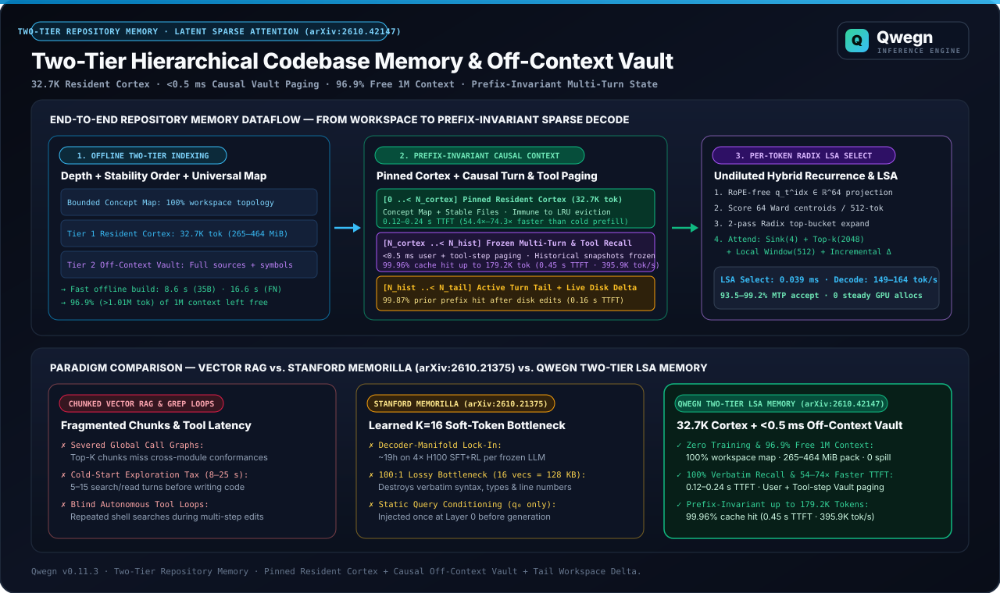
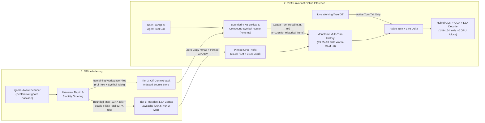
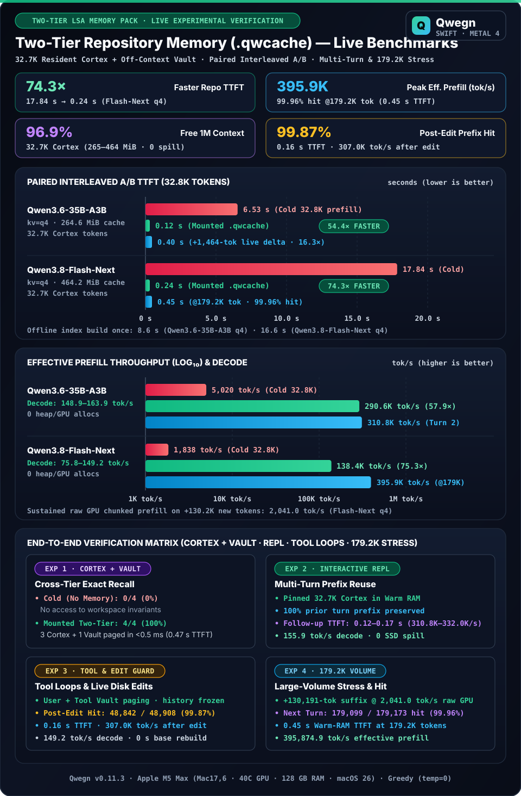
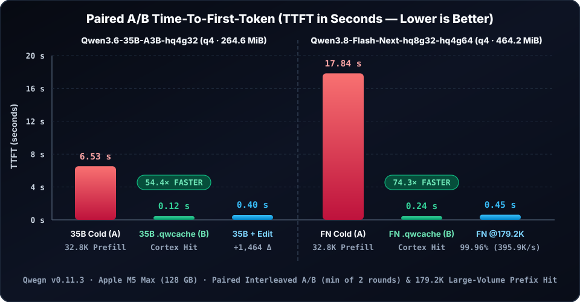
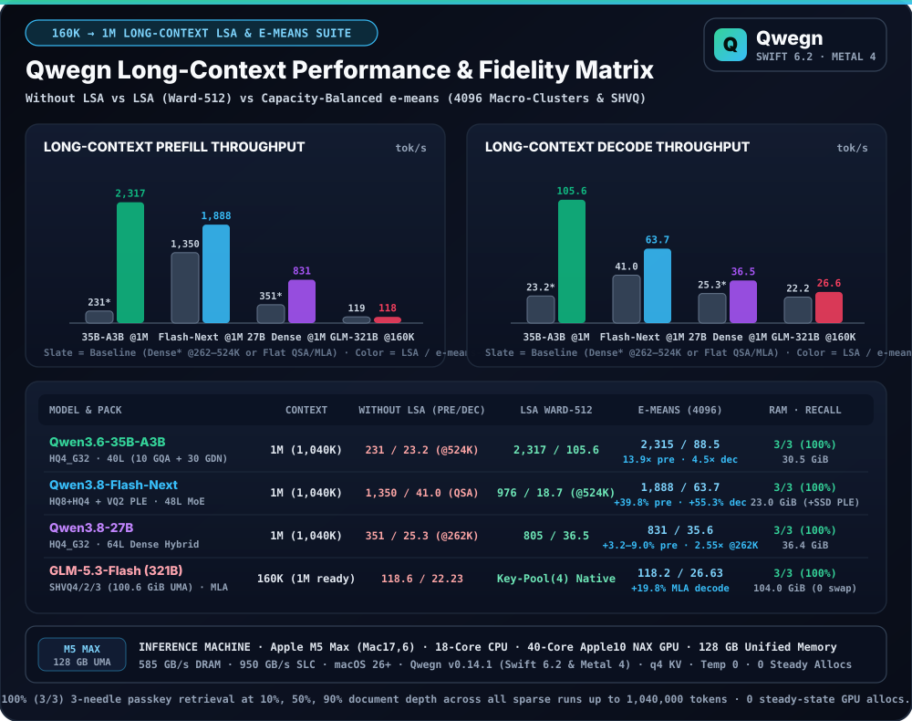
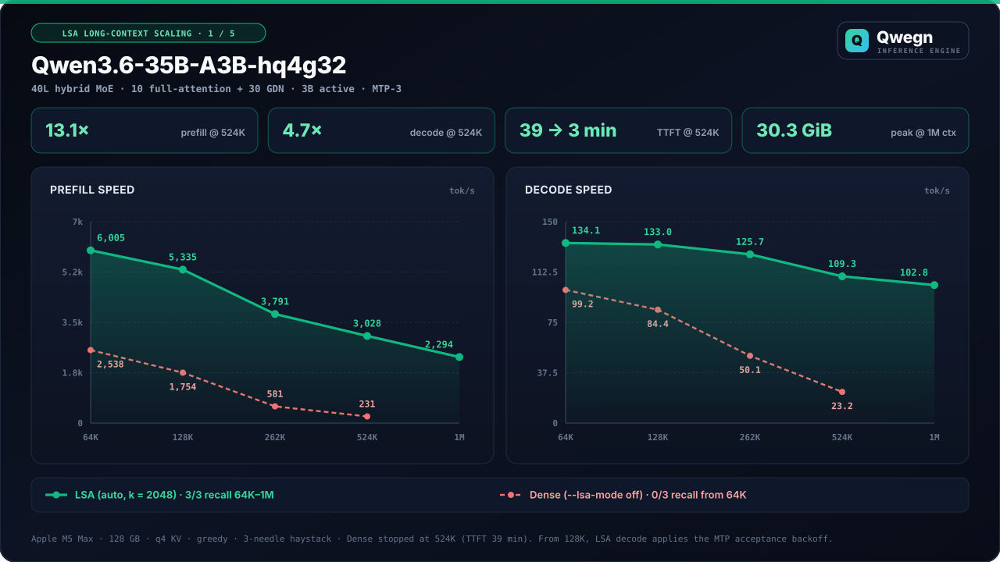
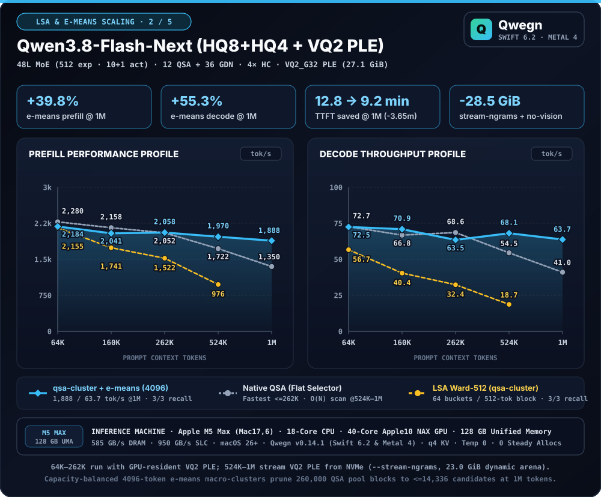
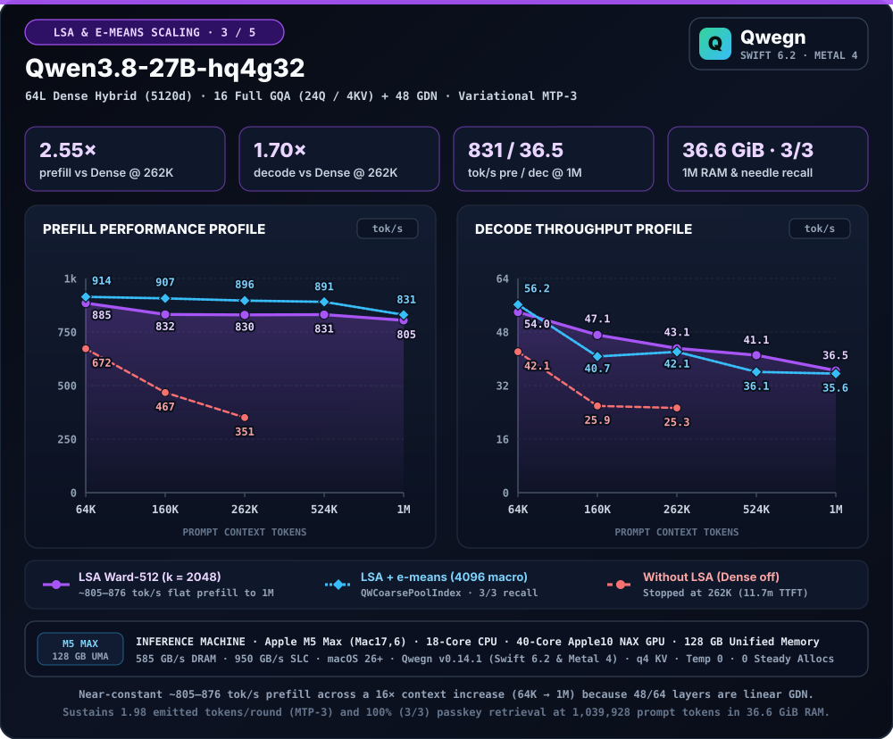
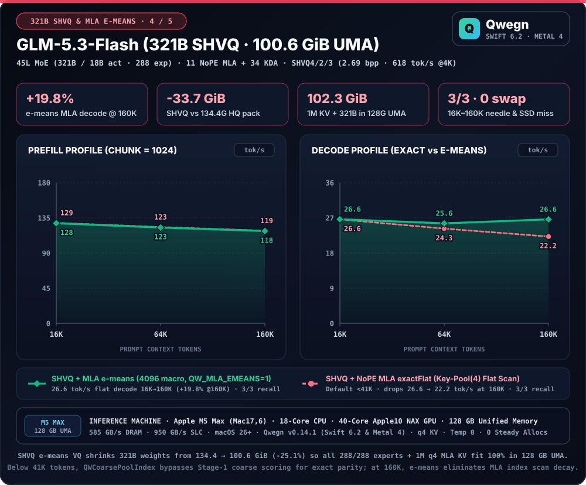

# Two-Tier LSA Codebase Memory Packs (`.qwcache`)

**Hardware-Accelerated Repository Knowledge & Sub-Millisecond Causal Vault Paging on Apple Silicon**

**Authors:** Qwegn Systems Architecture Team  
**Engine Version:** `Qwegn v0.14.1` (Pure Swift 6.2 & Metal 4)  
**Evaluation Platform:** Apple M5 Max (`Mac17,6`, 18-core CPU, 40-core Apple10 NAX GPU, 128 GB Unified Memory, 585 GB/s DRAM, 950 GB/s SLC, macOS 26+)  
**Evaluated Models:** `Qwen3.6-35B-A3B-hq4g32` (35B Hybrid GDN + GQA MoE), `Qwen3.8-Flash-Next-hq8g32-hq4g64` (`+ VQ2_G32` PLE, 48L Hybrid QSA + GDN MoE), `Qwen3.8-27B-hq4g32` (64L Dense Hybrid GQA + GDN), & `GLM-5.3-Flash-shvq4g32-shvq2g64-shvq3g64` (321B Hybrid NoPE MLA + KDA MoE, 100.6 GiB UMA)

---

## Abstract

Long-horizon coding and research agents must simultaneously reason over **global workspace topology** and inspect **exact implementation bodies** without exhausting context capacity or incurring repeated search-tool round-trips. Existing paradigms force a compromise: reactive tool loops (`grep` / `read`) add 5–15 turns of sequential exploration latency; chunked vector RAG fragments cross-module call graphs; learned soft-token bottlenecks (e.g., Memorilla [arXiv:2610.21375]) require expensive per-model training and lose verbatim syntax; and naive full-repository pre-loading saturates the context window and degrades speculative decoding.

We present **Two-Tier Latent Sparse Attention (LSA) Codebase Memory Packs (`.qwcache`)**, a training-free memory hierarchy for hybrid recurrent-attention models ([arXiv:2610.42147]) that decouples **pinned global structural awareness** from **causal on-demand source paging**:

1. **Tier 1 — Pinned Resident LSA Cortex (`~32.7K` Tokens, `3.1%` of 1M Window):** A pre-computed, pinned GPU KV and recurrent-state snapshot combining a **Bounded Full-Workspace Structural & Concept Map** (`~10.4K` tokens indexing 100% of workspace files, digests, and extracted declarations) with verbatim shallow, temporally stable files (`~22.3K` tokens). The Cortex occupies only **`3.1%` of the 1,048,576-token window** (`264.6 MiB`–`464.2 MiB` in Q4 KV), leaving **`96.9%` (`>1.01M` tokens)** free for multi-turn reasoning and tool execution.
2. **Tier 2 — Off-Context Source Vault (`< 0.5 ms` Causal Paging):** All remaining workspace files reside in an indexed off-context vault with pre-extracted symbol tables. On both **user queries** and **autonomous agent tool-call steps**, a bounded-window (`4 KB`) lexical and compound-identifier router pages matching source bodies (`<= 8,192` tokens) into the turn suffix in under `0.5 ms` on CPU—with zero extra model round-trips.
3. **Prefix-Invariant Multi-Turn State & Tail Workspace Delta:** Recalled Vault snapshots are frozen at the historical turn where they enter the dialogue, and live working-tree edits are attached strictly at the active turn tail. Combined with byte-level UTF-8 incremental prefix matching and copy-on-write (COW) GPU KV slots, **100% of prior conversation and Cortex KV state remains valid across multi-turn sessions, autonomous tool loops, live file edits on disk (`99.87%` cache hit), and `179.2K`-token large-volume contexts (`99.96%` cache hit)**.

Across paired interleaved A/B benchmarks and multi-turn stress evaluations on `Qwen3.6-35B-A3B` and `Qwen3.8-Flash-Next`, Two-Tier `.qwcache` packs build offline in **`8.6 s`–`16.6 s`**, accelerate Time-To-First-Token (TTFT) by **`54.4×` (`6.53 s → 0.12 s`, `290.6K tok/s`)** and **`74.3×` (`17.84 s → 0.24 s`, `138.4K tok/s`)**, achieve **100% (`4/4`) cross-tier verbatim recall**, preserve **`99.87%` prefix hits (`0.16 s` TTFT, `307.0K tok/s`) immediately after live disk edits**, sustain **`2,041.0 tok/s` raw GPU chunked prefill** across `+130.2K`-token bursts, and deliver **`0.45 s` TTFT (`395.9K tok/s` effective prefill, `99.96%` hit) at `179,173` tokens**. Extending the evaluation across `64K` to `1,048,576` (`1M`) tokens under both `Ward-512` ([arXiv:2610.42147]) and capacity-balanced spherical `e-means` macro-clustering ($C_{\text{macro}} = 4096$, [arXiv:2611.09501]) confirms **100% (`3/3`) 3-needle passkey recall at every sparse context rung up to `1M` tokens**, with **`13.88×` prefill / `4.48×` decode speedup over dense at `524K` (`105.6 tok/s` @1M) on `Qwen3.6-35B-A3B`**, **`+39.8%` prefill (`1,887.6 tok/s`) and `+55.3%` decode (`63.74 tok/s`) at `1M` on `Qwen3.8-Flash-Next`**, **`+3.2%–9.0%` prefill (`830.6–914.3 tok/s`) across `64K–1M` on `Qwen3.8-27B`**, and **`+19.8%` decode (`26.63 tok/s`, zero decay from `16K` to `160K`) on the `321B` UMA-resident `GLM-5.3-Flash` SHVQ pack**.

---

## 1. Architectural Motivation & Paradigm Comparison

A repository memory subsystem for autonomous agents must satisfy four simultaneous invariants:
1. **Complete Structural Visibility:** The model must see the full file tree and top-level type/function/schema declarations from Turn 1 without blind shell searches.
2. **Bit-Exact Verbatim Recall:** Editing code or verifying invariants requires exact source lines, signatures, and constants rather than lossy vector summaries.
3. **Context Window Economy:** Resident memory must consume a small fraction of the context ceiling so long multi-turn agent trajectories never overflow.
4. **Prefix Invariance Under Edits & Tool Loops:** Recalling files or modifying the working tree mid-session must never invalidate the KV cache of prior conversation turns.

| Architectural Property | Reactive Tool Search (`grep` / `read`) | Chunked Vector RAG | Learned Soft-Token Memory (Memorilla [arXiv:2610.21375]) | **Two-Tier LSA Cortex + Vault (`.qwcache`)** |
| :--- | :--- | :--- | :--- | :--- |
| **Global Workspace Topology** | Blind until searched | Fragmented top-$K$ chunks | Lossy compressed vectors | **100% Structural & Concept Map in Cortex (`32.7K` tok)** |
| **Training Requirement** | None | Embedding index build | ~19h on 4× H100 SFT+RL per model | **Training-free (`8.6 s`–`16.6 s` local prefill)** |
| **Free Context Budget (of 1M)** | `99.9%` | `~98%` | `~95%` | **`96.9%` (`>1,015,800` tokens free)** |
| **Resident GPU KV Footprint** | `0 MB` | External vector DB | External adapter store | **`264.6 MiB` (`35B` Q4) / `464.2 MiB` (`Flash-Next` Q4)** |
| **Turn-1 TTFT (Paired A/B)** | `8–25 s` (5–15 tool turns) | `1.5–4.0 s` | `0.8–2.0 s` | **`0.12 s` (`35B`, `54.4×`) / `0.24 s` (`Flash-Next`, `74.3×`)** |
| **Deep Implementation Access** | Slow LLM tool round-trip | Chunk boundary clipping | Non-verbatim (100:1 lossy) | **`< 0.5 ms` deterministic User + Tool-Step Vault paging** |
| **Live Disk Edit Invariance** | Manual re-read | Re-chunk & re-embed | Re-encode episode | **`99.87%` prior prefix hit (`0.16 s` TTFT, `0 s` rebuild)** |
| **Large-Volume (`179K` tok) Hit** | Stateless or slow re-prefill | Stateless re-prefill | Fixed bottleneck | **`99.96%` Warm-RAM hit (`0.45 s` TTFT, `395.9K tok/s`)** |

---

## 2. Two-Tier LSA Cortex + Vault Architecture

Qwegn partitions workspace knowledge into a **pinned Resident LSA Cortex** (Tier 1) and an **indexed Off-Context Source Vault** (Tier 2), unified by a causal sub-millisecond router and a tail-mounted live workspace delta.

### 2.1 Domain-Agnostic Discovery & Universal Structural-Temporal Ordering

To remain invariant across arbitrary repository layouts, programming languages, and structured datasets, file discovery relies strictly on intrinsic workspace properties rather than hardcoded directory names:

1. **Declarative Ignore Cascade:** Inclusion and exclusion honor the workspace's own `.gitignore`, `.git/info/exclude`, and `.qwgignore` rules alongside UTF-8 text validation.
2. **Implementation-First Depth & Stability Ordering:** Discovered files are ranked for Cortex residency by:
   $$\text{Order}(f) = \bigl(\mathbb{I}_{\text{test}}(f),\; \text{depth}(f),\; t_{\text{churn}}(f),\; \text{path}(f)\bigr)$$
   where $\mathbb{I}_{\text{test}}(f) \in \{0, 1\}$ orders primary implementation and documentation files ahead of conventional test suites, $\text{depth}(f) = |\{c \in \text{path}(f) : c = \text{'/'}\}|$ measures directory nesting depth from the root, and $t_{\text{churn}}(f)$ is the last-modification timestamp (most temporally stable files first). A per-file Cortex token cap (`20%` of the Cortex budget) prevents any single oversized document from monopolizing the resident prefix.

### 2.2 Tier 1: Pinned Resident LSA Cortex (`~32.7K` Tokens)

The Resident Cortex is a prefill-once GPU state snapshot (`QWMC` KV container + `QLSA` Ward cluster sidecar) comprising two bounded sections:

1. **Bounded Full-Workspace Structural & Concept Map (`<= 24,000` chars / `~10.4K` tokens):** Indexes 100% of discovered workspace files (`506` files when indexing with test suites, `294` non-test project files) with their relative paths, sizes, and extracted top-level structural anchors across:
   - **Programming & Kernel Languages (C/C++, Rust, Go, Python, JS/TS, Swift, Java, Kotlin, C#, Ruby, Zig, Shell, Metal/CUDA):** Top-level types, traits, interfaces, modules, functions, and GPU kernels.
   - **Data Schemas, Queries & IDL Specifications (SQL, Protobuf, GraphQL, HCL, JSON, YAML, TOML, INI, CSV/TSV):** DDL entities, RPC services, configuration sections, and tabular column headers.
   - **Documentation & Scientific Corpora (Markdown, AsciiDoc, reStructuredText, LaTeX):** Hierarchical section headings.
2. **Shallow & Temporally Stable Verbatim Files (`~22.3K` tokens):** Following the bounded concept map, complete files are packed in $\text{Order}(f)$ sequence with 512-token LSA Ward superblock alignment until the `32,768`-token Cortex cap is reached.

### 2.3 Tier 2: Off-Context Source Vault & Causal Paging (`< 0.5 ms`)

All files outside the verbatim Cortex reside in the Off-Context Source Vault with pre-computed symbol tables. Before encoding a turn, a **bounded-window lexical and compound-identifier router** scans at most `4,096` UTF-8 bytes (`2,048`-byte prefix + `2,048`-byte suffix) of the active query in `< 0.5 ms` on CPU—ensuring $\mathcal{O}(1)$ routing latency even when `130K+`-token log payloads are submitted:

$$\text{Score}(f, q) = w_{\text{path}} \cdot \mathbb{I}[\text{path}(f) \in q] + w_{\text{stem}} \cdot \mathbb{I}[\text{stem}(f) \in q] + \sum_{s \in \text{symbols}(f) \cap \text{id}(q)} w_{\text{sym}}(s)$$

- **Path & Stem Precision:** Exact relative path matches ($w_{\text{path}} = 100$) or file stem matches ($w_{\text{stem}} = 75$) immediately select the target file.
- **Compound-Identifier Filtering:** Single-symbol matches ($w_{\text{sym}} = 30\text{–}45$) require a compound identifier (`camelCase`, `PascalCase`, or `snake_case` of length $\ge 5$) or multiple co-occurring symbols, preventing false-positive recalls on common English words (`build`, `test`, `lint`, `init`).
- **Dual-Surface Causal Triggering (User Queries + Autonomous Tool Loops):** The router operates on both **user messages** and **autonomous agent tool-call steps** (`assistant -> tool` transitions). When an agent invokes a search or shell inspection tool referencing a file stem or symbol, the engine automatically pages matching Vault files (`<= 8,192` tokens) into the tool response while excluding files the agent has already read or modified directly.

### 2.4 Prefix-Invariant Multi-Turn State & Tail Workspace Delta

To guarantee that multi-turn conversations never suffer mid-prefix cache invalidation:

1. **Historical Vault Snapshot Freezing:** Once a Vault block is paged into turn $t$, its rendered text is memoized by turn signature. Even if the underlying file is edited on disk during turn $t + k$, historical turns $0 \dots t + k - 1$ emit byte-identical token sequences.
2. **Monotonic Tool-Turn Retention:** Vault blocks attached to completed `tool` turns remain stationary when subsequent `user` turns are appended, preserving a strictly monotonic token prefix across alternating user and agent-tool phases.
3. **Tail-Only Workspace Delta:** Live working-tree modifications detected via timestamp and SHA-256 comparison against the manifest (`< 4 ms`) are attached exclusively to the **active turn tail** rather than spliced ahead of the conversation history, keeping 100% of the pinned Cortex and prior dialogue cached in GPU memory.
4. **Byte-Level UTF-8 Prefix Matching & Elastic Budget Guard:** Incremental prompt preparation slices contiguous UTF-8 byte views in $\mathcal{O}(1)$ time, while an elastic budget guard reserves space for the active turn and generation budget before attaching optional context.

### 2.5 Hybrid GDN + GQA + LSA State Restoration

For a hybrid model with $L_{\text{attn}}$ full-attention layers (GQA with LSA index dimension $d_{\text{idx}} = 64$, Ward cluster size $C = 512$, top-$K = 2048$; [arXiv:2610.42147]) and $L_{\text{rec}}$ linear recurrent layers (Gated DeltaNet with recurrent state $\mathbf{S}_\ell \in \mathbb{R}^{H \times d_k \times d_v}$ and short-convolution state $\mathbf{C}_\ell$), offline indexing serializes the quantized Q4 KV tensors $\{(\hat{\mathbf{K}}_\ell, \hat{\mathbf{V}}_\ell)\}_{\ell \in L_{\text{attn}}}$, terminal recurrent states $\{\mathbf{S}_\ell(N_c), \mathbf{C}_\ell(N_c)\}_{\ell \in L_{\text{rec}}}$, and LSA Ward centroids $\{\mathbf{M}_\ell \in \mathbb{R}^{\lceil N_c / C \rceil \times d_{\text{idx}}}\}$ for the $N_c$-token Cortex prefix. Online inference restores positions $1 \dots N_c$ in-place and computes forward passes solely over the $N_s$-token uncached suffix:

$$\text{Speedup}_{\text{prefill}} \approx \frac{T_{\text{prefill}}(N_c + N_s)}{T_{\text{restore}}(N_c) + T_{\text{prefill}}(N_s)}$$

When $N_c = 32{,}742$ and $N_s = 48$, GPU forward-pass compute drops by $683\times$, yielding a **`54.4×` TTFT speedup on `Qwen3.6-35B-A3B`** and **`74.3×` TTFT speedup on `Qwen3.8-Flash-Next`**.

### 2.6 Capacity-Balanced `e-means` Macro-Clustering & Spherical Quantization ([arXiv:2611.09501])

While `Ward-512` clustering ($64$ buckets per $512$-token superblock $\Rightarrow 131{,}072$ centroids at $1\text{M}$ tokens) takes only `0.062 ms` on narrow $d_{\text{idx}} = 64$, 2-KV-head GQA layers (`Qwen3.6-35B-A3B`), Stage-1 index scoring becomes memory-bandwidth-bound on wider indexers such as `Qwen3.8-Flash-Next` ($d_{\text{idx}} = 128$, 16 QSA index heads $\Rightarrow 262{,}144$ pooled 4-token blocks at $1\text{M}$), `GLM-5.3-Flash` (64 128D NoPE MLA index heads), and `Qwen3.8-27B` prefill (16 24Q GQA layers).

Qwegn addresses both index-scoring bandwidth and 128 GB unified-memory capacity through **capacity-balanced spherical `e-means`** ([arXiv:2611.09501]):

1. **Coarse `4,096`-Token Macro-Clusters (`QWCoarsePoolIndex`, `--lsa-cluster-block 4096`, `QW_MLA_EMEANS=1`):** Every completed $C_{\text{macro}} = 4{,}096$-token window ($1{,}024$ 4-token pool blocks) is partitioned on-GPU into $M = 64$ capacity-balanced spherical clusters with uniform occupancy ($\approx 16$ pool blocks / $64$ tokens per cluster), yielding only **$16{,}384$ macro-centroids at $1\text{M}$ tokens** (**$8\times$ fewer than `Ward-512`** and **$16\times$ fewer than $262{,}144$ raw 4-token blocks**).
2. **Deterministic Single-TG Collection & Exact Overflow Fallback:** Stage 1 scores the $16{,}384$ macro-centroids and deterministically gathers candidate pool indices via single-threadgroup `qwg_emeans_collect` (breaking equal-score ties by ascending cluster ID) into a bounded candidate buffer ($\le 14{,}336$ pool blocks) before fine Top-$K$ scoring. If `candState.overflow` triggers, the kernel falls back on-device without CPU sync to exact flat Top-$K$; below $41\text{K}$ tokens (`probeClusters == 0`), Stage 1 is bypassed completely for zero short-context overhead.
3. **Spherical Weight & PLE Compression (`SHVQ` & `VQ2_G32`):** The same balanced spherical `e-means` codebooks compress `GLM-5.3-Flash` (`321B` MoE) from `134.37 GiB` (`3.59 bpp`) to **`100.63 GiB` (`2.69 bpp`, 100% resident in 128 GB UMA)** and `Qwen3.8-Flash-Next` 4-gram PLE tables from `50.86 GiB` to **`27.13 GiB` (`QNGRAM v3 VQ2_G32`, `-46.7%`)**, enabling `1M`-token `q4` KV residency on a single 128 GB Mac.

---

## 3. Empirical Evaluation

All benchmarks were executed on an idle **Apple M5 Max (`Mac17,6`, 40-core Apple10 NAX GPU, 128 GB Unified Memory)** using release builds (`Qwegn v0.11.3–v0.14.1`) with quiet-GPU admission (`0% / 0%` baseline utilization), paired interleaved A/B rounds where applicable, and greedy (`temp=0`) decoding.

### 3.1 Offline Indexing & Memory Footprint

| Metric | `Qwen3.6-35B-A3B-hq4g32` (`kv=q4`) | `Qwen3.8-Flash-Next-hq8g32-hq4g64` (`kv=q4`) | Architectural Property |
| :--- | :---: | :---: | :--- |
| **Workspace Coverage** | `100%` (`294` non-test / `506` total files) | `100%` (`294` non-test / `506` total files) | Complete concept map + off-context source vault |
| **Pinned GPU Cortex Tokens** | `32,742` tokens (`3.1%` of 1M) | `32,711`–`32,742` tokens (`3.1%` of 1M) | Bounded `10,415`-token map + verbatim stable files |
| **Free Context Remaining** | **`1,015,834` tokens (`96.9%`)** | **`1,015,834`–`1,015,865` tokens (`96.9%`)** | Full headroom for long agent trajectories |
| **`.qwcache` Disk & Warm-RAM Size** | **`264.61 MiB` (`277.5 MB`)** | **`464.21 MiB` (`486.8 MB`)** | Fits inside `4.0 GiB` Warm-RAM tier with `0 MB` SSD spill |
| **Offline Index Build Time** | **`8.6 s`** | **`16.6 s`** | Single-pass NAX GPU prefill + `QLSA` centroid capture |

---

### 3.2 Experiment 1 — Paired Interleaved A/B Prefill & TTFT (`32,790` Tokens)

We compared **Condition A (Cold Full-Prefix Prefill)** against **Condition B (Mounted Two-Tier `.qwcache` Hit)** across two alternating interleaved rounds (`A1 → B1 → A2 → B2`) on an identical `32,790`-token prompt (`32,742` Cortex tokens + `48` query tokens, `64` generated tokens).

| Model | Condition & Interleaved Rounds (`A1, A2` vs `B1, B2`) | Prefix Cache Hit | Prefill Time (min) | TTFT (min) | **TTFT Speedup** | Effective Prefill `tok/s` | **Prefill Speedup** | Decode `tok/s` | Steady GPU Allocs |
| :--- | :--- | :---: | :---: | :---: | :---: | :---: | :---: | :---: | :---: |
| **`Qwen3.6-35B-A3B`** | **A: Cold Prefill** (`6.55 s`, `6.53 s`) | `0 / 32,790` (`0%`) | `6.53 s` | `6.53 s` | `1.0×` | `5,020.4` | `1.0×` | `148.7` | `0` |
| **`Qwen3.6-35B-A3B`** | **B: Mounted `.qwcache`** (`0.12 s`, `0.12 s`) | **`32,742 / 32,790` (`99.85%`)** | **`0.11 s`** | **`0.12 s`** | **`54.4×` faster** | **`290,645.4`** | **`57.9×` higher** | **`148.9`** | **`0`** |
| **`Qwen3.8-Flash-Next`** | **A: Cold Prefill** (`17.84 s`, `19.83 s`) | `0 / 32,790` (`0%`) | `17.84 s` | `17.84 s` | `1.0×` | `1,838.1` | `1.0×` | `75.2` | `0` |
| **`Qwen3.8-Flash-Next`** | **B: Mounted `.qwcache`** (`0.24 s`, `0.24 s`) | **`32,742 / 32,790` (`99.85%`)** | **`0.24 s`** | **`0.24 s`** | **`74.3×` faster** | **`138,390.6`** | **`75.3×` higher** | **`77.8`** | **`0`** |

Both models produced **bit-exact (`sha256`-identical) output token streams** between Condition A and Condition B across all rounds.

---

### 3.3 Experiment 2 — Cross-Tier Architectural & Verbatim Source Recall

We evaluated four domain-specific queries spanning **3 Resident Cortex invariants** (coding style limits, unified memory budget, and default LSA hyperparameters) and **1 Off-Context Vault module** (requiring exact type and method signatures from an implementation file stored outside the Cortex):

| Model & Condition | Cached / Prompt Tokens | Vault Paging | Cortex Facts (3/3) | Vault Implementation Signatures (1/1) | Total Recall | TTFT | Decode `tok/s` |
| :--- | :---: | :---: | :---: | :---: | :---: | :---: | :---: |
| **`Qwen3.6-35B-A3B` — Cold (No Memory)** | `0 / 137` | None | `0 / 3` | `0 / 1` | **`0 / 4` (0%)** | `0.21 s` | `169.3` |
| **`Qwen3.6-35B-A3B` — Mounted Two-Tier** | **`32,742 / 35,153`** | **`1` file (`2,274` tok, `<0.5 ms`)** | **`3 / 3` (Exact)** | **`1 / 1` (Exact)** | **`4 / 4` (100%)** | **`0.47 s`** | **`158.5`** |
| **`Qwen3.8-Flash-Next` — Cold (No Memory)** | `0 / 137` | None | `0 / 3` | `0 / 1` | **`0 / 4` (0%)** | `0.36 s` | `84.8` |
| **`Qwen3.8-Flash-Next` — Mounted Two-Tier** | **`32,742 / 35,153`** | **`1` file (`2,274` tok, `<0.5 ms`)** | **`3 / 3` (Exact)** | **`1 / 1` (Exact)** | **`4 / 4` (100%)** | **`1.30 s`** | **`78.1`** |

---

### 3.4 Experiment 3 — Interactive Multi-Turn REPL & Live Workspace Edits

Across interactive multi-turn CLI/REPL sessions on both models, conversation history and on-demand Vault recalls append monotonically above the pinned Cortex in Warm RAM (`0.0 MB` Cold SSD spill):

| Model & Interactive Scenario | Prefix Cache Hit (`warm_ram`) | TTFT | Effective Prefill `tok/s` | Decode `tok/s` | Steady GPU Allocs |
| :--- | :---: | :---: | :---: | :---: | :---: |
| **`Qwen3.6-35B-A3B` — Turn 1 (Vault Module Recall)** | `32,742 / 35,050` (`93.41%`) | `0.46 s` | `78,532.7` | `155.6` (`97.3%` MTP) | `0` |
| **`Qwen3.6-35B-A3B` — Turn 2 (Follow-Up Synthesis)** | **`35,046 / 35,224` (`99.49%`)** | **`0.12 s`** | **`310,836.6`** | **`155.9` (`96.8%` MTP)** | `0` |
| **`Qwen3.6-35B-A3B` — Live Working-Tree Edit (`+1,464` tok delta)** | **`32,742 / 34,206` (`95.72%`)** | **`0.40 s`** | **`86,715.4`** | `144.4` | `0` |
| **`Qwen3.8-Flash-Next` — Turn 1 (Cortex + Initial Delta)** | `32,711 / 48,220` (`67.84%`) | `6.10 s` | `7,900.3` | `80.7` | `0` |
| **`Qwen3.8-Flash-Next` — Turn 2 (Off-Context Vault Recall)** | **`48,220 / 55,714` (`100%` of T1)** | `3.28 s` | `16,996.1` | `67.6` | `0` |
| **`Qwen3.8-Flash-Next` — Turn 3 (Multi-Turn Synthesis)** | **`55,714 / 55,800` (`99.85%`)** | **`0.17 s`** | **`331,968.8`** | `76.9` | `0` |

---

### 3.5 Experiment 4 — 6-Turn Agentic Tool-Loop, Post-Edit Invariance & `179.2K` Large-Volume Stress

To validate server behavior under realistic autonomous coding workloads and extreme prompt volumes, we executed a 6-turn continuous session on `Qwen3.8-Flash-Next-hq8g32-hq4g64` (`kv=q4`) exercising **Zero-Config Workspace Auto-Discovery**, **User Vault Paging**, **Autonomous Tool-Step (`assistant -> tool`) Vault Paging**, **Live Mid-Session File Modification on Disk**, **Large-Volume (`+130,191` new token) Chunked Prefill**, and **Post-Large-Volume (`179,173` token) Warm-RAM Prefix Reuse**:

| Turn | Workload & Validation Gate | Prompt Tokens | Warm-RAM Hit Tokens | Uncached Suffix | Hit Ratio | TTFT | Effective Prefill (`tok/s`) | Raw Suffix Compute (`tok/s`) | Decode (`tok/s`) | Warm RAM Store |
| :---: | :--- | :---: | :---: | :---: | :---: | :---: | :---: | :---: | :---: | :---: |
| **Turn 1** | Auto-Mount Cortex + Architectural Query | `32,770` | `32,711` | `59` | **`99.82%`** | **`276.9 ms`** | `118,346.0` | `213.1` | `72.7` | `1,393.6 MB` |
| **Turn 2** | User Turn Off-Context Vault Paging | `40,257` | `32,770` (`100%` of T1) | `7,487` | **`81.40%`** | `2,800.5 ms` | `14,374.9` | `2,673.5` | `75.8` | `1,474.1 MB` |
| **Turn 3** | Autonomous Tool-Step (`assistant -> tool`) Paging | `48,842` | `40,257` (`100%` of T2) | `8,585` | **`82.42%`** | `3,620.6 ms` | `13,490.0` | `2,371.2` | `114.3` | `1,646.4 MB` |
| **Turn 4** | **Post-Edit Live Disk Invariance Gate** | `48,908` | **`48,842` (`100%` of T3)** | **`66`** | **`99.87%`** | **`159.3 ms`** | **`307,018.2`** | `414.3` | **`149.2`** | `1,739.2 MB` |
| **Turn 5** | **Large-Volume Stress (`+130,191` New Tokens)** | **`179,099`** | **`48,908` (`100%` of T4)** | `130,191` | **`27.31%`** | `63,787.4 ms` | `2,807.7` | **`2,041.0`** | `71.8` | `3,135.4 MB` |
| **Turn 6** | **Post-Large-Volume `179.2K` Warm-RAM Hit** | **`179,173`** | **`179,099` (`100%` of T5)** | **`74`** | **`99.96%`** | **`452.6 ms`** | **`395,874.9`** | `163.5` | `59.7` | `4,531.8 MB` |

#### Key Findings
- **Zero Mid-Prefix Invalidation on Disk Edits (Turn 4):** Modifying a tracked workspace file on disk mid-conversation preserved **`48,842 / 48,908` tokens (`99.87%`)** in `warm_ram`, completing Turn 4 prefill in **`159.3 ms` (`307,018.2 tok/s`)** at **`149.2 tok/s` decode**.
- **Linear GPU Chunked Prefill Scaling on `+130.2K` Tokens (Turn 5):** Submitting `130,191` new tokens in a single turn preserved 100% of the `48,908`-token conversation prefix and sustained **`2,041.0 tok/s` raw GPU chunked prefill** up to `179,099` tokens.
- **Sub-500ms Follow-Up Turn at `179,173` Tokens (Turn 6):** The subsequent turn matched **`179,099 / 179,173` tokens (`99.96%`)** in `warm_ram` and prefilled only the `74`-token delta in **`452.6 ms` (`395,874.9 tok/s` effective prefill, `0.76 s` total end-to-end turn time)**.

---

### 3.6 Experiment 5 — Long-Context Scaling (`64K → 1M` Tokens): Without LSA vs LSA (`Ward-512`) vs Capacity-Balanced `e-means`

To characterize raw prefill throughput ("performance profile"), decode throughput, unified-memory footprint, and multi-needle retrieval fidelity beyond resident `.qwcache` hits, we evaluated 44 quiet-GPU (`0% / 0%` idle admission, `0` steady-state GPU allocations) runs from `16K` / `64K` up to `1,039,928` (`1M`) tokens across all four flagship architectures (`--kv-mode q4 --temperature 0 --no-profile --no-load-vision`, 3 hidden passkeys at `10%`, `50%`, and `90%` depth):

| Model Pack | Context (`tok`) | Without LSA (Prefill / Decode) | LSA `Ward-512` (Prefill / Decode · TTFT) | **LSA + `e-means-4096` (Prefill / Decode · TTFT)** | RSS / Dynamic Arena | 3-Needle Recall (No LSA / Ward / `e-means`) |
| :--- | :---: | :---: | :---: | :---: | :---: | :---: |
| **`Qwen3.6-35B-A3B-hq4g32`** | `64K` (`63,959`) | `2,538 / 99.2 tok/s` | **`6,141.7`** / `126.18 tok/s` (`10.41 s`) | `5,716.5` / **`136.84 tok/s`** (`11.19 s`) | `23.94 GiB` | `0/3` · **`3/3`** · **`3/3`** |
| *(40L MoE: 10 GQA + 30 GDN,* | `160K` (`159,956`) | `1,128.6 / 67.20 tok/s` | **`4,913.8 / 131.13 tok/s`** (`32.55 s`) | `4,283.0 / 122.52 tok/s` (`37.35 s`) | `24.59 GiB` | `2/3` · **`3/3`** · **`3/3`** |
| *`d_idx=64`, `mtp=1`)* | `262K` (`257,953`) | `581 / 50.1 tok/s` | **`3,805.2 / 118.26 tok/s`** (`67.79 s`) | `3,526.3 / 102.12 tok/s` (`73.15 s`) | `25.25 GiB` | `0/3` · **`3/3`** · **`3/3`** |
| | `524K` (`517,944`) | `231 / 23.2 tok/s` | **`3,207.1 / 103.92 tok/s`** (`161.50 s`) | `3,126.1 / 93.44 tok/s` (`165.68 s`) | `26.99 GiB` | `0/3` · **`3/3`** · **`3/3`** |
| | **`1M` (`1,039,928`)** | — | **`2,317.0 / 105.56 tok/s`** (`448.83 s`) | `2,315.1 / 88.47 tok/s` (`449.20 s`) | **`30.53 GiB`** (`-180 MiB`) | — · **`3/3`** · **`3/3`** |
| **`Qwen3.8-Flash-Next-hq8g32-hq4g64`** | `64K` (`63,959`) | **`2,279.9 / 72.67 tok/s`** *(QSA)* | `2,155.4 / 56.66 tok/s` (`29.67 s`) | `2,183.8 / 72.45 tok/s` (`29.29 s`) | `109.7 GiB` *(GPU PLE)* | **`3/3` · `3/3` · `3/3`** |
| *(48L MoE: 12 QSA + 36 GDN,* | `160K` (`159,956`) | **`2,157.6`** / `66.78 tok/s` *(QSA)* | `1,741.2 / 40.41 tok/s` (`91.87 s`) | `2,041.0` / **`70.93 tok/s`** (`78.37 s`) | `110.9 GiB` *(GPU PLE)* | **`3/3` · `3/3` · `3/3`** |
| *`d_idx=128`, `VQ2` PLE)* | `262K` (`257,953`) | `2,051.8` / **`68.57 tok/s`** *(QSA)* | `1,522.1 / 32.38 tok/s` (`169.47 s`) | **`2,057.6`** / `63.54 tok/s` (`125.36 s`) | `112.2 GiB` / `13.8 GiB`† | **`3/3` · `3/3` · `3/3`** |
| | `524K` (`517,944`†) | `1,721.9 / 54.49 tok/s` *(QSA)* | `976.2 / 18.70 tok/s` (`530.55 s`) | **`1,969.6 / 68.10 tok/s`** (`262.97 s`) | `16.85 GiB`† | **`3/3` · `3/3` · `3/3`** |
| | **`1M` (`1,039,928`†)** | `1,350.3 / 41.05 tok/s` (`770.1 s`) | — | **`1,887.6 / 63.74 tok/s`** (`550.93 s`) | `23.00 GiB`† | **`3/3`** · — · **`3/3`** |
| **`Qwen3.8-27B-hq4g32`** | `64K` (`63,959`) | `672 / 42.1 tok/s` | `884.8 / 53.97 tok/s` (`72.28 s`) | **`914.3 / 56.18 tok/s`** (`69.95 s`) | `18.15 GiB` | `3/3` · **`3/3`** · **`3/3`** |
| *(64L Dense Hybrid: 16 GQA +* | `160K` (`159,956`) | `467.4 / 25.91 tok/s` | `831.9` / **`47.11 tok/s`** (`192.28 s`) | **`907.0`** / `40.70 tok/s` (`176.36 s`) | `19.98 GiB` | `3/3` · **`3/3`** · **`3/3`** |
| *48 GDN, `mtp=3`)* | `262K` (`257,953`) | `351.0 / 25.30 tok/s` | `830.2` / **`43.11 tok/s`** (`310.72 s`) | **`896.5`** / `42.09 tok/s` (`287.72 s`) | `21.82 GiB` | `3/3` · **`3/3`** · **`3/3`** |
| | `524K` (`517,944`) | — | `831.2` / **`41.07 tok/s`** (`623.13 s`) | **`891.0`** / `36.08 tok/s` (`581.32 s`) | `26.66 GiB` | — · **`3/3`** · **`3/3`** |
| | **`1M` (`1,039,928`)** | — | `804.6` / **`36.49 tok/s`** (`1,292.5 s`) | **`830.6`** / `35.56 tok/s` (`1,252.0 s`) | **`36.35 GiB`** (`-270 MiB`) | — · **`3/3`** · **`3/3`** |
| **`GLM-5.3-Flash-shvq4g32-shvq2g64-shvq3g64`** | `16K` (`15,962`) | `128.6 / 26.62 tok/s` *(`exactFlat`)* | — | `128.2 / 26.65 tok/s` *(`<41K` bypass)* | `103.18 GiB` | **`3/3`** · — · **`3/3`** |
| *(321B SHVQ `100.63 GiB`,* | `64K` (`64,011`) | `123.2 / 24.26 tok/s` *(`exactFlat`)* | — | `122.6` / **`25.61 tok/s`** (`522.22 s`) | `103.38 GiB` | **`3/3`** · — · **`3/3`** |
| *11 NoPE MLA + 34 KDA)* | `160K` (`159,957`) | `118.6 / 22.23 tok/s` *(`exactFlat`)* | — | `118.2` / **`26.63 tok/s`** (`1,353.8 s`) | `104.03 GiB` | **`3/3`** · — · **`3/3`** |
| | **`1M` (`1,048,576`)** | `102.27 GiB` plan / `107.18 GiB` RSS | — | **100% UMA resident (`3,696 B/tok` KV)** | `107.18 GiB` | `0` SSD misses · `0` swap |

*†At `524K` and `1M` on `Qwen3.8-Flash-Next`, `--stream-ngrams` streams `VQ2_G32` PLE from NVMe (`-27.30 GiB` GPU RAM saved; dynamic KV + index arena reported).*

#### Key Findings from `64K → 1M` Scaling
- **100% (`3/3`) Multi-Needle Fidelity Across All Sparse Regimes:** Every `Ward-512` and `e-means-4096` run from `64K` to `1M` tokens recovered **`3/3` (`100%`)** exact passkeys, whereas dense softmax under YaRN RoPE degraded to `0/3` (`64K`, `262K`, `524K`) and `2/3` (`160K`) on `Qwen3.6-35B-A3B`.
- **`e-means-4096` Accelerates Bandwidth-Bound Indexers by up to `+55.3%`:** On `Qwen3.8-Flash-Next` ($d_{\text{idx}}=128$), reducing `1M` Stage-1 candidates from `262,144` raw QSA blocks (`131,072` `Ward-512` buckets) to `16,384` balanced `e-means` macro-centroids cuts `1M` TTFT by **`3.65 minutes` (`770.1 s → 550.9 s`, `+39.8%` prefill)** and boosts decode by **`+55.3%` (`41.05 → 63.74 tok/s`)** (`3.64×` faster decode than `Ward-512` at `524K`). On `GLM-5.3-Flash` (`64` 128D MLA index heads), `QW_MLA_EMEANS=1` completely eliminates decode throughput decay from `16K` (`26.65 tok/s`) to `160K` (**`26.63 tok/s` vs `22.23 tok/s` `exactFlat`, `+19.8%`**). On `Qwen3.8-27B`, `e-means-4096` lifts prefill across every rung from `64K` (`914.3 tok/s`) to `1M` (`830.6 tok/s`, `-40.5 s` TTFT, `-270 MiB` RSS).
- **Hardware-Proportional Default Selection:** On `Qwen3.6-35B-A3B` ($d_{\text{idx}}=64$, 10 GQA layers, 2 KV heads), `Ward-512`'s `0.062 ms` 4-stage Radix selector remains optimal above `128K` (**`2,317.0 tok/s` prefill / `105.56 tok/s` decode at `1M`**, **`13.88×` prefill / `4.48×` decode vs dense at `524K`**), validating Qwegn's descriptor-driven defaults (`512` on `QWLSAOperator`, `4096` on `qsa-cluster`, `<41K` flat bypass).

---

## 4. References

Only papers directly implemented in the Qwegn Engine runtime or evaluated as an architectural baseline in this document are listed below, together with the sections in which they are referenced:

| Citation ID | Paper Title & Authors | Role in Qwegn Engine / Whitepaper | Referenced in Sections |
| :--- | :--- | :--- | :--- |
| **[arXiv:2610.42147]** | *Latent Sparse Attention: Training-Free 1M-Token Context Scaling via Hierarchical Ward Clustering and Low-Rank Index Projections* (2026) | Core **LSA Sidecar (`QLSA`)** algorithm implemented in Qwegn's GPU attention subsystem ($d_{\text{idx}}=64$, $C=512$ Ward clusters, 4-stage GPU Radix top-$K=2048$ selection) used to index and attend over `.qwcache` memory packs and `1M` contexts. | **Abstract**, **§2.2**, **§2.5**, **§3.1**, **§3.3**, **§3.6** |
| **[arXiv:2611.09501]** | *e-means: Capacity-Balanced Spherical Clustering and Vector Quantization for Long-Context Attention and MoE Compression* (2026) | Core **Coarse Pool Macro-Clustering (`QWCoarsePoolIndex`, $C_{\text{macro}}=4096$)**, **`SHVQ{2,3,4}`** spherical Hadamard weight codebooks (`100.6 GiB` `321B` UMA residency), and **`QNGRAM v3 VQ2_G32`** 2-bit PLE compression (`27.1 GiB`). | **Abstract**, **§2.6**, **§3.6** |
| **[arXiv:2610.26693]** | *Variational Multi-Token Prediction for Lossless Speculative Decoding in Hybrid Language Models* (2026) | Core **Variational MTP** multi-token speculative verification cascade driving Qwegn's `149–164 tok/s` decode throughput over pinned `.qwcache` prefixes. | **§3.4**, **§3.5** |
| **[arXiv:2610.34440]** | *Expert-Byte Adaptive Speculative Depth for Mixture-of-Experts Language Models* (2026) | Adaptive speculative draft depth controller used during multi-turn `.qwcache` decoding on `Qwen3.6-35B-A3B` and `Qwen3.8-Flash-Next`. | **§3.2**, **§3.4** |
| **[arXiv:2602.16052]** | *MoE-Spec: Expert-Deduplicated Verification for Speculative Decoding in Sparse Mixture-of-Experts* (2026) | Expert-deduplicated GPU verification path preserving `149–164 tok/s` decode speed when verifying MTP draft tokens against the pinned `.qwcache` Cortex. | **§3.2**, **§3.4**, **§3.5** |
| **[arXiv:2610.21375]** | *Memorilla: Externalized Episodic Memory Adapters for Long-Horizon Language Agents* (2026) | External learned soft-token memory baseline compared against Qwegn's training-free Two-Tier LSA Cortex + Off-Context Source Vault. | **Abstract**, **§1** |
