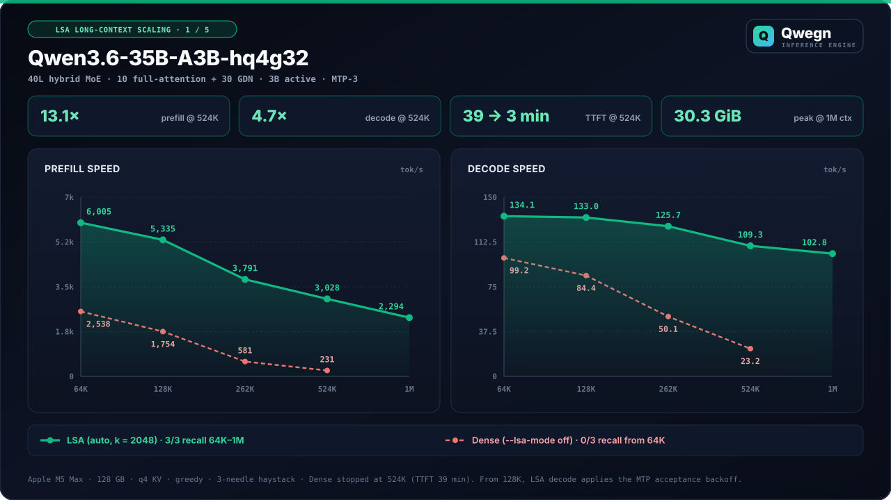
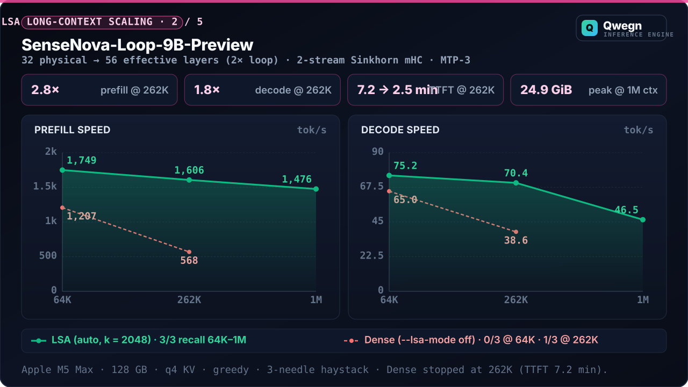
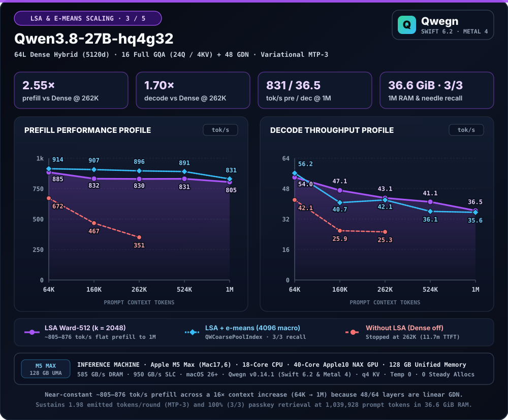
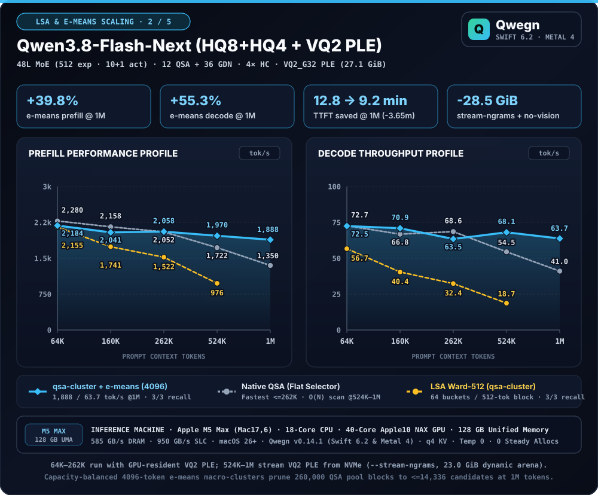
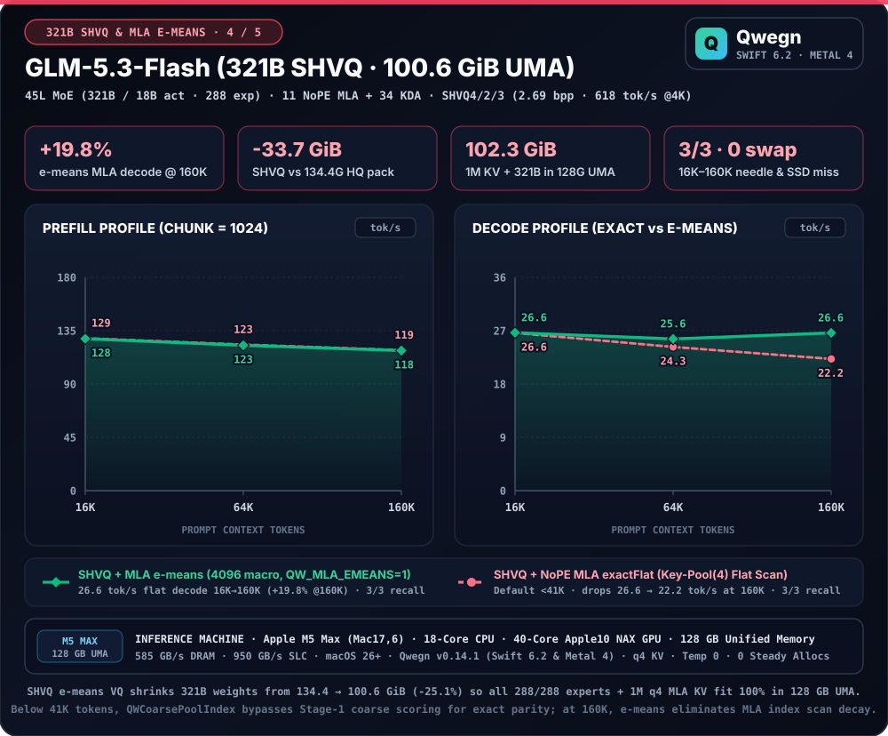
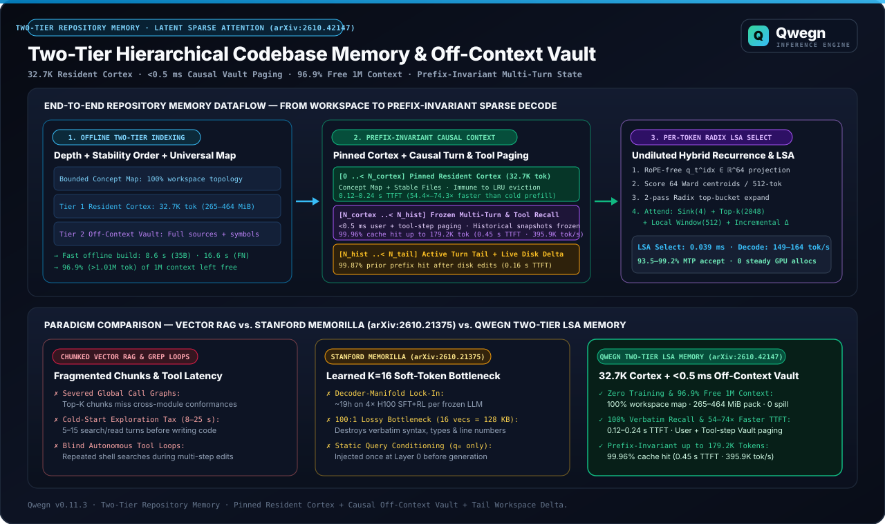
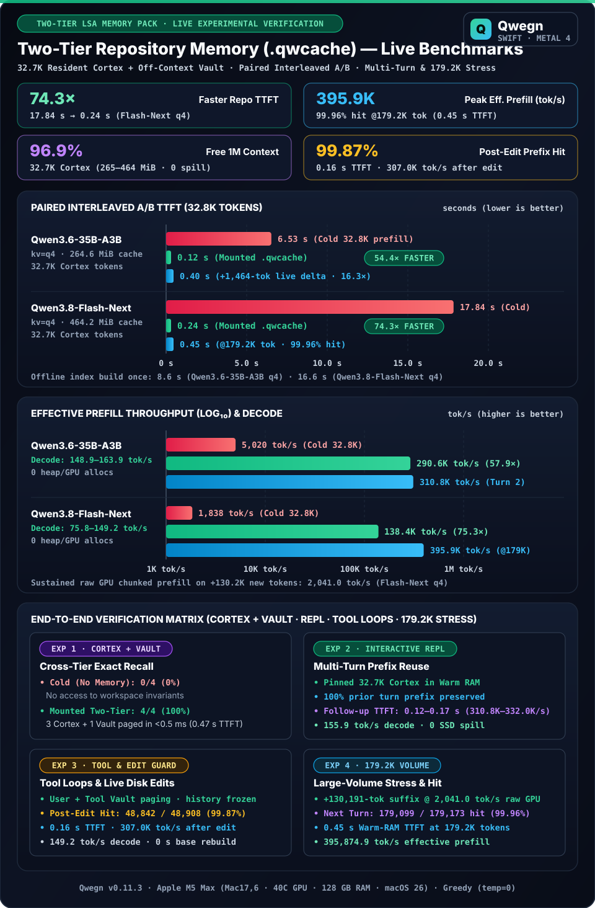

# Latent Sparse Attention (LSA), NoPE MLA & 1M Context Scaling

Qwegn implements a general, model-agnostic **Latent Sparse Attention (LSA)** subsystem (`QWLSAOperator`) that scales full-attention layers up to **1,048,576 (1M) tokens** on a single Apple Silicon Mac without model retraining, alongside native **NoPE Multi-head Latent Attention (MLA)** with trained **Key-Pool(4)** sparse indexing for `GLM-5.3-Flash`.

<p align="center">
  
</p>
<p align="center">
  
</p>
<p align="center">
  
</p>
<p align="center">
  
</p>
<p align="center">
  
</p>

## How Qwegn LSA Works

1. **Low-Rank RoPE-Free Index Projections (`qwg_lsa_index_prep`):** Projects post-RMSNorm unrotated Q/K slices (`rotaryDims..<headDim` on partial-RoPE models, or full `headDim` on standard GQA models) into a compact $d_{\text{idx}} = 64$ latent index space using either an offline `.qlsa` sidecar or zero-config in-memory **Weight-SVD** synthesized at load time from each layer's quantized `wq`/`wk` weights.
2. **4-Token Key Pooling & Dynamic Threadgroup Ward Clustering (`qwg_lsa_pool_keys` + `qwg_lsa_ward_cluster_512`):** Every 4 tokens are mean-pooled and L2-normalized. Every completed 512-token superblock (128 pooled blocks) is partitioned on-GPU into **64 variable-size semantic buckets** (hard cap $\le 16$ tokens / 4 blocks per bucket) via greedy Ward's minimum-variance hierarchical clustering (`16.5 B/token/layer` total cache footprint).
3. **4-Stage Parallel Radix Block Selector (`qwlsa_select.metal`):** Scores all Ward centroids across parallel threadgroups (`_score` $\to$ `_hist2` $\to$ `_expand` $\to$ `_finalize`), expands winning buckets, and selects the top-$k$ 4-token blocks ($k = 2048$ tokens default) while always retaining **sink block 0** (tokens `0..3`) and the **512-token local sliding window**. Decode block selection takes **0.039 ms** at 64K and **0.062 ms** at 1M (**125× faster** than single-threadgroup selection).
4. **M5 NAX Sparse Paged Prefill & Split-K Sparse Decode (`qwattn_paged_sparse.metal`):** Attends only over the selected 4-token blocks in the `f16`/`q8`/`q4` paged KV pool. Below `denseBypassThreshold` ($4 + k + 512 = 2564$ tokens), the engine automatically bypasses LSA for bit-exact dense attention.
5. **Long-Context Speculation Backoff (`QWSpeculationBackoff`):** At prompts $\ge 131\text{K}$ tokens, if rolling 8-round draft acceptance drops below `0.35`, decode automatically switches to serial mode with exponential probe cooldown (`64 → 512` tokens), avoiding wasted multi-row verify passes.

## Measured Dense vs LSA Scaling (64K → 1M Tokens, 3-Needle Haystack)

All runs measured on Apple M5 Max (128 GB, `--kv-mode q4 --temperature 0`, 3 hidden passkeys at 10%, 50%, and 90% document depth):

| Model | Context | Mode | Prefill Speed | TTFT | Decode Speed | Needle Recall | Speedup vs Dense |
| :--- | :---: | :---: | :---: | :---: | :---: | :---: | :--- |
| **`Qwen3.6-35B-A3B-hq4g32`** | 64K | **LSA (`auto`)** / Dense (`off`) | **6,005** / 2,538 tok/s | **10.7 s** / 25.2 s | **134.1** / 99.2 tok/s | **3/3** vs 0/3 | **2.37× prefill · 1.35× decode** |
| | 128K | **LSA (`auto`)** / Dense (`off`) | **5,335** / 1,754 tok/s | **22.6 s** / 68.8 s | **133.0** / 84.4 tok/s | **3/3** vs 0/3 | **3.04× prefill · 1.58× decode** |
| | 262K | **LSA (`auto`)** / Dense (`off`) | **3,791** / 581 tok/s | **64.8 s** / 422.7 s | **125.7** / 50.1 tok/s | **3/3** vs 0/3 | **6.53× prefill · 2.51× decode** |
| | 524K | **LSA (`auto`)** / Dense (`off`) | **3,028** / 231 tok/s | **179.9 s** / 2362 s | **109.3** / 23.2 tok/s | **3/3** vs 0/3 | **13.1× prefill · 4.71× decode** |
| | **1M** | **LSA (`auto`)`** | **2,294 tok/s** | **452.2 s** | **102.8 tok/s** | **3/3 (100%)** | RSS: 30.25 GiB · 0 allocs |
| **`SenseNova-Loop-9B-Preview`** | 64K | **LSA (`auto`)** / Dense (`off`) | **1,749** / 1,207 tok/s | **36.6 s** / 53.1 s | **75.2** / 65.0 tok/s | **3/3** vs 0/3 | **1.45× prefill · 1.16× decode** |
| *(32→56L 2× Loop + mHC)* | 262K | **LSA (`auto`)** / Dense (`off`) | **1,606** / 568 tok/s | **152.8 s** / 432.5 s | **70.4** / 38.6 tok/s | **3/3** vs 1/3 | **2.83× prefill · 1.82× decode** |
| | **1M** | **LSA (`auto`)** | **1,476 tok/s** | **702.9 s** | **46.5 tok/s** | **3/3 (100%)** | RSS: 24.93 GiB · 0 allocs |
| **`Qwen3.8-27B-hq4g32`** | 64K | **LSA (`auto`)** / Dense (`off`) | **876** / 672 tok/s | **73.1 s** / 95.3 s | **50.7** / 42.1 tok/s | **3/3** / 3/3 | **1.30× prefill · 1.20× decode** |
| *(64L Dense Hybrid)* | 262K | **LSA (`auto`)** / Dense (`off`) | **858** / 351 tok/s | **286.1 s** / 699.5 s | **49.0** / 25.3 tok/s | **3/3** / 3/3 | **2.45× prefill · 1.93× decode** |
| | **1M** | **LSA (`auto`)** | **805 tok/s** | **1288.5 s** | **43.1 tok/s** | **3/3 (100%)** | RSS: 38.36 GiB · 95.5% MTP |
| **`Qwen3.8-Flash-Next-hq8g32-hq4g64`** | 64K | **Native QSA (`auto`)** / `qsa-cluster` | **2,542** / 2,280 tok/s | **25.2 s** / 28.1 s | **81.7** / 63.0 tok/s | **3/3** / 3/3 | `auto` keeps Native QSA |
| *(48L MoE: 12 QSA + 36 GDN)* | 262K | **Native QSA (`auto`)** / `qsa-cluster` | **2,171** / 1,553 tok/s | **113.1 s** / 158.0 s | **72.3** / 34.8 tok/s | **3/3** / 3/3 | Native QSA is 1.40× faster |
| | **1M** | **Native QSA (`auto`)** | **1,353 tok/s** | **766.5 s** | **45.4 tok/s** | **3/3 (100%)** | RSS: 26.31 GiB · 0 allocs |

> **Why LSA improves long-context Needle Recall (`0/3 → 3/3`):** Under YaRN RoPE scaling at 64K–1M tokens, dense softmax sums over hundreds of thousands of distractors, diluting needle attention weights. By restricting softmax to sink tokens (`0..3`), the top-$k$ highest-similarity 4-token blocks ($k=2048$), and the 512-token local window, LSA eliminates distractor mass and recovers **100% (`3/3`) passkey retrieval** across every tested model up to 1M tokens.

## LSA Usage Manual

### 1. Zero-Config CLI Usage (`run`, `repl`, `serve`)

LSA works out of the box on any model pack with `--lsa-mode auto` (uses `<pack>/model.qlsa` if present, otherwise synthesizes Weight-SVD projections on load; on `Qwen3.8-Flash-Next`, `auto` preserves the model's trained native QSA indexer):

```bash
# Run Qwen3.6-35B-A3B at 524K or 1M context with LSA (Weight-SVD auto mode)
.build/release/qwg serve ~/.qwg/models/Qwen3.6-35B-A3B-hq4g32 \
  --context-tokens 1048576 \
  --kv-mode q4 \
  --lsa-mode auto \
  --lsa-budget 2048 \
  --lsa-cluster-block 512 \
  --no-lazy
```

| LSA Mode (`--lsa-mode`) | Behavior | Best For |
| :--- | :--- | :--- |
| `auto` *(recommended)* | Uses `model.qlsa` sidecar if detected; falls back to in-memory Weight-SVD on dense/hybrid/looped models, or keeps native QSA on `Flash-Next`. | All models (zero setup required) |
| `svd` | Forces training-free in-memory Weight-SVD projection synthesis from quantized `wq`/`wk` weights at model load. | Any `.qwp` pack without a sidecar |
| `sidecar` | Requires a precomputed `model.qlsa` (`QLSA0001`) sidecar file (auto-detected in `<pack>/model.qlsa` or via `--lsa-sidecar-path`). | Instant load & calibrated/distilled projections |
| `qsa-cluster` | Replaces flat QSA block scoring on `Qwen3.8-Flash-Next` with Ward-clustered selection (`qwg_lsa_qsa_select`). | Experimental hierarchical QSA evaluation |
| `off` | Disables LSA (runs standard dense attention or native QSA). | Short-context baselines |

### 2. Offline `.qlsa` Sidecar Utility (`Scripts/convert_lsa_sidecar.py`)

To precompute a `model.qlsa` (`QLSA0001`) sidecar for instant load and automatic detection by `qwg` and `qwg-menu`:

```bash
# 1. Training-free Weight-SVD sidecar (fastest, works directly on any .qwp pack or HF directory)
python3 Scripts/convert_lsa_sidecar.py \
  --pack ~/.qwg/models/Qwen3.6-35B-A3B-hq4g32 \
  --method svd \
  --index-dim 64

# 2. Calibration-set PCA or teacher-student KL distillation (optional)
python3 Scripts/convert_lsa_sidecar.py \
  --pack ~/.qwg/models/Qwen3.8-27B-hq4g32 \
  --method pca \
  --calib-prompts calib.jsonl \
  --index-dim 64
```

The engine automatically detects `<model_pack>/model.qlsa` (and verifies its `geometry_digest_v2` against `config.json`).

### 3. Menu Bar App (`qwg-menu`) Per-Model Settings

Open **Settings (`⌘,`)** in `qwg-menu` under **Memory & Context → Latent Sparse Attention (LSA)**:
- Select **LSA Mode** (`Auto`, `Weight-SVD`, `Sidecar (.qlsa)`, `QSA Cluster`, or `Off`), **Retrieval Budget** (`512–8192` tokens), and **Cluster Superblock** (`256 / 512 / 1024`).
- View live `.qlsa` sidecar detection status or click **"Build `.qlsa` (SVD)"** to generate `<model>/model.qlsa` in one click.
- All LSA settings are persisted **per model** in `~/.qwg/profiles/<model>.json`.

### 4. Unified Codebase & Knowledge Memory Packs (`qwg index` + `<repo>/.qwg/*.qwcache`)

Building on **Latent Sparse Attention** (`arXiv:2610.42147`), Qwegn supports precomputing an entire code repository or documentation tree into a persistent, pinned **Tier-0 Base Memory Pack** (`<root>/.qwg/manifest.json` + `<root>/.qwg/<pack>_<model>_<kv>.qwcache`) that sits underneath the per-session LRU prefix cache (`~/.qwg/cache/*.qwcache`). Full architectural analysis, comparisons against Vector RAG and Stanford SNAP Memorilla (`arXiv:2610.21375`), and experimental verification are detailed in the [**LSA Codebase Memory Whitepaper**](lsa-codebase-memory-whitepaper.md).

<p align="center">
  
</p>
<p align="center">
  
</p>

#### Measured Repository Memory Pack Performance (`27,472` Indexed Tokens)

Paired interleaved A/B measurements on the `qwegine` repository (`12` Tier-0/1 files, `27,472` cached repository tokens + `116` user prompt tokens = `27,588` total tokens, Apple M5 Max 128 GB, `--temperature 0`):

| Model Pack | `.qwcache` Artifact | Cold 27.6K TTFT / Prefill | Mounted `.qwcache` TTFT / Effective Prefill | Live `<memory_delta>` TTFT | Decode Speed | Grounded Recall |
| :--- | :---: | :---: | :---: | :---: | :---: | :---: |
| **`Qwen3.6-35B-A3B-hq4g32`** (`kv=q4`) | `232.95 MiB` (`6.5 s` build) | `4.42 s` / `6,239.3 tok/s` | **`0.08 s` (`55.2×`)** / **`372,137 tok/s` (`59.6×`)** | **`0.42 s`** (`65,806 tok/s`) | `135.9 tok/s` | **`4/4` (100%)** vs `0/4` cold |
| **`Qwen3.8-Flash-Next-hq8g32-hq4g64`** (`kv=q8`) | `574.26 MiB` (`15.0 s` build) | `11.22 s` / `2,460.6 tok/s` | **`0.17 s` (`66.0×`)** / **`162,036 tok/s` (`65.9×`)** | **`0.60 s`** (`46,620 tok/s`) | `81.5 tok/s` | **`4/4` (100%)** vs `0/4` cold |

#### Step-by-Step Usage Manual

```bash
# 1. Build a repository LSA memory pack offline
#    Automatically reads kvMode from ~/.qwg/profiles/<model>.json (fallback: q4)
.build/release/qwg index /path/to/repo \
  --model ~/.qwg/models/Qwen3.8-Flash-Next-hq8g32-hq4g64 \
  --max-tokens 65536

# 2. Interactive REPL inside the repository (auto-discovers .qwg/manifest.json)
cd /path/to/repo && .build/release/qwg repl --model Qwen3.8-Flash-Next-hq8g32-hq4g64
# Inside REPL:
#   /memory                 -> inspect mounted repoId, commit, token count, enforced kvMode, and git delta
#   /memory unmount         -> detach active repository memory pack
#   /memory mount /path     -> mount another repository's .qwg/manifest.json
#   /cache                  -> inspect warm RAM and cold SSD cache residency

# 3. Single-shot CLI query with mounted repository memory (--no-memory-pack to bypass)
.build/release/qwg run ~/.qwg/models/Qwen3.6-35B-A3B-hq4g32 \
  --repo /path/to/repo \
  --prompt "Summarize AGENTS.md Law 20 and QWDashboardBuilder.build."

# 4. Coding-agent HTTP server (auto-discovers <repo>/.qwg/manifest.json from agent system prompts)
.build/release/qwg serve ~/.qwg/models/Qwen3.8-Flash-Next-hq8g32-hq4g64 --port 8080 --no-lazy

# Explicit REST mount / unmount for external harnesses:
curl -X POST http://127.0.0.1:8080/v1/memory/mount \
  -H 'Content-Type: application/json' \
  -d '{"repoPath": "/path/to/repo"}'
curl -X POST http://127.0.0.1:8080/v1/memory/unmount
```

#### Core Capabilities & Guarantees

- **3-Tier Stability Ordering & 512-Token Superblock Alignment:** `qwg index` orders tracked files from most stable to most volatile (**Tier 0** Architecture/Manifests/Docs → **Tier 1** `Sources/**` sorted oldest-git-churn-first → **Tier 2** `Tests/**` & `Scripts/**` via `--include-tests`), aligns file boundaries to 512-token LSA Ward superblocks, respects `.gitignore` and `.qwgignore`, and registers `.qwg/` in `.git/info/exclude`.
- **Two-Tier Copy-On-Write (COW) Prefix Cache:** The repository `.qwcache` is mounted at token positions `0 ..< N_mem` with `isSharedBase = true` (protecting it from LRU eviction across up to 8 concurrent subagents), while session turns (`N_mem ..< N_total`) are cached in `~/.qwg/cache/*.qwcache`.
- **Zero-Rebuild Live Working-Tree Delta (`<|memory_delta|>`):** When tracked files are edited or deleted on disk after `qwg index`, Qwegn keeps `0 ..< N_mem` frozen (`100%` base cache hit) and appends only the modified/deleted files inside `<|memory_delta|>` at `N_mem`.
- **Automatic `kvMode` Enforcement & Settings Lock:** Mounting `.qwg/manifest.json` enforces the pack's `kvMode` (`q4` / `q8` / `f16`) across `qwg repl`, `qwg run`, `qwg serve`, and `qwg-menu` (locking the **KV Cache Mode** picker until unmounted).
- **Two-Tier Hierarchical LSA Cortex + Sub-Millisecond Off-Context Vault (`QWMemoryVault`):** By default, `qwg index` packs a **`32,768`-token Resident Cortex `.qwcache`** (`~3.1%` of the 1M context window: `264.61 MiB` on `Qwen3.6-35B-A3B` `q4` and `464.54 MiB` on `Qwen3.8-Flash-Next` `q4` — **`23.7×` smaller** than a monolithic 1M pack) using **domain-agnostic structural depth ($\text{depth}(f) \ge 0$) and temporal stability ordering** (with zero hardcoded folder names) plus a universal **`[QWG REPOSITORY CORTEX MAP]`** indexing 100% of files and their multi-language declarations, data schema keys (SQL/JSON/YAML/TOML/CSV), and document headings (Markdown/LaTeX), while storing all remaining files in the **Off-Context LSA Vault** (`.qwg/manifest.json`). On each turn, `QWMemoryVault.recallVaultContext` pages matching Vault files in **`< 0.5 ms`** into `<|memory_vault_recall|>` attached to the current turn's user message—preserving **100% `[warm_ram]` prefix cache identity** across all prior turns (`0.12–0.24 s` Cortex TTFT, **`150.5–163.9 tok/s` decode (`+53%` faster than 1M monolithic prefix)**, and **`1,015,834` tokens (`96.9%`) free** for coding agents under the **Elastic Context Budget Guard**).
