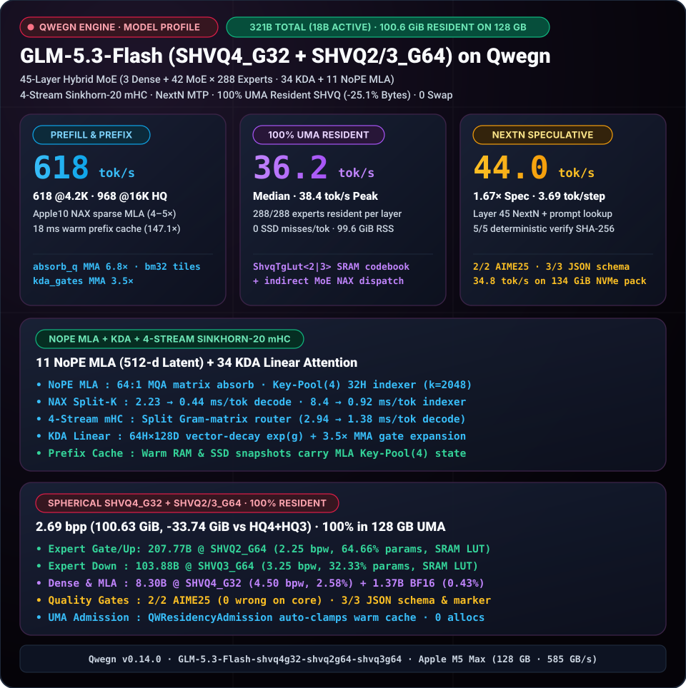
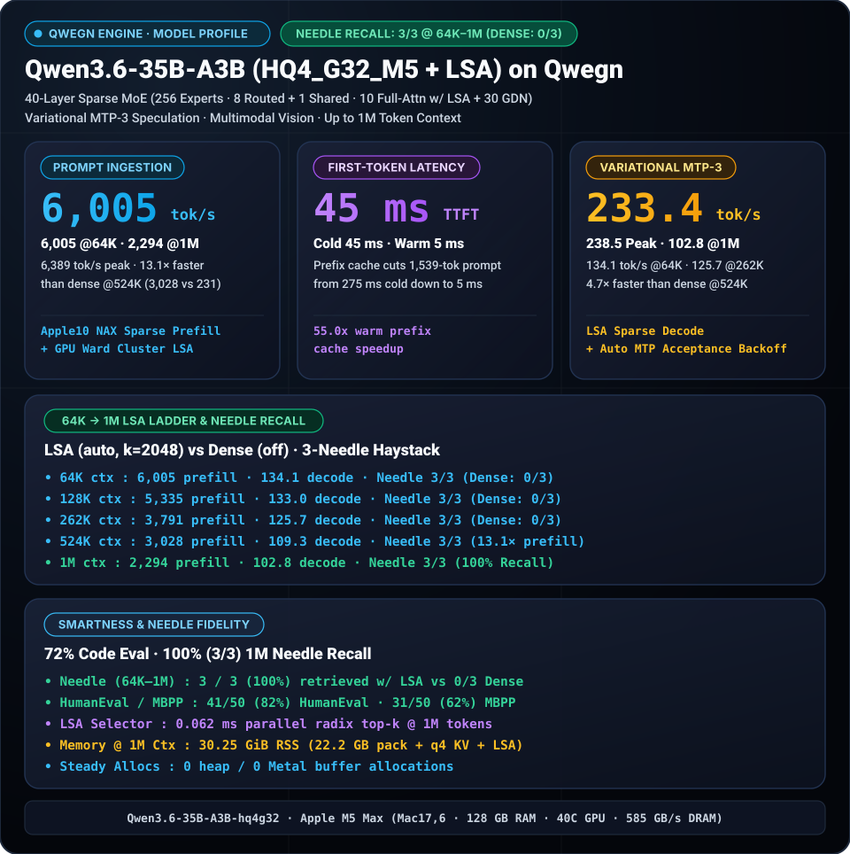
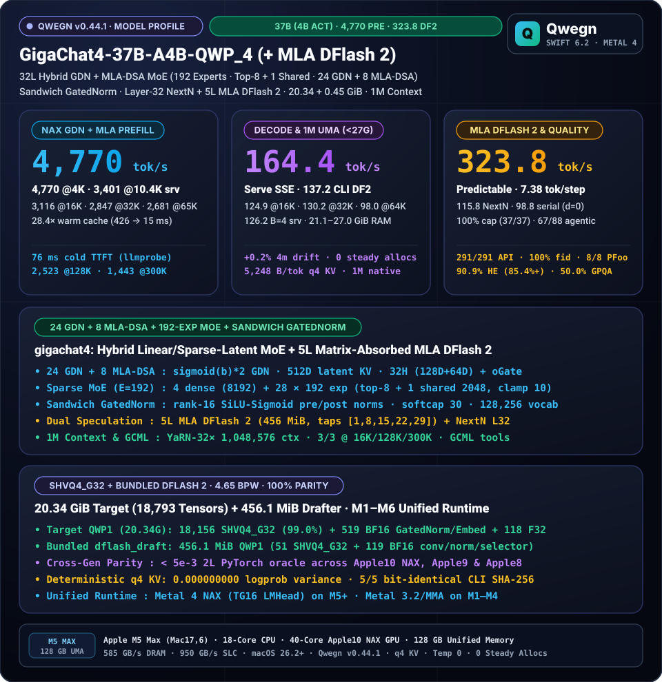
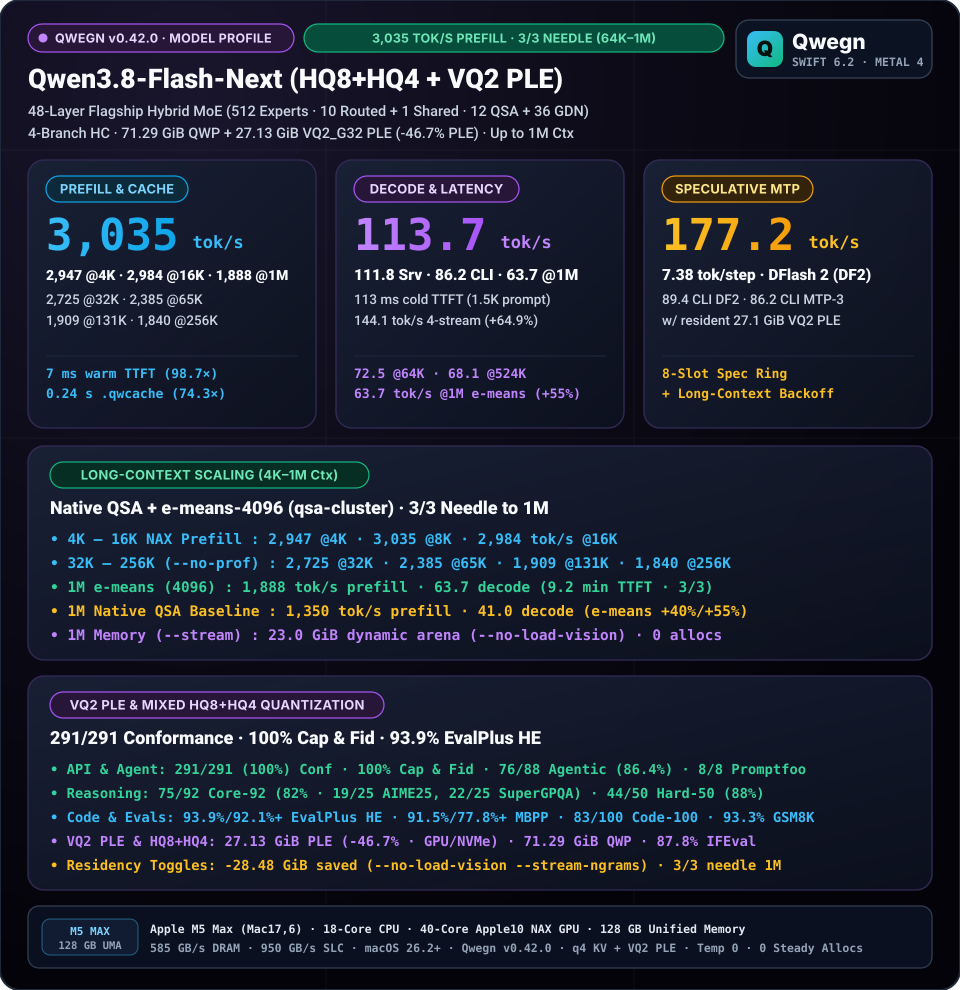
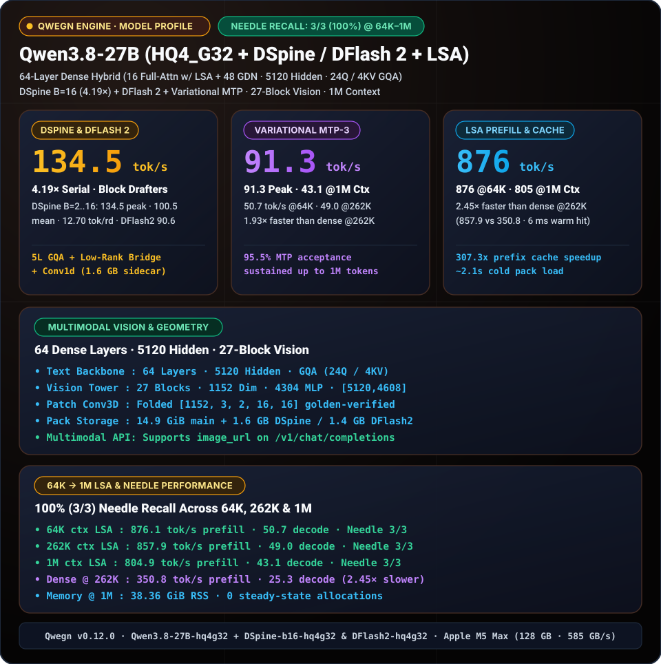
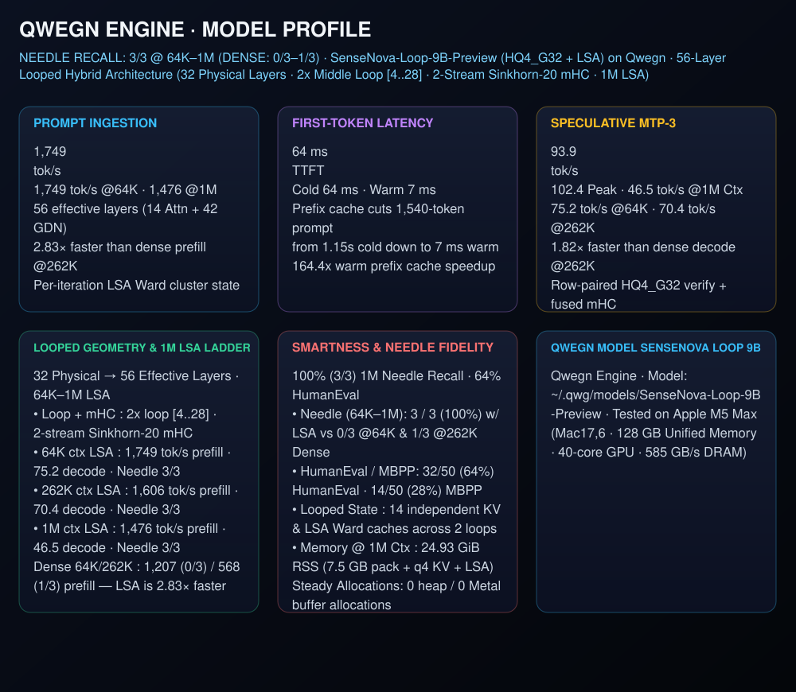
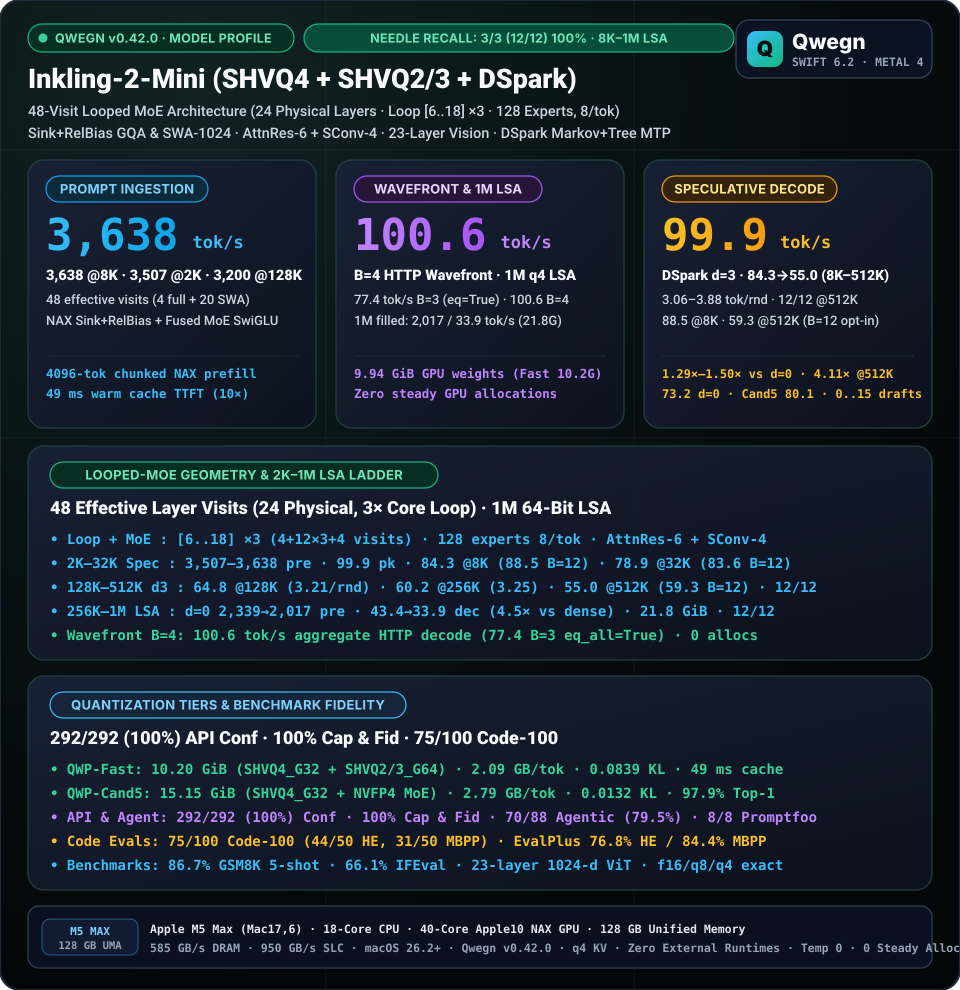
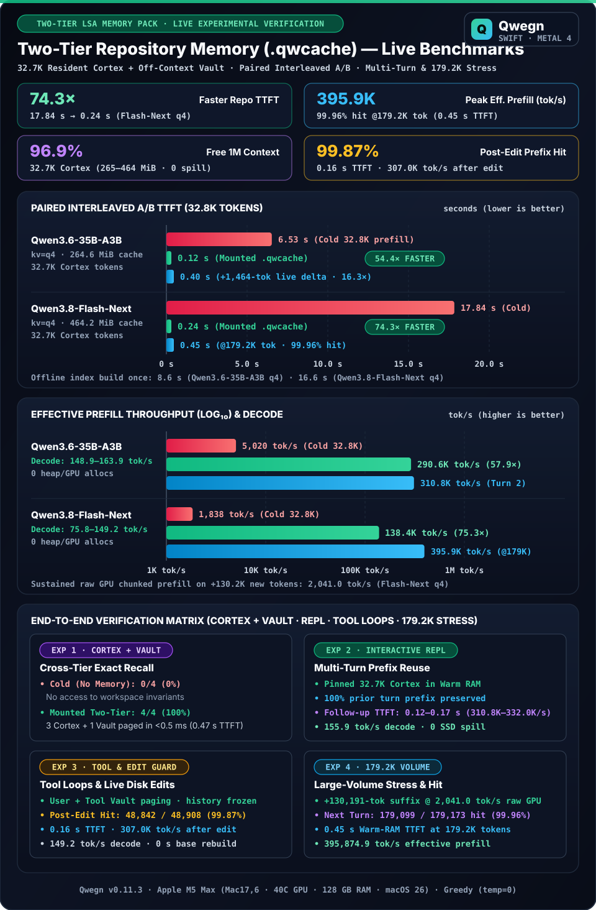

# Supported Models & Packs

Qwegn drives execution purely through capability descriptors decoded from each model's `config.json` (`QWModelDescriptor` + `QWModelCapabilities`), with zero runtime branches on model name. Pre-quantized native `QWP1` packs are published under [`huggingface.co/qwegnai`](https://huggingface.co/qwegnai).

```bash
# Download and run an official QWP1 pack directly
qwg pull qwegnai/Ling-3.2-air-QWP-Mixed --folder ~/.qwg/models
qwg run ~/.qwg/models/Ling-3.2-air-QWP-Mixed --prompt "Hello!" --max-tokens 128

# Or quantize a local Hugging Face checkpoint
qwg quantize ~/.qwg/hf/<model> --out ~/.qwg/models/<pack> --quant q4g
```

## Official Native Model Catalog

| Model | `model_type` | Params (Total / Active) | Pack Format & Disk Size | Prefill Peak | Speculative / Serial Decode | Long Context | Hugging Face |
| :--- | :--- | :---: | :--- | :---: | :---: | :---: | :--- |
| **GLM-5.3-Flash** | `glm5_next` | `321B` / `18B` | `SHVQ4_G32 + SHVQ2_G64 + SHVQ3_G64` (`100.63 GiB`) | `1,014 tok/s` | `54.7` NextN / `46.4 tok/s` | `1M` UMA (`743 / 45.0` `@242.5K`) | [`qwegnai/GLM-5.3-Flash-QWP-Mixed`](https://huggingface.co/qwegnai/GLM-5.3-Flash-QWP-Mixed) |
| **ERNIE-5.5-Flash-Base** | `ernie5_5_moe` | `280B` / `14B` | `HQ8_G32 + SHVQ15_G64 + SHVQ3_G64` (`81.61 GiB`) | `1,137 tok/s` | `52.7` ECHO / `37.2 tok/s` | `1M` UMA (`303 / 16.3` `@300K`) | [`qwegnai/ERNIE-5.5-Flash-Base-QWP-Mixed`](https://huggingface.co/qwegnai/ERNIE-5.5-Flash-Base-QWP-Mixed) |
| **ERNIE-5.5-Flash-Preview** | `ernie5_5_moe` | `280B` / `14B` | Fast `HQ4_M5+HQ8+SHVQ15/3` (`77.91 GiB` disk / `76.37 GiB` GPU, `2.36 bpw`) · Precision `HQ8+SHVQ15/3` (`81.57 GiB` disk / `80.02 GiB` GPU, `2.52 bpw`) + `dspark.qwp` (`4.39 GiB`) + `flashindexer.qwp` | `1,545 tok/s` *(Fast)* / `1,051` *(Mixed)* | `110.6` `DSpark` (`89.5` JSON) / `81/100` *(Mixed Code)* | `16K` `3/3` needle (`1,260 / 37.5`, `60.9` `@65.6K`) | [`qwegnai/ERNIE-5.5-Flash-Preview-QWP-Mixed-Fast`](https://huggingface.co/qwegnai/ERNIE-5.5-Flash-Preview-QWP-Mixed-Fast) · [`qwegnai/ERNIE-5.5-Flash-Preview-QWP-Mixed`](https://huggingface.co/qwegnai/ERNIE-5.5-Flash-Preview-QWP-Mixed) |
| **Edge0-145B** | `qwen4_exp` | `145B` / sparse | `HQ8_G32 + HQ4_G64 + VQ2` PLE (`56.0 + 27.1 GiB`) | `2,572 tok/s` | `135.6` spec / `69.2 tok/s` | `300K` (`1,886 tok/s`, `1M` UMA) | [`qwegnai/Edge0-145B-QWP-Mixed`](https://huggingface.co/qwegnai/Edge0-145B-QWP-Mixed) |
| **Ling-3.2-air** | `bailing_moe_v3_vl` | `124B` / `5.5B` | `HQ8_G32 + SHVQ3_G64` (`52.23 GiB`, `3.41 bpw`) | `2,847 tok/s` | `110.5` pred / `103.7` NextN / `78.3` | `262K` (`3/3` `@16.9K`) | [`qwegnai/Ling-3.2-air-QWP-Mixed`](https://huggingface.co/qwegnai/Ling-3.2-air-QWP-Mixed) |
| **Qwen3.8-Flash-Next** | `qwen4_exp` | 48L / 512 exp | `HQ8_G32 + HQ4_G64 + VQ2` PLE (`71.3 + 27.1 GiB`) | `3,035 tok/s` | `177.2` `DFlash2` / `81.5 tok/s` | `1M` `e-means` (`1,888 / 63.7 tok/s`) | [`qwegnai/Qwen3.8-Flash-Next-QWP-Mixed`](https://huggingface.co/qwegnai/Qwen3.8-Flash-Next-QWP-Mixed) |
| **Maxwell-V1-Flash** | `maxwell_moe` | `36.8B` / `~3.2B` | `HQ8_G32 + SHVQ3/4_G64` (`17.18 GiB`, `3.84 bpw`) | `5,324 tok/s` | `210.5` spec / `104.0` srv / `100.4` | `524K` (`1,620 / 20.8` `@64K`) | — |
| **GigaChat4-37B-A4B** | `gigachat4` | `37.6B` / `4B` | `SHVQ4_G32` (`20.34 GiB`) + bundled `MLA DFlash2` (`456 MiB`) | `4,770 tok/s` | `323.8` pred / `164.4` srv / `137.2` CLI | `1M` UMA (`3/3` `@300K`, `<27 GiB`) | [`qwegnai/GigaChat4-37B-A4B-QWP_4`](https://huggingface.co/qwegnai/GigaChat4-37B-A4B-QWP_4) |
| **Apex-35B-V1.0** | `qwen3_5_moe` | `35.95B` / `3B` | `HQ4_G32_M5` (`22.18 GiB`) | `6,416 tok/s` | `213.8` pred / `178.0` srv / `148.5` | `1M` `Ward-512` (`5,491 / 100.9 tok/s`) | [`qwegnai/Apex-35B-V1.0-QWP_4`](https://huggingface.co/qwegnai/Apex-35B-V1.0-QWP_4) |
| **Qwen3.6-35B-A3B** | `qwen3_5_moe` | 40L / 256 exp | `HQ4_G32` | `6,462 tok/s` | `382.8` srv / `324.3` CLI / `155.1` | `1M` `Ward-512` (`2,317 / 105.6 tok/s`) | [`qwegnai/Qwen3.6-35B-A3B-QWP_4`](https://huggingface.co/qwegnai/Qwen3.6-35B-A3B-QWP_4) |
| **Qwen3.8-27B** | `qwen3_5` | `27B` dense + ViT | `HQ4_G32` (+ `DSpine-b16` / `DFlash2`) | `1,043 tok/s` | `154.2` DF2 / `148.0` DSpine / `32.8` | `1M` `e-means` (`831 / 36.5 tok/s`) | [`qwegnai/Qwen3.8-27B-QWP_4`](https://huggingface.co/qwegnai/Qwen3.8-27B-QWP_4) |
| **SenseNova-Loop-9B** | `sensenova_loop` | `9B` (32L `2×` loop) | `HQ4_G32` (`7.38 GiB` VL / `4.63 GiB` text) | `2,045 tok/s` | `165.7` pred / `153.0` 4-srv / `58.4` | `524K` YaRN (`1M` `49.4 tok/s`) | [`qwegnai/SenseNova-Loop-9B-QWP_4`](https://huggingface.co/qwegnai/SenseNova-Loop-9B-QWP_4) |
| **Inkling-2-Mini (Fast)** | `inkling2_loop` | 24L (`48`-visit) MoE | `SHVQ4 + SHVQ2/3` + `DSpark` (`10.20 GiB`) | `3,638 tok/s` | `99.9` `DSpark d=3` / `100.6` `B=4` / `73.2` | `1M` (`2,017 / 33.9`), `512K` `d=3` `55.0` | [`qwegnai/Inkling-2-Mini-QWP-Mixed-Fast`](https://huggingface.co/qwegnai/Inkling-2-Mini-QWP-Mixed-Fast) |
| **Inkling-2-Mini (NVFP4)** | `inkling2_loop` | 24L (`48`-visit) MoE | `SHVQ4_G32 + NVFP4` MoE (`15.15 GiB`) | `3,504 tok/s` | `80.1` `d=3` / `66.4 tok/s` | `16K` `3/3` needle (`0.0132` KL) | [`qwegnai/Inkling-2-Mini-QWP-Mixed`](https://huggingface.co/qwegnai/Inkling-2-Mini-QWP-Mixed) |
| **Sage-S2.1-Flash** | Hybrid MoE | Hybrid MoE | `HQ8_G32 + SHVQ2_G64 + SHVQ3_G64` | `845.7 tok/s` | `49.6` pred / `42.4 tok/s` | `65K+` (`18 ms` warm, `81/100` Code) | — |

Official speculative drafters on Hugging Face:
- [`qwegnai/Qwen3.8-27B-DSpine-b16-QWP_4`](https://huggingface.co/qwegnai/Qwen3.8-27B-DSpine-b16-QWP_4) — 5-layer block-causal DSpine drafter (`B=2..16`) for `Qwen3.8-27B`
- [`qwegnai/Qwen3.8-27B-DFlash2-QWP_4`](https://huggingface.co/qwegnai/Qwen3.8-27B-DFlash2-QWP_4) — 5-layer block-diffusion DFlash 2 drafter (`154.2 tok/s`)

---

## Model Profiles

### GLM-5.3-Flash

*321B / 18B Active · `100.63 GiB` 100% UMA Resident*

<p align="center">
  
</p>

45L MoE (`321B` total / `18B` active, 288 experts, 8 + 1 active), 11 NoPE MLA (`512D` latent KV + Key-Pool(4)) + 34 KDA, 4-stream Sinkhorn mHC, NextN MTP, vision (`SHVQ4_G32 + SHVQ2_G64 + SHVQ3_G64`, `100.6 GiB` 100% resident on 128 GB Mac — **`1,014 tok/s`** `@4K` / `1,006` `@5.2K` prefill, **`46.0–54.7 tok/s`** decode, **`292/292` API / `100%` cap & fid / `80/100` `Code-100` (`92%` HE)**). Cold-expert NVMe streaming also supports larger packs (`134.37 GiB`, `31.6–34.8 tok/s`).

### ERNIE-5.5-Flash-Base

*280B / 14B Active · `81.61 GiB` 100% UMA Resident*

<p align="center">
  
</p>

43L MoE (`280B` total / `14B` active, 512 experts, dual-split sigmoid `top-10` + 1 shared, `moe_latent_size=2048`, `SituAndMul`), 37 Heavily Compressed Attention (`HCA` `128:1` + `128`-tok SWA + VHA) + 6 decoupled-RoPE `MLA-DSA` (`64H` Walsh-Hadamard `H_128`), 4-stream Sinkhorn-20 mHC (`hc_head`), `MultiMax` `lm_head`, shared-Layer-43 `ECHO` (`HQ8_G32 + SHVQ15_G64 + SHVQ3_G64`, `81.61 GiB` 100% UMA-resident through `1M` — **`1,137 tok/s`** `@4K` / `909` `@16K` / `899` `@18.8K` prefill, `45.6` CLI ECHO / `52.7 tok/s` serve decode, `78.6×` `.qwcache`, `3/3` needles @ `18.8K`/`149.5K`/`300K`).

### ERNIE-5.5-Flash-Preview

*280B / 14B Active · Track C `77.91 GiB` (`2.36 bpw`) & Track A `81.57 GiB` (`2.52 bpw`) · `dspark.qwp` + `flashindexer.qwp` · `291/291`–`292/292` API*

<p align="center">
  
</p>

43L MoE (`280B` total / `14B` active, quantized from `baidu/ERNIE-5.5-Flash-Preview` MXFP4 `F8_E8M0` experts + FP8 dense blocks into two UMA-resident packs with `model.qlsa`, bundled `dspark.qwp` speculative drafter, and `flashindexer.qwp`), native `chatv2p3` & parallel `<ernie:tool_call>` protocol, `0` steady-state allocations:
- **Track C ([`ERNIE-5.5-Flash-Preview-QWP-Mixed-Fast`](https://huggingface.co/qwegnai/ERNIE-5.5-Flash-Preview-QWP-Mixed-Fast), `77.91 GiB` disk / `76.37 GiB` GPU, `2.36 bpw`)**: `HQ4_G32_M5` dense trunk + `HQ8_G32` head + `SHVQ15_G64`/`SHVQ3_G64` experts (`77.11–82.30 GiB` RAM) — **`1,544.9 tok/s`** GPU (`1,540.9` wall) at `4K` prefill, **`43.28–44.78 tok/s`** serial decode, **`59.95–89.48 tok/s`** `DSpark d=7 neural --dspark-confidence-schedule` (JSON `89.48` at `5.77 tok/rnd` with `--moe-spec-budget 36`; Code `63.92`; Prose `62.65`), `16K` `3/3` verbatim needles (`1,259.9 tok/s` `d0` & `1,165.5 tok/s` `d7n_cs`), Law 28 `S1–S9` **`9/9 PASS`** (`0` errors), and active-DSpark `llmprobe`: **`291/291 (100%)`** conformance, **`36/36 (100%)`** fidelity, **`110.6 tok/s`** speculative (`7.11 tok/step`, `3.47×`), **`60.9 tok/s`** at `65.6K` (`3.76 tok/step`), `38×` prefix cache, and **`75/100`** (`--reasoning off`, `HE 44/50`, `MBPP 31/50`) / **`78/100`** (`--reasoning low`, `HE 45/50`, `MBPP 33/50`) `Code-100`.
- **Track A ([`ERNIE-5.5-Flash-Preview-QWP-Mixed`](https://huggingface.co/qwegnai/ERNIE-5.5-Flash-Preview-QWP-Mixed), `81.57 GiB` disk / `80.02 GiB` GPU, `2.52 bpw`)**: higher-precision `HQ8_G32` trunk (`80.77–85.82 GiB` RAM) — **`1,051.3 tok/s`** GPU at `4K` (`+19.5%` vs `v0.40.0` `879.6`), **`1,000.0 tok/s`** at `16K` (`+22.9%` vs `813.7`, `3/3` needles bit-exact vs `BASE`), `JSON 128`-tok `32.15 -> 62.78 tok/s` (`+95.3%` under `DSpark` + `--moe-spec-budget 36`), and active-DSpark `llmprobe` `--reasoning off` **`81/100` `Code-100`** (`HE 47/50`, `MBPP 34/50`, `0` errors).

### Ling-3.2-air

*124B / 5.5B Active · `52.23 GiB` Multimodal KDA + Direct-Q MLA + Group-MoE*

<p align="center">
  
</p>

42L Hybrid-Linear MoE (`bailing_moe_v3_vl`: `124B` total / `5.5B` active, `2` dense `L0–1` `6144` + `40` Group-Limited MoE `512` experts `top-8` + `1` shared `768`, `n_group=8`, `topk_group=4`, per-layer SwiGLU clamp `L35–41`), `35` full-rank KDA (`no_kda_lora`, `conv_k=4`, `kda_lower_bound=-5`) + `7` Direct-Q decoupled-RoPE Gated MLA (`512D` latent KV, `128D` NoPE + `64D` interleaved RoPE, `norm_qkv`), dedicated NextN `mtp=1` (`L42`), `27L` `1152`-dim ViT with 2-layer GELU `linear_proj` and `3D VideoRoPE` `[8, 12, 12]`, `262,144` native context (`HQ8_G32 + SHVQ3_G64`, `52.23 GiB` `3.41 bpw` — **`2,847 tok/s`** `@4.1K` / **`2,141.4 tok/s`** `@10.4K` prefill, **`100.0 tok/s`** sustained `QWServer` / **`110.5 tok/s`** predictable spec `1.98 tok/step` / **`103.7 tok/s`** CLI `mtp=1` / `76.2–78.3` serial, `14.5×` warm prefix cache `37 ms`, **`100%` capability (`strong`) / `98.04%` fidelity (`36/36`) / `285/293` API / `3/3` needle @ `16.9K`**, `0` steady-state allocations).

### Qwen3.6-35B-A3B

*40L MoE · `6,462 tok/s` Prefill · `382.8 tok/s` Decode*

<p align="center">
  
</p>

40L MoE (256 experts, 8 + 1 active), 10 QSA + 30 GDN, async MoE MTP, vision (**`6,462` `@2K` / `6,316` `@6.5K` / `6,142` `@64K` prefill**, **`382.8 tok/s`** serve spec / `324.3` CLI `d=5` / `182.0` serve, **`2,317 / 105.6 tok/s`** `@1M` `Ward-512`, **`291/291` API / `97.3%` cap / `81/100` `Code-100` (`96%` HE) / `83.3%` `Core-30`**).

### Apex-35B-V1.0

*35.95B / 3B Active · `5,491 / 100.9 tok/s` @ 1M*

<p align="center">
  
</p>

40L MoE (`35.95B`/`3B` active, 256 experts `8+1`), 10 GQA + 30 GDN, Variational MTP-3, AMX/Metal vision (`HQ4_G32_M5`, `22.18 GiB` — **`6,416` `@4K` / `6,262` `@16K` / `5,810` serve** prefill, **`261.1` spec / `178.0` serve / `174.9` CLI** decode, **`5,491 / 100.9 tok/s` `@1M`** `Ward-512` with `3/3` needles across `64K–1M`, **`295/295` API / `100%` fid / `91.9%` cap / `72/100` `Code-100` (`86%` HE)**).

### Maxwell-V1-Flash

*36.8B All-MBSA · 4-Stream mHC · `5,324 tok/s`*

<p align="center">
  
</p>

45L all-MBSA (`maxwell_moe`: `1,024+1,024+16×128` tiled-32 NAX/split-K, `32Q/4KV` `head_dim=128` `qk_layernorm`), 4-stream Sinkhorn-20 mHC, 3 dense + 42×256 sigmoid top-12 + shared MoE, dedicated mHC-MTP head (`HQ8_G32 + SHVQ3/4_G64`, `17.18 GiB` `3.84 bpw`, `0.0055` KLD / `100%` top-1 vs BF16 — **`5,324 tok/s`** `@2K–4K`, `100.4` CLI / `104.0` serve / **`210.5 tok/s`** serve spec, `7–15 ms` warm cache `25.8×–47.3×`, **`291/291` API / `100%` cap & fid / `59/100` `Code-100`**, `3/3` needles `@16K`/`64K`).

### GigaChat4-37B-A4B

*37.59B / 4B Active · `20.34 GiB` `SHVQ4_G32` + Bundled `456 MiB` MLA `DFlash 2` · `1M` Context (`< 27 GiB` UMA)*

<p align="center">
  
</p>

32L Hybrid GDN + Decoupled-RoPE `MLA-DSA` MoE ([`qwegnai/GigaChat4-37B-A4B-QWP_4`](https://huggingface.co/qwegnai/GigaChat4-37B-A4B-QWP_4): `24` `sigmoid(b)*2` GDN + `8` `MLA-DSA` `512D` latent KV `32H` `128D+64D`, `4` dense `8192` + `28 × 192` routed experts sigmoid `top-8` + `1` shared `2048` with `SwiGLU` clamp `10.0`, rank-`16` sandwich `GatedNorm`, `final_logit_softcapping = 30.0`, Layer-32 `NextN` MTP, bundled 5L Matrix-Absorbed MLA `DFlash 2` drafter in `dflash_draft/`, and GCML `<|thought|>` / `<|function call|>` protocol; `20.34 GiB` `4.65 bpw` + `456.1 MiB` drafter — **`4,770 tok/s`** `@4K` / `3,401` `@10.4K` prefill, **`323.8 tok/s`** predictable spec `7.38 tok/step` / **`164.4 tok/s`** SSE / **`137.2 tok/s`** CLI `code128` / **`122.2 tok/s`** forced-192 (`102.3–121.0 tok/s` across `0.5K–65.6K`) / **`126.2 tok/s`** `B=4` serve, `15 ms` `31.3×` warm cache, **`3/3` needles @ `16K`/`128K`/`300K`**, **`1M` native context in `26.99 GiB` RAM**, **`291/291` API / `100%` (`37/37`) cap / `67/88` (`76.1%`) agentic / `100%` fidelity / `70/100` `Code-100` / `45/92` `Core-92` (`68.3K` tok) / `29/50` `Hard-50` / `90.9%` (`85.4%+`) `HumanEval+` / `87.5%` `IFEval` / `50.0%` `GPQA` / `66.7%` `MMLU-Pro` / `20.0%` `AIME25` / `8/8` `Promptfoo`**, `0` steady-state allocations).

### Qwen3.8-Flash-Next

*48L MoE + `DFlash 2` + `VQ2_G32` PLE*

<p align="center">
  
</p>

48L MoE (512 experts, 10 + 1 active), 12 QSA + 36 GDN, 4-branch HC, `VQ2_G32` PLE (`27.1 GiB`, `-27.3 GiB` toggle with `--stream-ngrams`), MTP-3 & lossless 5L `DFlash 2` (`521.5 MiB` `SHVQ4_G32` — **`177.2 tok/s`** spec / `111.8` serve / `89.4` CLI DF2 / **`291/291` API / `100%` cap & fid / `83/100` `Code-100` (`96%` HE)**), vision (`HQ8_G32 + HQ4_G64`, `71.3 GiB` — **`3,035 tok/s`** peak prefill, `1,888 / 63.7 tok/s` `@1M` `e-means`).

### Edge0-145B

*145B MoE + `VQ2_G32` PLE · `1M` UMA*

<p align="center">
  
</p>

48L Hybrid GDN+QSA MoE (`145B` total, 512 experts `10 + 1` active), 4-branch HC, `VQ2_G32` PLE (`27.13 GiB`), MTP-3 (`HQ8_G32 + HQ4_G64`, `56.00 GiB` core / `83.13 GiB` total weights / `85.36 GiB` resident / `58.30 GiB` `--stream-ngrams` — **`2,568–2,572 tok/s`** prefill, `69.2` CLI / `68.5–135.6 tok/s` server decode, `3/3` needles @ `16K`/`128K`/`300K`, `1M` UMA-qualified, `9/10` `Code-10` & `Core-10`).

### Qwen3.8-27B

*64L Dense + `DSpine-b16` & `DFlash 2` + Metal FP16 ViT*

<p align="center">
  
</p>

64L dense hybrid, 5120 hidden, 24Q / 4KV GQA, MTP-3/5, 5-layer DSpine (**`148.0`** peak / `4.19×` · **`291/291` API / `100%` cap & fid / `76/88` agentic / `75/100` `Code-100` (`88%` HE)**) & DFlash 2 drafters (`154.2 tok/s` serve), Native Metal FP16 ViT (**`812.2 ms`** `4.12×` encode, `961.6 MiB`).

### SenseNova-Loop-9B

*`2×` Looped mHC · `524K` YaRN · Metal ViT*

<p align="center">
  
</p>

32 physical → 56 effective layers (`2×` loop `[4..28]`), `F32` 2-stream Sinkhorn-20 mHC, `524K` native YaRN-2×, `HQ4_G32` (`7.38 GiB` / `4.63 GiB` text — **`2,045 tok/s`** `@4K` / `1,944` `@16K` / `1,763` `@64K` prefill, **`165.7 tok/s`** serve spec / `98.1` CLI code / **`153.0 tok/s`** 4-stream HTTP `3.02×`, **Native Metal FP16 ViT (`807.8 ms` `4.09×` encode, `950.6 MiB`, `100%` SHA-256 parity)**, **`291/291` API / `100%` cap & fid / `61/100` `Code-100`**, `3/3` needles `@16K`/`64K`).

### Inkling-2-Mini

*48-Visit Looped MoE + `DSpark` · `8K–1M`*

<p align="center">
  
</p>

24 physical → **48 effective layer visits** (`[6..<18] ×3`, `4` trunk + `12×3` loop + `4` coda), `128` experts (`8/tok`), `24Q/8KV` (`head_dim=128`) Sink+RelBias GQA (`4` full + `20` `SWA-1024`), `AttnRes-6`, `SConv-4`, `23`-layer ViT, `DSpark` Markov+Tree MTP (`--mtp-drafts 0...15`):
- **`Inkling-2-Mini-QWP-Mixed-Fast`** (`10.20 GiB` total / `9.94 GiB` GPU weights, `SHVQ4_G32 + SHVQ2_G64 + SHVQ3_G64` — **`3,638 tok/s`** `@8K` / `3,200` `@128K` prefill, **`99.9 tok/s`** `DSpark d=3` / `86.2` `code256` `B=12` / **`100.6 tok/s`** `B=4` HTTP wavefront, `8K–512K` lossless `DSpark d=3` **`84.3 @8K` / `78.9 @32K` / `64.8 @128K` / `60.2 @256K` / `55.0 tok/s @512K`**, `@1M` `q4` LSA `2,017 / 33.9 tok/s`, `3/3 (12/12)` recall `8K–1M`, **`89/89 (100%)` API / `21/25` `Code-25`**).
- **`Inkling-2-Mini-QWP-Mixed`** (`15.15 GiB`, `SHVQ4_G32 + NVFP4` MoE, **`0.0132` mean KL / `97.9%` Top-1**, `3,504` `@8K` prefill, `80.1` `d=3` / `79.9` `var5`, `13/13` HE).

### Sage-S2.1-Flash & Codebase Memory (`QWMemoryPack`)

**Sage-S2.1-Flash** (`HQ8_G32 + SHVQ2_G64 + SHVQ3_G64`) · Hybrid MoE (`--context-tokens 65536`: **`291/292` API / `100%` cap / `99.39%` fidelity / `70/88` agentic / `81/100` `Code-100` (`90%` HE, `72%` MBPP)**, `42.4 / 845.7 tok/s`, spec `49.6 / 39.9` (`1.98 tok/step`), `100.8×` warm cache (`1,814 → 18 ms`)).

<p align="center">
  
</p>

## Standard Checkpoint Support

All standard Hugging Face and MLX-compatible architectures registered in `QWModelFamilyRegistry` run on the unified runtime and save per-model tuning profiles in `~/.qwg/profiles/`:

`bailing_moe_v3`, `bailing_moe_v3_vl`, `bailing_moe_v3_text`, `glm5_next`, `glm5_next_text`, `ernie5_5_moe`, `ernie5_5_moe_text`, `maxwell_moe`, `inkling2_loop`, `inkling2_loop_text`, `sensenova_loop`, `sensenova_loop_text`, `qwen3_5`, `qwen3_5_text`, `qwen3_5_moe`, `qwen3_5_moe_text`, `qwen4_exp`, `qwen4_exp_text`, `qwen3`, `qwen3_moe`, `qwen2`, `llama`, `mistral`.
